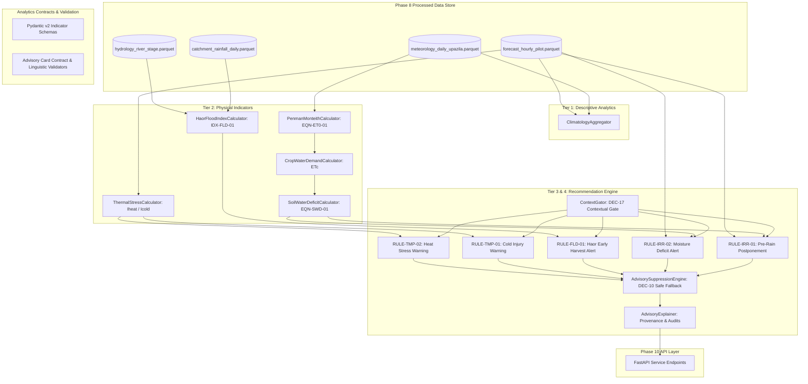

# Agricultural Analytics Architecture — Ritucast

## 1. Executive Summary & Purpose

The **Ritucast Agricultural Analytics Architecture** defines the modular, decoupled structure responsible for transforming validated Phase 8 environmental datasets into agronomic indicators and actionable advisory cards.

In strict alignment with Phase 5 system architecture ([system-architecture.md](file:///Users/kazi/Projects/RITUCAST/docs/architecture/system-architecture.md)), this architecture decouples scientific computation from API transport and UI presentation, guarantees deterministic execution, and enforces strict governance middleware (`DEC-10`, `DEC-17`).

---

## 2. Component Architecture & Information Flow

---

## 3. Modular Responsibilities & Bounded Contexts

### 3.1 Analytics Contracts (`analytics.contracts`)
- **`indicator_schemas.py`**: Defines strictly typed Pydantic v2 models for `DescriptiveAgroclimaticSummary`, `ReferenceET0Result`, `CropWaterDemandResult`, `SoilWaterDeficitResult`, `HaorFloodIndexResult`, and `ThermalStressResult`.
- **`advisory_schemas.py`**: Enforces the 5-section recommendation card anatomy (`DEC-30`), field verification copy invariants, and automated validators that ban overconfident linguistic phrases (*"১০০% নিশ্চিত"*, *"নিশ্চিত বৃষ্টি"*, *"ফলনের নিশ্চয়তা"*).

### 3.2 Descriptive Climatology (`analytics.descriptive`)
- **`climatology.py`**: Aggregates time-series meteorological data over arbitrary temporal windows, reporting temperature means/extremes, cumulative precipitation, and data completeness percentages.

### 3.3 Physical Indicator Modules (`analytics.indicators`)
- **`penman_monteith.py`**: Implements standardized FAO-56 Penman-Monteith physical reference evapotranspiration (`EQN-ET0-01`).
- **`crop_water_demand.py`**: Models dynamic crop water demand $ET_c = K_c(t) \times ET_0$ with continuous piecewise linear interpolation along Boro rice phenological development knots.
- **`soil_water_deficit.py`**: Solves daily root-zone water balance ($D_t$) for Barind heavy clay soils with USDA-SCS effective precipitation sub-models (`EQN-SWD-01`).
- **`haor_flood_index.py`**: Synthesizes transboundary catchment rainfall, river stage danger proximity, and water level surge rates into the composite flood index $I_{\text{flood}}$ (`IDX-FLD-01`).
- **`thermal_stress.py`**: Evaluates cardinal temperature thresholds for booting cold sterility ($T_{\text{min}} \le 15^\circ\text{C}$) and anthesis heat sterility ($T_{\text{max}} \ge 35^\circ\text{C}$).

### 3.4 Agricultural Rule Modules (`analytics.rules`)
- Encapsulates deterministic evaluation logic across the master rule catalog: `RULE-IRR-01`, `RULE-IRR-02`, `RULE-FLD-01`, `RULE-TMP-01`, `RULE-TMP-02`.
- Each rule subclass inherits from `BaseAgriculturalRule`, implementing typed condition checks and returning structured `AdvisoryCard` payloads.

### 3.5 Recommendation Engine Coordinator (`analytics.engine`)
- **`context_gate.py`**: Enforces `DEC-17` contextual gating. Rejects unvalidated Upazilas or uncalibrated crops before evaluating rules.
- **`suppression.py`**: Enforces `DEC-10` automated suppression. Flags stale data (>36h) or high ensemble spread (>50% with rain prob 40–60%) and emits safe SAAO fallback copy.
- **`explainability.py`**: Compiles transparent rule traces, indicator audits, and plain Bengali rationales.
- **`advisory_engine.py`**: Master coordinator binding all components into a single callable service.

### 3.6 Evaluation & Benchmark Suite (`analytics.evaluation`)
- **`benchmark_evaluator.py`**: Verifies implemented algorithms against standardized FAO-56 test vectors and USDA-SCS benchmark cases.
- **`readiness_audit.py`**: Automatically verifies anti-leakage invariants and maintains the formal machine learning readiness ledger.

---

## 4. Failure Modes & Graceful Degradation

| Failure Mode | Trigger Condition | System Behavior & Fallback |
| :--- | :--- | :--- |
| **Missing Context** | User does not supply growth stage or valid Upazila | `ContextGator` raises `ContextGatingError`. Zero speculation or generic advice emitted. |
| **Data Latency Exceeded** | Observations are $>36\text{h}$ old | `AdvisorySuppressionEngine` transitions card to `SUPPRESSED` status, displaying SAAO manual contact notice. |
| **High Model Spread** | NWP ensemble spread $>50\%$ with rain prob $40–60\%$ | Advisory suppressed; farmer advised to rely on manual soil moisture touch tests. |
| **Hydrological Gauge Offline** | BWDB gauge logs unavailable | Haor flood score flags `f_S` and `f_R` as unavailable; $I_{\text{flood}}$ computes conservative penalty bound with explicit uncertainty disclaimer. |
| **Extreme Physical Outlier** | Solar radiation $>35\,\text{MJ/m}^2/\text{day}$ | Pipeline flags physical violation; advisory suppressed. |
