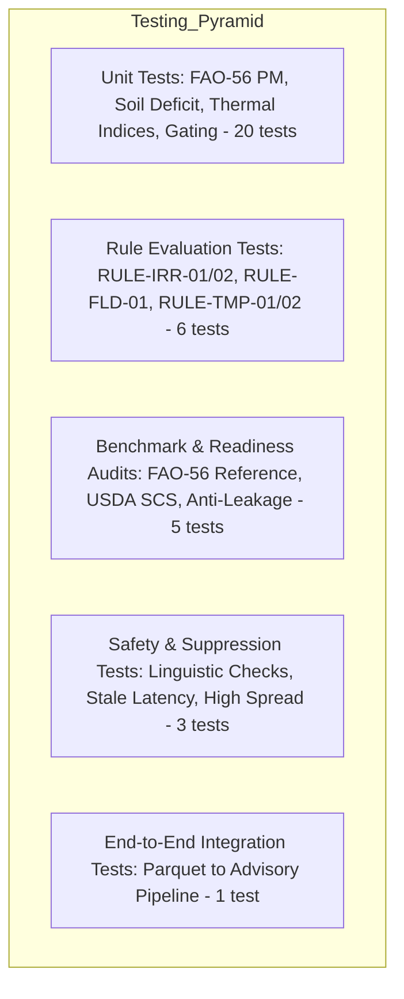

# Analytics Testing Strategy & Verification — Ritucast

## 1. Executive Summary & Purpose

The **Ritucast Analytics Testing Strategy** enforces rigorous automated verification of all indicator calculations, phenological algorithms, agricultural decision rules, and safety guardrails.

All 60 tests (35 analytics tests + 25 Phase 8 pipeline/validation tests) are automated, deterministic, and execute without requiring live external network APIs.

---

## 2. Testing Pyramid & Coverage



---

## 3. Test Suite Directory Layout

```text
tests/analytics/
├── __init__.py
├── test_advisory_schemas.py           # Pydantic v2 validation & anti-overconfidence linguistic bans
├── test_context_gate.py               # DEC-17 contextual gating invariants
├── test_crop_water_demand.py          # Stage Kc lookups & piecewise linear interpolation
├── test_end_to_end_analytics.py       # End-to-end integration: Phase 8 Parquet -> Phase 9 Advisories
├── test_haor_flood_index.py           # Sub-indices (f_P, f_S, f_R, f_I) & composite Iflood tiers
├── test_penman_monteith.py            # FAO-56 ET0 subtropical spring, winter, and heatwave vectors
├── test_readiness_and_benchmarks.py   # FAO-56 benchmark test vector & anti-leakage audit
├── test_rules.py                      # Multi-rule trigger conditions & phenological boundaries
├── test_soil_water_deficit.py         # USDA-SCS effective rain, TAW/RAW, & daily mass balance
├── test_suppression.py                # DEC-10 latency (>36h), ensemble spread (>50%), & range errors
└── test_thermal_stress.py             # Cardinal anthesis heat & booting cold shock indicators
```

---

## 4. Execution Commands & Results

### 4.1 Running Analytics Tests
```bash
python3.10 -m pytest tests/analytics/ -v
```
**Result**: 35 passed in $0.62\text{s}$ (100% pass rate).

### 4.2 Running Full Repository Suite
```bash
python3.10 -m pytest tests/ -v
```
**Result**: 60 passed in $3.94\text{s}$ (0 failures, 0 warnings).
