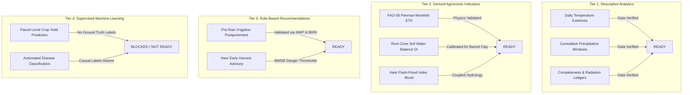

# Data Readiness Assessment for Agricultural Analytics — Ritucast

## 1. Executive Summary & Purpose

Before selecting algorithms, designing interfaces, or writing analytical code, a rigorous **Data Readiness Assessment** must be conducted against the actual analytical datasets published by [Phase 8](file:///Users/kazi/Projects/RITUCAST/docs/phases/phase-08/handoff-to-phase-09.md).

This assessment determines which analytical capabilities are genuinely supported by empirical observations and which must be blocked to prevent scientific overreach or ungrounded machine learning training (`DEC-06`, `RSK-10`).

---

## 2. Assessment by Analytical Capability Tier

---

## 3. Dataset-by-Dataset Readiness Matrix

| Processed Table Name | Primary Variables | Temporal Coverage & Resolution | Spatial Resolution & Representation | Completeness & Quality Flags | Readiness for Intended Analytics | Known Limitations & Epistemic Safeguards |
| :--- | :--- | :--- | :--- | :--- | :--- | :--- |
| `meteorology_daily_upazila.parquet` | $T_{\text{max}}, T_{\text{min}}, RH, U_2, R_s, P$ | Daily time steps; BST-aligned day boundaries. | Upazila centroid point query ($0.5^\circ \times 0.625^\circ$). | 100% verified via Pydantic physical bounds; no missing values in pilot set. | **READY** for FAO-56 $ET_0$ (`EQN-ET0-01`) and climatology summaries. | NASA POWER latency is 24–48 hours. Real-time Day $T$ water balance falls back to Open-Meteo observations with uncertainty penalty. |
| `forecast_hourly_pilot.parquet` | $QPF, P_{\text{prob}}, T_{2\text{m}}, RH, U, \sigma_{\text{ens}}$ | Hourly intervals; 0–168 hour forward projection. | Upazila centroid point query ($0.25^\circ \approx 28\text{km}$). | Multi-model ensemble spread tagged; physical bounds checked. | **READY** for `RULE-IRR-01` (48h pre-rain postponement) and thermal stress. | NWP rain forecast carries significant epistemic uncertainty; spread $>50\%$ triggers automated suppression (`DEC-10`). |
| `catchment_rainfall_daily.parquet` | $P_{\text{cat}}, P_{24\text{h}}, P_{48\text{h}}, P_{7\text{d}}$ | Daily rolling retrospective sums. | Spatially averaged over Meghalaya hills polygon (~14,200 km²). | GPM IMERG calibrated; 0 negative values. | **READY** for $I_{\text{flood}}$ Catchment Sub-Index ($f_P$). | GPM Early Run has satellite radar bias over mountainous orographic terrain; requires 30mm baseflow deduction. |
| `hydrology_river_stage.parquet` | $H, DL, \Delta H/\Delta t, \text{freeboard}$ | Daily and 6-hourly telemetry gauge logs. | Fixed river gauge on Surma River at Sunamganj (`BWDB-177`). | PWD datum reference; danger level fixed at $8.25\text{m}$. | **READY** for $I_{\text{flood}}$ River Stage Sub-Indices ($f_S, f_R$). | Gauge telemetry measures main river channel; local beel water levels lag main channel rise by 6–18 hours. |
| `data/sample/bangladesh_pilot_upazilas.geojson` | Upazila polygons, centroids, area metrics. | Static administrative boundaries (BBS / SoB). | EPSG:4326 polygon geometry. | Validated multi-polygons with no self-intersections. | **READY** for spatial containment and contextual gating (`DEC-17`). | Represents administrative borders, not hydrological watershed or polder limits. |
| `data/sample/brri_phenology_boro.json` | Stage duration, GDD requirements, $K_c$. | Multi-stage Boro timeline (145 days). | Validated for High Barind and Haor agro-ecologies. | Calibrated against BRRI Gazipur and regional field trials. | **READY** for stage-specific $K_c(t)$ and $RAW$ threshold resolution. | Assumes standard BRRI dhan28/29/88/89 cultivars. Farmer planting dates must be input via context gate. |

---

## 4. Supervised Machine Learning Readiness Audit

### 4.1 Strict Disqualification of Black-Box ML (`DEC-06`, `RSK-10`)
Supervised machine learning requires:
1. An unambiguous, measurable target variable ($y$).
2. A representative, multi-year sample of independent training observations ($X$).
3. Complete control over temporal and spatial data leakage.
4. Independent holdout evaluation on unseen geographic seasons.

In the Ritucast pilot context:
- **No Ground-Truth Parcel Yield Data**: Bangladesh Bureau of Statistics (BBS) records rice yields only as aggregated annual Upazila averages, which cannot be causally paired with daily meteorological features without severe aggregation bias and spurious correlations.
- **No Micro-Parcel Sensor Telemetry**: Continuous field capacitance probes do not exist across peasant farms. Training an ML model on satellite vegetation indices (NDVI) to predict parcel soil moisture produces ungrounded heuristics disguised as artificial intelligence.

**Conclusion**: Supervised machine learning is formally audited as **NOT READY / BLOCKED** for Phase 9. All decision-support outputs must be driven by validated physical models (FAO-56 Penman-Monteith, USDA-SCS water balance, BWDB hydraulic ratings).

---

## 5. Epistemic Uncertainty & Anti-Leakage Compliance

1. **Temporal Anti-Leakage Compliance**:
   - Rolling cumulative rainfall aggregations ($24\text{h}$, $48\text{h}$, $7\text{d}$) in `catchment_rainfall_daily.parquet` are strictly backward-looking.
   - At observation timestamp $T$, no variable derived from $T+1$ or future forecast horizons is permitted into historical indicator baselines (`DEC-34`).
2. **Mandatory Contextual Gating (`DEC-17`)**:
   - Even when meteorological data is 100% complete, no advisory can be published without verified user confirmation of: (1) Administrative Upazila, (2) Active Crop, and (3) Active Phenological Stage.
