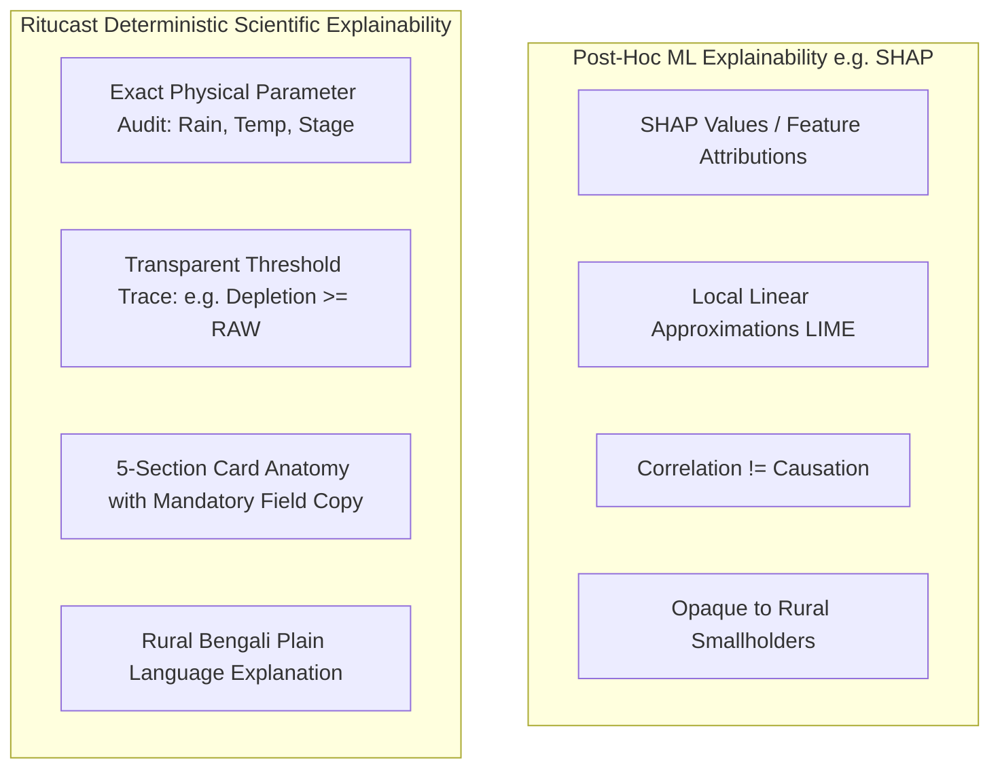

# Explainability and Scientific Attribution Strategy — Ritucast

## 1. Executive Summary & Purpose

In peasant agricultural extension, **explainability is a safety and adoption requirement**, not an optional UI enhancement. Farmers and Sub-Assistant Agriculture Officers (SAAOs) will not change pumping schedules or risk premature harvesting based on unexplained algorithmic outputs.

This document establishes the **Explainability and Scientific Attribution Strategy** for Ritucast, implemented in [explainability.py](file:///Users/kazi/Projects/RITUCAST/analytics/engine/explainability.py) via `AdvisoryExplainer`.

---

## 2. Explainability Taxonomy: Deterministic Audits vs. Post-Hoc ML



### Why SHAP is Inappropriate for the Current Release
SHAP (SHapley Additive exPlanations) is designed to approximate feature attributions of non-linear black-box machine learning models (e.g. gradient boosted trees). Because Ritucast operates on **deterministic physical conservation equations and domain-informed agricultural rules**, computing post-hoc SHAP values would introduce artificial complexity and obscure direct physical causality.

Instead, Ritucast provides **100% exact parameter audits**: every output card explicitly logs the exact numerical input variables, physical constants, threshold equations, and data provenance manifests that triggered the advisory.

---

## 3. Four Pillars of Ritucast Explainability

### Pillar 1: The Plain-Language Agronomic Explanation (গ্রামীণ ভাষায় ব্যাখ্যা)
Technical meteorological jargon is translated into practical, culturally resonant rural Bengali:
- *Technical*: $QPF_{48\text{h}} = 25\text{mm}, P_{\text{prob}} = 75\%, D_t < 31\text{mm}$.
- *Ritucast Card Explanation*:
  > *"আগামী ৪৮ থেকে ৭২ ঘণ্টার মধ্যে আপনার এলাকায় উল্লেখযোগ্য বৃষ্টির সম্ভাবনা রয়েছে (সম্ভাবনা ৭৫%, আনুমানিক ২৫ মিমি)। নলকূপ চালু করার আগে অপেক্ষা করুন। বৃষ্টি হলে সেচের জ্বালানি খরচ সাশ্রয় হবে।"*

### Pillar 2: Parameter Audit (প্রাসঙ্গিক পরিমাপক)
Every advisory card includes an inspectable `supporting_indicators` dictionary documenting exact sensor readings:
```json
{
  "qpf_48h_mm": 25.0,
  "rain_prob_pct": 75.0,
  "soil_depletion_mm": 10.0,
  "taw_mm": 56.0,
  "ensemble_spread_pct": 20.0
}
```

### Pillar 3: Data Provenance Manifest (তথ্যের উৎস)
Identifies the upstream providers, models, and calculation standards:
```json
{
  "forecast_model": "ECMWF-IFS/Open-Meteo",
  "agroclimatology": "NASA-POWER/FAO-56",
  "crop_coefficient": "BRRI-Gazipur-2020"
}
```

### Pillar 4: Mandatory Ground Verification Copy (মাঠ পর্যবেক্ষণ নির্দেশনা)
Every advisory card displays a bold, prominent reminder that models cannot see parcel-level soil cracks:
> *"সেচ বন্ধ রাখার আগে জমির আইল এবং মাটির রস নিজে হাত দিয়ে পরীক্ষা করুন। যদি জমি ইতিমধ্যে ফেটে গিয়ে থাকে, তবে হালকা পানি দিন।"*
