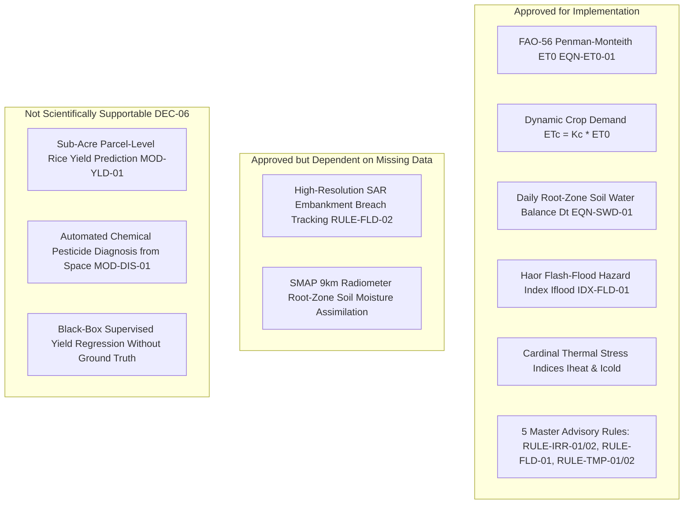

# Phase 9: Agricultural Analytics & Recommendation Scope — Ritucast

## 1. Executive Summary & Purpose

Phase 9 establishes the analytical and decision-support core of **Ritucast**. Following the successful ingestion and validation of environmental datasets in [Phase 8](file:///Users/kazi/Projects/RITUCAST/docs/phases/phase-08/validation-report.md), Phase 9 transforms raw physical observations into localized, explainable, and scientifically validated agricultural intelligence for smallholders and Sub-Assistant Agriculture Officers (SAAOs) in Bangladesh.

In accordance with [AGENTS.md](file:///Users/kazi/Projects/RITUCAST/AGENTS.md) and Phase 4 scientific governance ([scientific-governance.md](file:///Users/kazi/Projects/RITUCAST/docs/science/scientific-governance.md)), this phase enforces the Four-Tier Information Taxonomy (`DEC-08`), Mandatory Contextual Gating (`DEC-17`), and the Automated Advisory Suppression Policy (`DEC-10`).

---

## 2. Capability Classification & Prioritization

Each candidate analytical capability is classified into one of four governance states:

1. **Approved for Implementation**: Fully supported by Phase 8 processed datasets, calibrated against peer-reviewed agronomic literature and BRRI manuals, and verified via automated test vectors.
2. **Approved but Dependent on Missing Data**: Scientifically justified but deferred until high-frequency satellite telemetry (e.g. daily SAR passes) or field soil sensors become accessible.
3. **Future Enhancement**: Planned for broader national rollout across non-pilot Agro-Ecological Zones (AEZs) or minor crops.
4. **Not Scientifically Supportable**: Banned under `DEC-06` due to physical sensor limitations or lack of causal ground truth.

---

## 3. Detailed Scope Matrix

| Capability Identifier | Domain | Scientific Basis | Input Data Sources | Phase 9 Status | Scope Boundaries & Guardrails |
| :--- | :--- | :--- | :--- | :---: | :--- |
| `CAP-ET0-01` | Agroclimatology | FAO-56 Penman-Monteith (`EQN-ET0-01`) | `meteorology_daily_upazila.parquet` | **Approved for Implementation** | Computes reference evapotranspiration at Upazila centroid ($z=20\text{m}$ Barind, $z=5\text{m}$ Haor). |
| `CAP-ETC-01` | Crop Water Demand | Stage-Specific $K_c$ interpolation | `CAP-ET0-01` + BRRI phenology | **Approved for Implementation** | Interpolates continuous $K_c(t)$ from Day 1 to Day 145 for Boro rice varieties. |
| `CAP-SWD-01` | Soil Moisture | Root-Zone Water Depletion (`EQN-SWD-01`) | `CAP-ETC-01` + USDA-SCS $P_{\text{eff}}$ | **Approved for Implementation** | Calibrated for High Barind heavy silty clay ($TAW=56.0\text{mm}, RAW=19.6\text{mm}$). |
| `CAP-FLD-01` | Flood Hydrology | Transboundary Flash Flood Index (`IDX-FLD-01`) | `catchment_rainfall_daily.parquet` + `hydrology_river_stage.parquet` | **Approved for Implementation** | Multi-factor index coupling Meghalaya rainfall ($P_{\text{cat}}$) with Surma river rise. |
| `CAP-TMP-01` | Thermal Stress | Cardinal Anthesis & Booting Indices | `forecast_hourly_pilot.parquet` | **Approved for Implementation** | Detects $T_{\text{max}} \ge 35^\circ\text{C}$ (heatwave) and $T_{\text{min}} \le 15^\circ\text{C}$ (cold shock). |
| `CAP-ADV-01` | Decision Support | Pre-Rain Irrigation Postponement (`RULE-IRR-01`) | $QPF_{48\text{h}} \ge 20\text{mm}, P_{\text{prob}} \ge 65\%, D_t < 31\text{mm}$ | **Approved for Implementation** | Advises Barind DTW operators to withhold pumping 48–72h before rain. |
| `CAP-ADV-02` | Decision Support | Root-Zone Moisture Deficit Alert (`RULE-IRR-02`) | $D_t \ge RAW (19.6\text{mm}), \sum P_{5\text{d}} < 5\text{mm}$ | **Approved for Implementation** | Triggers AWD replenishment cycle when soil water depletion reaches threshold. |
| `CAP-ADV-03` | Decision Support | Haor Early Harvest Alert (`RULE-FLD-01`) | $I_{\text{flood}} \ge 0.75, P_{\text{cat}} \ge 100\text{mm}, H \ge DL-0.5\text{m}$ | **Approved for Implementation** | Advises early harvesting where Boro grain maturity $\ge 80\%$. |
| `CAP-ADV-04` | Decision Support | Thermal Stress Warnings (`RULE-TMP-01/02`) | Consecutive days above/below thresholds | **Approved for Implementation** | Advises standing water thermal buffering ($3–7\text{cm}$) to prevent sterility. |
| `CAP-SAR-02` | Flood Inundation | SAR Inundation Watermask (`RULE-FLD-02`) | Sentinel-1 SAR C-Band $\sigma^\circ$ | **Approved but Deferred** | Sentinel-1 6–12 day revisit cycle cannot provide deterministic 24h operational breach alerts. |
| `CAP-YLD-01` | Yield Prediction | Parcel-Level ML Yield Model (`MOD-YLD-01`) | Satellite NDVI + Weather | **Rejected / Banned (`DEC-06`)** | Sub-acre ground-truth yield logs do not exist. Supervised modeling prohibited. |

---

## 4. Operational Guardrails & Exclusions

1. **Zero Premature API / Frontend Work**: Phase 9 delivers purely mathematical routines, Pydantic schemas, validation audits, and automated unit tests. No FastAPI routes, WebSockets, or React UI components are constructed.
2. **Strict Dual-Zone Scope**: Operational testing is limited to the four approved testbed Upazilas:
   - High Barind Tract: Godagari (`BD-50-20-30`) and Tanore (`BD-50-20-90`).
   - Haor Basin: Sunamganj Sadar (`BD-60-90-86`) and Tahirpur (`BD-60-90-89`).
3. **Anchor Crop Bound**: All rules and phenological lookups apply strictly to Boro rice (*Oryza sativa L.*). Upland Rabi crops remain in future roadmap phases.
