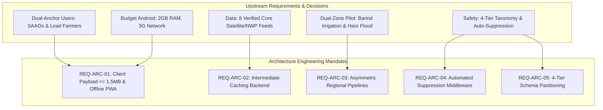

# Ritucast: Architecture Requirements & Engineering Constraints

## 1. Executive Summary & Purpose

Software architecture in agricultural decision-support systems must be strictly derived from verified user needs, operational field realities, and scientific constraints. Architecture that ignores rural network volatility, budget hardware limits, or data staleness risks catastrophic failure in the field.

This document formalizes the **System Architecture Requirements and Engineering Constraints** for Ritucast, translating the approved requirements from Phase 1 (Discovery), Phase 2 (Requirements & PRD), Phase 3 (Datasets), and Phase 4 (Scientific Validation) into actionable technical specifications.

---

## 2. Requirement Traceability Matrix to Architecture

---

## 3. Core Architectural Requirements

### 3.1 Client Hardware & Network Budgets (`REQ-ARC-01`)
- **Target User Hardware (`DEC-09`, `ASM-01`)**: Frontline extension workers (SAAOs) and progressive lead farmers operate entry-level Android smartphones (Android 8.0 Oreo through Android 13, 2GB–3GB RAM, quad-core processors, 720p displays).
- **Network Profile (`ASM-02`)**: Rural 3G and edge 4G cellular connections across Godagari, Tanore, Sunamganj Sadar, and Tahirpur with high round-trip latency ($300–800\text{ ms}$) and intermittent dead zones.
- **Client Payload Ceiling (`NFR-PER-01`)**: Initial JavaScript + CSS + HTML production bundle size must **not exceed $1.5\text{MB}$ uncompressed** ($<450\text{KB}$ gzip/brotli transfer).
- **Time-to-Interactive (TTI) (`NFR-PER-02`)**: Time-to-Interactive on a throttled 3G network simulation ($1.6\text{ Mbps}$ down, $750\text{ kbps}$ up, $300\text{ ms}$ RTT) must be **$\le 3.5\text{ seconds}$**.
- **Client Memory Ceiling (`NFR-PER-03`)**: Peak client JavaScript heap memory allocation must **not exceed $45\text{MB}$**, preventing Out-Of-Memory (OOM) browser tab crashes on 2GB RAM devices (`RSK-06`).
- **Offline Resilience (`FR-UX-03`, `NFR-REL-01`)**: Progressive Web App (PWA) with Service Worker caching enabling the client to display the last cached 3 days of upazila weather, soil water balance, and advisories without an active cellular signal.

### 3.2 Intermediate Caching Backend (`REQ-ARC-02`)
- **Zero Direct Browser Upstream Queries (`DEC-09`, `RSK-09`)**: Mobile client browsers must **never query external upstream APIs** (NASA POWER, ESA CDSE, Open-Meteo, CMR) directly.
- **Backend Ingestion & Aggregation**: All external data acquisition, coordinate transformation, spatial zonal statistics, and raster clipping must occur asynchronously within backend ingestion workers.
- **API Response Latency (`NFR-PER-04`)**: Backend API endpoints serving cached upazila advisories, weather summaries, and hydrological risk indices must achieve a 95th percentile latency of **$P_{95} \le 500\text{ ms}$**.

### 3.3 Asymmetric Regional Processing Pipelines (`REQ-ARC-03`)
- **Pipeline Differentiation (`DEC-11`, `DEC-16`)**: The system backend must not execute a single monolithic, homogeneous processing script.
- **Barind Irrigation Pipeline**: Executes daily for northwestern upazilas (Godagari, Tanore). Ingests NASA POWER solar radiation, wind speed, humidity, and temperature; calculates FAO-56 Penman-Monteith $ET_0$ (`EQN-ET0-01`); evaluates dynamic $K_c$ (`EQN-ETC-01`); and computes root-zone soil water deficit $D_t$ (`EQN-SWD-01`) to trigger pre-rain irrigation postponement (`RULE-IRR-01`).
- **Haor Flash-Flood Pipeline**: Executes multi-hourly for northeastern upazilas (Sunamganj Sadar, Tahirpur). Aggregates GPM IMERG V07 precipitation over the transboundary Meghalaya catchment ($P_{\text{cat}}$); polls BWDB Surma/Kushiyara river stages; and processes Sentinel-1 SAR inundation masks to compute the composite hazard index $I_{\text{flood}}$ (`IDX-FLD-01`) and trigger early harvest alerts (`RULE-FLD-01`).

### 3.4 Automated Suppression Middleware (`REQ-ARC-04`)
- **Data Staleness Enforcement (`DEC-10`, `NFR-REL-03`)**: Every environmental and meteorological observation must persist an ingestion timestamp. If weather forecast observations are **$>36\text{ hours}$ old**, the backend must automatically suppress active recommendation cards.
- **Meteorological Disagreement Suppression (`DEC-10`, `RSK-11`)**: When multi-model NWP ensemble spread ($S_{\text{spread}}$) between ECMWF IFS and NOAA GFS exceeds $50\%$ and rainfall probability hovers ambiguously between $40\%$ and $60\%$, the system must automatically withhold definitive postponement cards.
- **Standard Fallback Payload**: The suppression middleware must return a standardized, localized Bangla fallback payload directing users to manually inspect field moisture and consult their local SAAO.

### 3.5 Four-Tier Information Taxonomy Schema (`REQ-ARC-05`)
- **Data Model Partitioning (`DEC-08`, `NFR-SCI-01`)**: All database tables, internal object models, and API response JSON payloads must maintain strict structural separation across:
  1. `Tier 1: Observations`: Direct physical readings (NASA $R_s$, BMD rain, Sentinel-1 $\sigma^\circ$).
  2. `Tier 2: Indicators`: Derived agronomic indicators ($ET_0$, $D_t$, $I_{\text{flood}}$).
  3. `Tier 3: Predictions`: Probabilistic future forecasts ($48\text{h}$ rain probability %, temperature).
  4. `Tier 4: Recommendations`: Actionable agronomic cards with plain-language explanations and confidence badges.

### 3.6 Mandatory Contextual Gating (`REQ-ARC-06`)
- **Request Parameter Enforcement (`DEC-17`)**: The API and business logic layers must reject or withhold recommendation generation unless the request contains verified confirmation of:
  1. `upazila_id` (e.g., `BD-50-28` for Godagari).
  2. `crop_id` (e.g., `boro_rice`).
  3. `growth_stage` (e.g., `vegetative_tillering`, `flowering_anthesis`, `dough_maturity`).

### 3.7 Security, Privacy & Data Minimization (`REQ-ARC-07`)
- **Zero Farmer PII Collection (`NFR-SEC-01`, `DEC-14`)**: The initial system architecture must not collect farmer names, phone numbers, national ID numbers (NID), or parcel-level land ownership documents.
- **Public Open-Access Model (`NFR-SEC-02`)**: All advisory and agro-climatic endpoints are public read-only resources served via CDN and API gateway; no account creation or login walls are required for basic advisory lookups.
- **Rate Limiting & Abuse Prevention (`NFR-SEC-03`)**: Enforce rate limiting at the API gateway ($60\text{ requests/min}$ per IP) with Redis token-bucket implementation to prevent denial-of-service and scraping abuse.

---

## 4. Architectural Non-Goals & Scope Boundaries

In accordance with locked project decisions (`DEC-06`, `MOD-YLD-01`, `MOD-DIS-01`):
1. **NO Microservices Mesh**: The initial release does not require Kubernetes, Istio service meshes, or microservices architectures.
2. **NO Sub-Acre Parcel Computer Vision**: No parcel-level machine learning inference engine for field-boundary yield predictions.
3. **NO Automated Chemical Agrochemical Prescriptions**: No diagnostic computer vision module prescribing proprietary chemical pesticides.
4. **NO Hardware IoT Actuators**: No automated telemetric relay controllers for tubewell pump switches.
