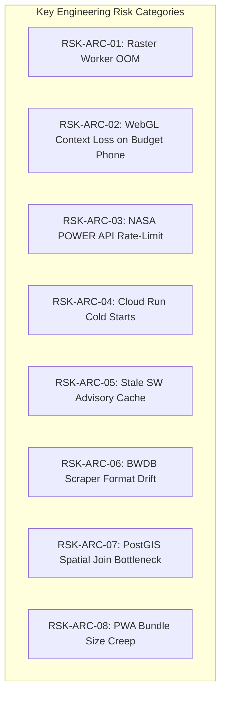

# Ritucast: Architecture & Engineering Risk Register

## 1. Executive Summary & Governance

Technical architecture choices in cloud, geospatial, and mobile systems carry distinct operational failure modes. This register identifies, quantifies, and establishes explicit engineering mitigations for all architectural and infrastructure risks.

- **Likelihood**: Low / Medium / High
- **Impact**: Low / Medium / Critical
- **Priority**: Likelihood $\times$ Impact (P1 = Urgent/Critical, P2 = Significant, P3 = Moderate, P4 = Low)

---

## 2. Master Architecture Risk Matrix

| Risk ID | Risk Description | Category | Likelihood | Impact | Priority | Architectural Mitigation Strategy | Monitoring & Trigger Mechanism |
| :--- | :--- | :--- | :---: | :---: | :---: | :--- | :--- |
| **`RSK-ARC-01`** | **Worker Container Memory Exhaustion on Sentinel-1 SAR**: Downloading and processing large 1GB GRD scenes causes worker container out-of-memory crash (`OOMKilled`, exit code 137). | Geospatial Worker | Medium | High | **P1** | Enforce Rasterio streaming windowed reads (`Window`) chunk-by-chunk; never load full uncompressed rasters into memory. Cap worker memory at $1.5\text{GB}$ with Cloud Run resource limits. | Cloud Run memory utilization metric $>80\%$ triggers alert. |
| **`RSK-ARC-02`** | **MapLibre GL JS WebGL Context Loss on Budget Phones**: Low-end GPU chipsets (Mali-T830 / Adreno 506) lose WebGL context or run out of video RAM during map pan/zoom. | Frontend Mobile | Medium | High | **P1** | Lazy-load MapLibre only on user request; enforce strict context teardown on component unmount; provide automated fallback to lightweight Leaflet 2D canvas raster rendering. | Listen to `webglcontextlost` event in React map container. |
| **`RSK-ARC-03`** | **NASA POWER API Concurrency Throttling**: Batch queries to NASA POWER exceed the soft limit of 30 requests/min per IP, leading to HTTP 429 blocks (`RSK-14`). | Ingestion Pipeline | Medium | Medium | **P2** | Celery token-bucket rate limiter throttles outgoing requests to $1\text{ req/2s}$; use regional bounding box queries rather than individual point queries. | HTTP 429 response status from NASA POWER triggers exponential backoff. |
| **`RSK-ARC-04`** | **Cloud Run Cold Start Latency Spikes**: Serverless scale-to-zero causes a $3–5\text{s}$ container cold start latency spike during the first morning user visit. | API Performance | High | Medium | **P2** | Configure Cloud Run `min-instances: 1` during peak morning farming hours ($06:00–10:00\text{ BST}$); Cloud CDN edge caching absorbs $90\%$ of requests without waking container. | Cloud Run startup latency metric $>2.5\text{s}$ triggers review. |
| **`RSK-ARC-05`** | **Stale Service Worker Advisory Cache Leak**: Outdated client Service Worker cache serves stale advisories, masking urgent flash-flood emergency warnings. | Safety / Mobile | Low | Critical | **P1** | Enforce `NetworkFirst` caching strategy with a $5\text{s}$ timeout for `/advisories` endpoints; Service Worker explicitly renders cache timestamp and sync banner. | Client-side cache age check vs device system clock. |
| **`RSK-ARC-06`** | **BWDB Web Scraper Format Drift**: Changes in the HTML markup of the FFWC river stage portal break hourly water level ingestion. | Ingestion Pipeline | High | High | **P1** | Decouple flood engine: if river gauge scraper fails, $I_{\text{flood}}$ gracefully falls back to transboundary Meghalaya catchment rain ($P_{\text{cat}}$) with an explicit sensor degradation flag. | Hourly automated scraper health check logs `P1 Alert` on format failure. |
| **`RSK-ARC-07`** | **PostGIS Spatial Join Bottlenecks**: Heavy on-the-fly `ST_Intersects` spatial joins during batch ingestion degrade database performance. | Database | Low | Medium | **P3** | Spatial GiST indexing; pre-compute and store grid-to-upazila spatial intersection weights in static lookup tables (`spatial_weights`). | Database query execution time $>500\text{ms}$ triggers index tuning. |
| **`RSK-ARC-08`** | **Client PWA Bundle Budget Creep**: Iterative additions of third-party JavaScript libraries push production bundle size over the $1.5\text{MB}$ limit (`DEC-09`). | Frontend Mobile | Medium | High | **P2** | Enforce strict `size-limit` CI/CD quality gate in GitHub Actions; automatically reject pull requests that exceed $1.5\text{MB}$ uncompressed. | GitHub Actions CI bundle size audit check fails build. |

---

## 3. High-Priority Risk Escalation Protocol

1. Any architectural risk evaluated at **P1** requires an automated circuit breaker or fallback state implemented in the Phase 8 (Data Pipeline) and Phase 10 (Backend API) deliverables.
2. If an external data feed fails repeatedly, the **Automated Suppression Middleware (`ADR-08`)** must immediately prevent dangerous recommendations and log the outage in the Observability Service.
