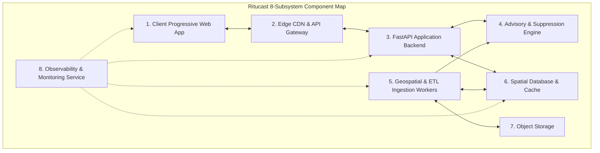

# Ritucast: Component Boundaries & Responsibilities

## 1. Executive Summary & Architecture Decomposition

To prevent spaghetti architecture, tight coupling, and cascading failures, Ritucast establishes clear, strictly enforced boundaries across **eight core subsystems**. Each component operates with well-defined responsibilities, formal input/output contracts, isolated dependencies, and explicit failure-mode fallbacks.

---

## 2. Component Specifications

### 2.1 Subsystem 1: Client Progressive Web App (PWA)

| Dimension | Specification |
| :--- | :--- |
| **Component Name** | `ritucast-web` |
| **Primary Responsibilities** | 1. Render responsive, high-contrast, Bangla-first user interfaces for SAAOs and lead farmers. 2. Collect and validate user selections (Upazila, Crop, Phenological Stage). 3. Present the 4-Tier Information Taxonomy cards with clear visual badges. 4. Provide interactive offline fallback via Workbox Service Workers and IndexedDB. 5. Generate lightweight social share cards (PNG/SVG) and WhatsApp text summaries. |
| **Strict Prohibitions** | 1. **NO Direct External API Calling**: Never query NASA, ESA, or Open-Meteo from browser. 2. **NO Heavy Geospatial Calculations**: No client-side polygon clipping or raster rendering. 3. **NO Bundle Bloat**: Total uncompressed production JS/CSS bundle must remain $\le 1.5\text{MB}$. |
| **Inputs** | User touch/click interactions; JSON payloads from Ritucast API; Service Worker cache events. |
| **Outputs** | Rendered DOM elements; client-side cached state in IndexedDB; social share image blobs. |
| **Dependencies** | Modern mobile browser (Chromium $\ge 80$, Safari $\ge 12$, Firefox $\ge 75$); Workbox PWA libraries. |
| **Failure Behavior** | When offline, falls back to cached data with an explicit "অফলাইন মোড" banner; if cache is empty, displays an informative prompt to connect to cellular data for initial sync. |

---

### 2.2 Subsystem 2: Edge CDN & API Gateway

| Dimension | Specification |
| :--- | :--- |
| **Component Name** | `ritucast-ingress` |
| **Primary Responsibilities** | 1. Terminate TLS/SSL (HTTPS) at edge points of presence. 2. Cache static PWA assets (HTML, CSS, JS, icons, vector font files) on global edge nodes. 3. Enforce DDoS protection, IP-based rate limiting ($60\text{ req/min}$ per IP), and CORS headers. 4. Route API requests `/api/v1/*` to the FastAPI application backend container. |
| **Inputs** | Inbound HTTPS requests from client devices. |
| **Outputs** | Cached static assets to clients; proxied HTTP requests to backend; HTTP 429 on rate limit breach. |
| **Dependencies** | Google Cloud Load Balancing, Google Cloud CDN, Google Cloud Armor. |
| **Failure Behavior** | Returns standard HTTP 502/504 if backend is unreachable; serves stale CDN cache for static assets. |

---

### 2.3 Subsystem 3: FastAPI Application Backend

| Dimension | Specification |
| :--- | :--- |
| **Component Name** | `ritucast-api` |
| **Primary Responsibilities** | 1. Expose high-performance, asynchronous REST API endpoints adhering to OpenAPI 3.0. 2. Enforce request parameter validation via Pydantic v2 schemas (`DEC-17`). 3. Coordinate cache-aside lookups with Redis and relational queries with PostgreSQL. 4. Invoke the Advisory & Suppression Engine to assemble recommendation responses. 5. Append mandatory provenance metadata (`Rule ID`, timestamps, confidence scores). |
| **Inputs** | Validated HTTP GET/POST requests from API Gateway. |
| **Outputs** | Compact, standardized JSON response payloads adhering to the 4-Tier taxonomy. |
| **Dependencies** | Python 3.11, FastAPI, Pydantic v2, SQLAlchemy 2.0 (asyncpg), Redis client (`redis-py`). |
| **Failure Behavior** | Returns structured JSON error payloads with machine-readable error codes (`STALE_DATA_SUPPRESSED`, `INVALID_CONTEXT`, `DATABASE_TIMEOUT`); never leaks internal stack traces. |

---

### 2.4 Subsystem 4: Advisory & Suppression Engine

| Dimension | Specification |
| :--- | :--- |
| **Component Name** | `ritucast-advisory-engine` |
| **Primary Responsibilities** | 1. Execute the formal agricultural rule catalog (`RULE-IRR-01`, `RULE-IRR-02`, `RULE-FLD-01`, etc.). 2. Enforce mandatory contextual gating (verifying `upazila_id`, `crop_id`, and `growth_stage`). 3. Compute multi-model NWP ensemble spread ($S_{\text{spread}}$) and forecast lead-time decay. 4. Calculate quantitative Advisory Confidence Scores ($C_{\text{adv}}$) and assign UI color badges. 5. **Execute Automated Suppression**: Intercept advice and generate safe fallback copy if weather data is $>36\text{h}$ old (`DEC-10`, `NFR-REL-03`) or model spread $>50\%$. |
| **Inputs** | Daily weather forecasts, derived agronomic indicators ($ET_0, D_t, I_{\text{flood}}$), phenology stage. |
| **Outputs** | Structured advisory object: Recommendation copy in Bangla, rationale breakdown, confidence score. |
| **Dependencies** | Internal Python business logic library; NumPy; Pydantic models. |
| **Failure Behavior** | If any input variable fails physical range validation, immediately suppresses active advice and emits a fallback monitoring notice. |

---

### 2.5 Subsystem 5: Geospatial & ETL Ingestion Workers

| Dimension | Specification |
| :--- | :--- |
| **Component Name** | `ritucast-workers` |
| **Primary Responsibilities** | 1. Execute scheduled asynchronous data pulls from NASA POWER, Open-Meteo, GPM, Sentinel-1, BWDB. 2. Perform spatial coordinate transformations (WGS84 EPSG:4326 to UTM 45N/46N EPSG:32645/32646). 3. Run raster windowing and zonal statistics across official 495 upazila boundary polygons. 4. Execute the mathematical formulations for FAO-56 Penman-Monteith $ET_0$, $ET_c$, and $D_t$. 5. Compute the transboundary Meghalaya 48h rainfall accumulation ($P_{\text{cat}}$) and $I_{\text{flood}}$. 6. Invalidate and pre-warm hot Redis advisory cache keys. |
| **Inputs** | Cloud Scheduler cron triggers; external REST/OData APIs; raw NetCDF/GeoTIFF streams. |
| **Outputs** | Validated time-series rows inserted into PostGIS; pre-aggregated JSON strings pushed to Redis. |
| **Dependencies** | Python 3.11, Celery, Redis queue, GDAL, Rasterio, Shapely, GeoPandas, xarray, httpx. |
| **Failure Behavior** | Retries transient network failures up to 3 times with exponential backoff; dead-letter queue for corrupted payloads; alerts monitoring log without affecting web API availability. |

---

### 2.6 Subsystem 6: Spatial Database & Cache

| Dimension | Specification |
| :--- | :--- |
| **Component Name** | `ritucast-datastore` |
| **Primary Responsibilities** | 1. Persist official administrative boundary polygons (`DATA-BND-01`) with PostGIS spatial indices. 2. Store historical and active meteorological time-series records (NASA POWER, Open-Meteo). 3. Record daily root-zone soil water balance depletion logs ($D_t$) and BWDB river stages. 4. Store the Master Scientific Asset Registry and audit logs. 5. Redis in-memory cache stores pre-computed upazila summary JSON payloads ($6\text{h}$ TTL) and rate-limit counters. |
| **Inputs** | SQL queries and spatial transactions from backend and ingestion workers. |
| **Outputs** | Relational rows, spatial GeoJSON features, cached key-value strings. |
| **Dependencies** | PostgreSQL 16, PostGIS 3.4 extension, Redis 7 Alpine. |
| **Failure Behavior** | PostgreSQL automated daily snapshots and Point-In-Time-Recovery (PITR); Redis persists to AOF/RDB; backend falls back gracefully to DB if Redis is temporarily unreachable. |

---

### 2.7 Subsystem 7: Object Storage

| Dimension | Specification |
| :--- | :--- |
| **Component Name** | `ritucast-storage` |
| **Primary Responsibilities** | 1. Stage raw downloaded satellite granules (Sentinel-1 GRD zip, GPM IMERG HDF5) prior to extraction. 2. Store pre-rendered vector map tiles (PMTiles / MBTiles) for administrative boundary overlays. 3. Archive historical analytical Parquet exports for off-line scientific validation. |
| **Inputs** | Raw binary files uploaded by ETL ingestion workers. |
| **Outputs** | Streaming byte ranges to workers; public vector tiles to CDN. |
| **Dependencies** | Google Cloud Storage (GCS) Standard / Nearline buckets; MinIO for local development. |
| **Failure Behavior** | Automated lifecycle policies delete staged raw satellite files after 7 days to eliminate storage bloat (`.gitignore` compliance). |

---

### 2.8 Subsystem 8: Observability & Monitoring Service

| Dimension | Specification |
| :--- | :--- |
| **Component Name** | `ritucast-observability` |
| **Primary Responsibilities** | 1. Collect structured JSON application logs from backend and ingestion workers. 2. Expose Prometheus metrics: API response latency, request rates, cache hit ratios, queue depth. 3. **Monitor Data Freshness**: Alert on-call engineers if weather ingestion lag exceeds $24\text{ hours}$. 4. Track suppression frequency: Alert if $>20\%$ of upazilas are simultaneously suppressed. |
| **Inputs** | Standard output JSON streams from containers; `/metrics` scraping endpoints. |
| **Outputs** | Cloud Monitoring dashboards; email/Slack/webhook alerting notifications. |
| **Dependencies** | Google Cloud Logging, Google Cloud Monitoring, OpenTelemetry instrumentation. |
| **Failure Behavior** | Fails silently without impacting primary request paths; local in-memory log buffer prevents I/O blocking. |
