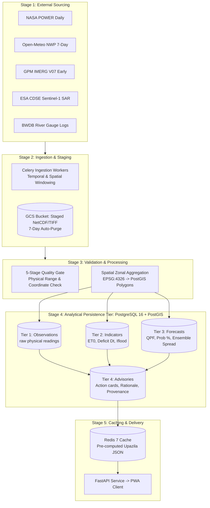
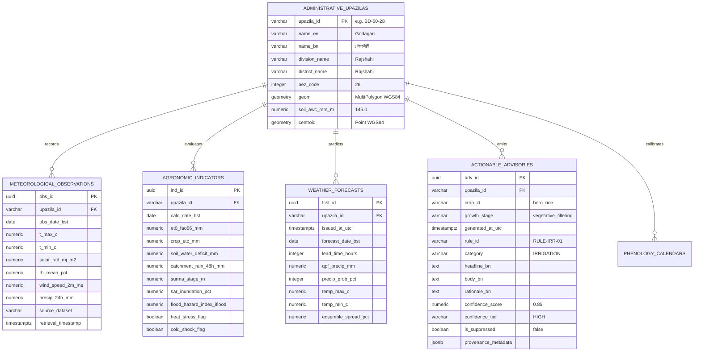
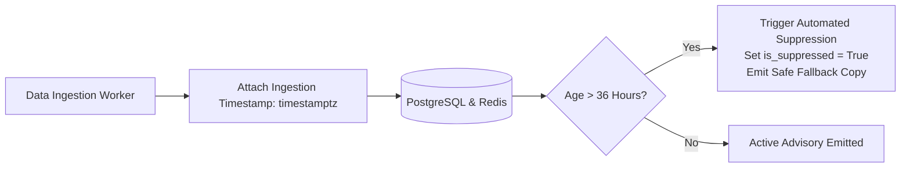

# Ritucast: Data Architecture & Relational Schema Specification

## 1. Executive Summary & Data Lifecycle

The Ritucast data platform transforms multi-source spaceborne observations and numerical weather predictions into structured, localized, and explainable agricultural insights. In accordance with the **Four-Tier Information Taxonomy (`DEC-08`, `NFR-SCI-01`)**, the data architecture maintains strict separation between empirical measurements, physical indicators, probabilistic forecasts, and operational recommendations.

---

## 2. Relational Database Schema Blueprints (PostgreSQL 16 + PostGIS 3.4)

The database schema strictly mirrors the 4-tier taxonomy, with dedicated tables and spatial indices optimized for rapid upazila lookups:

---

## 3. Spatial Data Architecture & Coordinate Reference Systems (CRS)

To guarantee mathematical accuracy across Bangladesh's geography:

| Spatial Dimension | Standard Convention | Technical Justification & Processing Rules |
| :--- | :--- | :--- |
| **Storage & API Standard** | **WGS84 (`EPSG:4326`)** | Universal global standard for GPS, GeoJSON, and web mapping. All spatial database tables store polygon boundaries and centroids in EPSG:4326. |
| **Projected Metric Computation (West)** | **UTM Zone 45N (`EPSG:32645`)** | Covers Western Bangladesh (Barind Tract, Rajshahi Division). Used by backend workers for precise metric distance, buffer, and area computations ($m^2$). |
| **Projected Metric Computation (East)** | **UTM Zone 46N (`EPSG:32646`)** | Covers Eastern Bangladesh (Haor Basin, Sylhet Division). Used for measuring catchment areas and flooded hectare calculations. |
| **Spatial Indexing** | **PostGIS GiST Indexing** | Spatial columns (`geom`) are indexed using Generalized Search Trees (`CREATE INDEX idx_upazila_geom ON administrative_upazilas USING GIST (geom);`). Enables sub-millisecond bounding box filtering. |
| **Area-Weighted Zonal Aggregation** | **Polygon Weighted Mean** | Coarse raster grid cells ($X_i$) intersecting upazila polygon $P$ are aggregated via area-weighting: $\bar{X} = \frac{\sum (X_i \cdot \text{Area}(X_i \cap P))}{\text{Area}(P)}$. Avoids unweighted center-point biases. |

---

## 4. Temporal Data Architecture & Timezone Conventions

Agricultural operations in Bangladesh follow local solar diurnal cycles, while spaceborne platforms and global weather models operate in Universal Coordinated Time (UTC).

### 4.1 Temporal Harmonization Protocol
1. **Internal Datastore Convention**: All timestamp columns (`retrieval_timestamp`, `issued_at_utc`, `generated_at_utc`) are stored strictly in **UTC with timezone (`timestamptz`)**.
2. **User-Facing Presentation Convention**: All dates presented in API responses, Bangla UI cards, and historical logs are converted to **Bangladesh Standard Time (BST = UTC+6)**.
3. **The 24-Hour Rainfall Day Alignment**:
   - The Bangladesh Meteorological Department (BMD) standard 24h rainfall day runs from **09:00 BST to 09:00 BST** (which corresponds to **03:00 UTC to 03:00 UTC**).
   - Backend ingestion workers aggregate half-hourly GPM IMERG rainfall grids across this exact $03:00\text{ UTC}$ window, eliminating timing mismatches between satellite accumulations and ground-truth gauges.

---

## 5. Data Freshness, Staleness Tracking & Retention Policy

### 5.1 Freshness Auditing & Alert Thresholds
- **Critical Threshold ($\le 12\text{ hours}$)**: Fresh data; full confidence weighting applied.
- **Degraded Threshold ($12–36\text{ hours}$)**: Moderately aged data; confidence score decays proportionally (`DEC-18`).
- **Suppression Ceiling ($>36\text{ hours}$)**: **Mandatory Automated Suppression (`DEC-10`, `NFR-REL-03`)**. Active advisories are suppressed; fallback notice served.

### 5.2 Data Retention & Lifecycle Rules
- **Hot Analytical Tier (PostgreSQL / Redis)**: Active 7-day rolling forecasts and past 30 days of daily observations are retained in PostgreSQL and Redis for immediate API querying.
- **Historical Timeseries Tier (PostgreSQL Partitioning)**: Historical daily observations are partitioned by year (`PARTITION BY RANGE (obs_date_bst)`), indexed for multi-year baseline climatology.
- **Raw Satellite Storage (GCS Bucket)**: Staged raw NetCDF, HDF5, and GeoTIFF files have an automated **7-day Lifecycle Deletion Rule**, preventing storage cost bloat. Only processed tabular summaries and vector inundation polygons are permanently retained.
