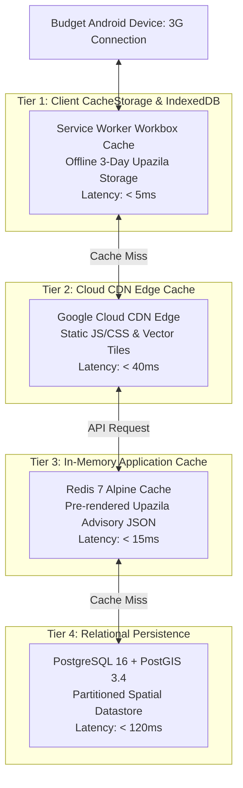
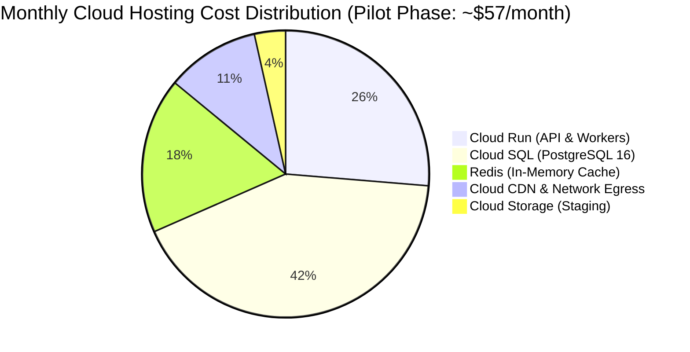

# Ritucast: Reliability, Performance & Cost Engineering Model

## 1. Executive Summary & Operational Target

A decision-support system designed for resource-constrained rural agricultural environments must achieve exceptional performance without requiring expensive cloud infrastructure. Ritucast is engineered to run reliably on volatile 3G networks and budget Android devices while maintaining a monthly cloud operational footprint of **under $\$65/\text{month}$** during its pilot deployment.

---

## 2. Multi-Tier Caching Architecture

To achieve sub-second API latencies ($P_{95} \le 500\text{ ms}$, `NFR-PER-04`) and eliminate redundant satellite queries, Ritucast deploys a **Four-Tier Caching Hierarchy**:

### 2.1 Cache Time-to-Live (TTL) Policy Matrix

| Cache Key Pattern | Cached Resource Type | Caching Layer | Enforced TTL | Invalidation Trigger |
| :--- | :--- | :--- | :--- | :--- |
| `static:assets:*` | Static PWA Bundles (JS, CSS, icons, fonts) | Cloud CDN + Client Cache | **1 Year** (Immutable) | Content-hashed file name change on deploy. |
| `geom:upazila:*` | Upazila Admin Boundary GeoJSON / PMTiles | Cloud CDN + IndexedDB | **30 Days** | Manual boundary dataset update. |
| `wx:upazila:{id}` | 7-Day Weather Observations & Forecasts | Redis + CDN | **6 Hours** | Ingestion worker completes 6-hourly NWP sync. |
| `adv:{id}:{crop}:{stage}` | Pre-rendered 4-Tier Advisory JSON | Redis In-Memory | **6 Hours** | Ingestion worker computes new daily water balance. |
| `wb:upazila:{id}` | Daily Root-Zone Water Deficit Timeseries | Redis + PostgreSQL | **24 Hours** | Midnight daily $ET_0$ calculation completion. |

---

## 3. Budget Android Performance Engineering

Target users operate budget smartphones (e.g., Walton Primo, Symphony, Xiaomi Redmi 9A with 2GB RAM, Android 8+). Performance engineering is enforced as a safety constraint:

| Performance Metric | Hard Budget Limit | Architectural Optimization Strategy |
| :--- | :--- | :--- |
| **Production Bundle Size** | **$\le 1.5\text{MB}$ uncompressed** ($<450\text{KB}$ gzipped) | 1. Tree-shaking enabled via Vite Rollup. 2. Dynamic code splitting: MapLibre GL JS (~180KB gzipped) is loaded lazily only when user taps "মানচিত্র দেখুন" (View Map). 3. Zero runtime CSS libraries (pure Vanilla CSS custom properties). |
| **Time-to-Interactive (TTI)** | **$\le 3.5\text{ seconds}$ on 3G** | 1. Critical path CSS inlined in `index.html`. 2. PWA App Shell rendered synchronously before API data arrives. 3. Fonts locally hosted in modern WOFF2 format with `font-display: swap`. |
| **Peak Client Heap RAM** | **$\le 45\text{MB}$ peak memory** | 1. Virtualized lists for multi-day weather cards. 2. Strict cleanup of WebGL map contexts on component unmount. 3. Avoid large in-memory GeoJSON objects; use vector PMTiles streaming. |
| **API Response Time** | **$P_{95} \le 500\text{ ms}$** | 1. 95% of requests served directly from Redis in-memory cache in $<20\text{ ms}$. 2. Async connection pooling via `asyncpg` in FastAPI. |

---

## 4. Google Cloud Platform (GCP) Pilot Operating Cost Model

Ritucast is intentionally designed to avoid expensive enterprise infrastructure during its initial pilot phase. By utilizing serverless containers (Cloud Run) and managed PostgreSQL (Cloud SQL), monthly operational costs remain minimal:

| Cloud Infrastructure Component | Configuration & Sizing for Pilot | Estimated Monthly Usage | Estimated Cost (USD/mo) |
| :--- | :--- | :--- | :--- |
| **Google Cloud Run (Web API)** | 1 vCPU, 1GB RAM, auto-scaling ($0 \rightarrow 3$ instances) | $\sim 200,000$ HTTP requests/month | **$\$8.00 – \$12.00$** |
| **Google Cloud Run (Workers)** | 1 vCPU, 1.5GB RAM, scheduled job execution | 4 runs/day $\times 15\text{ min/run}$ | **$\$4.00 – \$6.00$** |
| **Cloud SQL for PostgreSQL** | `db-f1-micro` (1 vCPU, 0.6GB RAM) or `db-g1-small` | 24/7 managed instance with 15GB SSD | **$\$20.00 – \$25.00$** |
| **Redis In-Memory Cache** | Containerized Redis 7 on Cloud Run or Memorystore | 1GB memory capacity | **$\$8.00 – \$12.00$** |
| **Google Cloud Storage (GCS)** | Multi-regional Standard Bucket | $\le 20\text{GB}$ storage with 7-day auto-purge | **$\$1.00 – \$2.00$** |
| **Cloud CDN & Load Balancing** | Serverless Network Endpoint Group (NEG) | $\sim 15\text{GB}$ egress/month | **$\$5.00 – \$8.00$** |
| **Total Estimated Operating Cost** | **Pilot Deployment (4 Upazilas)** | **Full 24/7 Availability** | **$\le \$55.00 – \$65.00 / \text{month}$** |

---

## 5. Cost Scaling & Circuit Breakers

1. **Auto-Scaling Ceilings**: Cloud Run maximum instances are strictly capped at $5\text{ instances}$ to prevent runaway bills from unexpected traffic spikes.
2. **Billing Alerts**: GCP Budget Alerts are configured at $\$50, \$75$, and $\$100$ thresholds with automated webhook notifications to the engineering lead.
3. **Storage Auto-Purge**: Object storage lifecycle rules automatically delete raw satellite granules older than 7 days, capping storage costs under $\$2/\text{month}$.
