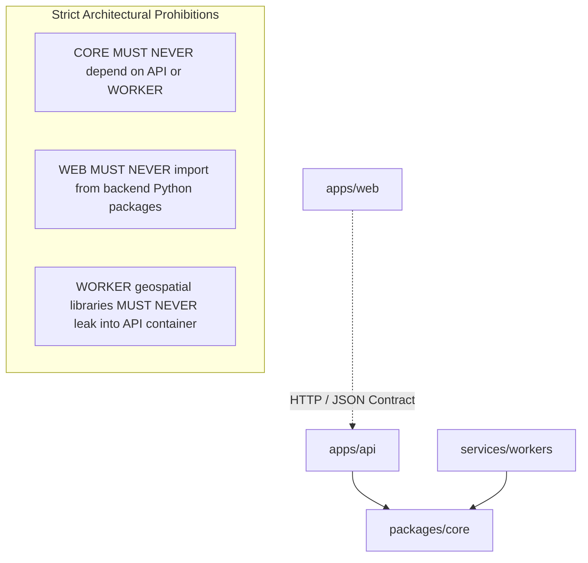

# Ritucast: Repository & Module Structure Specification

## 1. Executive Summary & Monorepo Strategy

Ritucast adopts a **Decoupled Monorepo Architecture**. Housing the web client, application API, geospatial worker pipelines, shared scientific models, and 18-phase governed documentation within a single repository guarantees:
1. **End-to-End Type Safety**: Shared Pydantic models in Python compile directly into TypeScript interfaces for the React client.
2. **Unified Scientific Truth**: Core agronomic algorithms (`EQN-ET0-01`, `IDX-FLD-01`) reside in a single shared core package, eliminating divergent logic between background ETL workers and the web API.
3. **Traceable Git History**: All documentation, architecture records, schema migrations, and code changes are preserved in atomic, cross-referenced commits.

---

## 2. Master Repository Layout

```text
RITUCAST/
├── apps/
│   ├── web/                          # Client Progressive Web App (React 18 + TypeScript + Vite)
│   │   ├── public/                   # Static assets, Web App Manifest, offline fallback HTML
│   │   ├── src/
│   │   │   ├── assets/               # Local icons and WOFF2 Bangla fonts
│   │   │   ├── components/           # 4-Tier advisory cards, weather views, map overlays
│   │   │   ├── hooks/                # Custom React hooks (useUpazila, useOfflineStatus)
│   │   │   ├── services/             # API client & IndexedDB cache handlers
│   │   │   ├── styles/               # Handcrafted Vanilla CSS design tokens (index.css)
│   │   │   └── App.tsx               # Root application component
│   │   ├── package.json              # Client dependencies
│   │   └── vite.config.ts            # Vite bundler configuration with PWA Workbox plugin
│   │
│   └── api/                          # Application REST API (Python 3.11 + FastAPI)
│       ├── app/
│       │   ├── api/v1/               # Versioned REST endpoints (weather, water_balance, advisories)
│       │   ├── core/                 # Config, settings, security middleware, rate limiter
│       │   ├── middleware/           # Automated Suppression Middleware (stale data check)
│       │   ├── models/               # SQLAlchemy 2.0 ORM database entity definitions
│       │   ├── schemas/              # Pydantic v2 request/response validation schemas
│       │   ├── services/             # Advisory engine orchestrator & cache-aside service
│       │   └── main.py               # FastAPI ASGI application entrypoint
│       ├── pyproject.toml            # Poetry / Pip dependency manifest
│       └── Dockerfile                # Multi-stage container definition
│
├── services/
│   └── workers/                      # Background Geospatial & Ingestion Workers (Celery)
│       ├── tasks/
│       │   ├── ingest_meteorology.py # NASA POWER & Open-Meteo polling tasks
│       │   ├── ingest_hydrology.py   # BWDB river stage & GPM IMERG catchment accumulation
│       │   └── ingest_radar.py       # ESA CDSE Sentinel-1 SAR inundation extraction
│       ├── celery_app.py             # Celery worker configuration & beat schedule
│       └── Dockerfile                # Container with GDAL / Rasterio / GEOS dependencies
│
├── packages/
│   └── core/                         # Shared Agronomic & Scientific Logic Engine
│       ├── agronomy/                 # Phenology duration tables, dynamic Kc interpolation
│       ├── equations/                # FAO-56 Penman-Monteith, USDA SCS effective rain
│       ├── hydrology/                # Daily water balance Dt, Haor Iflood composite index
│       └── rules/                    # Master agricultural rule catalog (RULE-IRR-01, etc.)
│
├── tests/
│   ├── unit/                         # Isolated function & equation mathematical checks
│   ├── integration/                  # Database transactions & API endpoint tests
│   └── e2e/                          # Playwright user journey mobile simulations
│
├── docs/                             # Governed 18-Phase Project Documentation
│   ├── project/                      # Phase 1 Discovery & Strategy
│   ├── product/                      # Phase 2 Strategy & Journeys
│   ├── requirements/                 # Phase 2 PRD & NFR Specifications
│   ├── data/                         # Phase 3 Dataset Inventory & Governance
│   ├── science/                      # Phase 4 Agricultural Knowledge & Models
│   ├── architecture/                 # Phase 5 System Architecture & ADRs
│   │   └── decisions/                # Architecture Decision Records (ADR-01 to ADR-09)
│   ├── planning/                     # Master Roadmap, Risk Register, Decision Log
│   └── phases/                       # Sequential execution packages (phase-01 to phase-18)
│
├── .editorconfig                     # Universal character encoding & formatting rules
├── .gitignore                        # Comprehensive secret & raw data exclusion rules
├── AGENTS.md                         # Project-wide AI operating instructions
└── README.md                         # Master repository index
```

---

## 3. Module Boundaries & Dependency Rules

To maintain modularity and avoid circular dependencies:



### Dependency Invariant Rules:
1. **Rule 1: Downward Dependency Only**: `apps/api` and `services/workers` depend downward upon `packages/core`. `packages/core` is a pure scientific library with zero database or web framework dependencies.
2. **Rule 2: Geospatial Isolation**: Heavy C-libraries (`gdal`, `rasterio`) are confined exclusively to `services/workers`. The web API service container (`apps/api`) remains lightweight, relying on PostGIS for spatial queries.
3. **Rule 3: Contract Decoupling**: The frontend `apps/web` interacts with the backend strictly via the OpenAPI 3.0 REST contract; zero direct shared memory or tight coupling.
