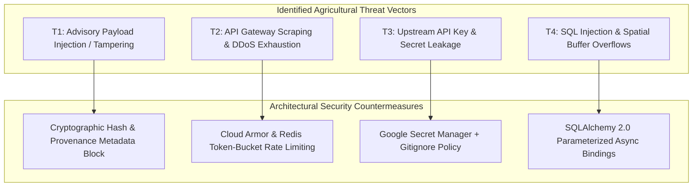
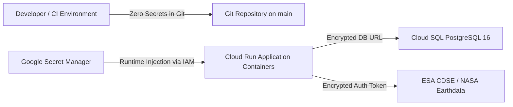

# Ritucast: Security, Privacy & Data Governance Architecture

## 1. Executive Summary & Security Philosophy

Agricultural intelligence applications serving rural smallholders require a distinct threat modeling posture. Unlike enterprise software where user access control and complex Role-Based Access Control (RBAC) dominate, Ritucast's primary security vulnerabilities are:
1. **Advisory Tampering & Misinformation**: Malicious or corrupted manipulation of flood and irrigation advisories causing crop damage.
2. **Denial-of-Service / Resource Starvation**: Scraping or DDoS attacks crashing the API during critical pre-flood mobilization.
3. **Surveillance & Land Tenure Risk**: Storing sensitive parcel-level boundaries that could expose smallholders to land tenure disputes.

Ritucast adopts a **Security-by-Design and Privacy-by-Default** architecture enforcing zero Personal Identifiable Information (PII) collection, immutable provenance logging, and open data compliance.

---

## 2. Threat Modeling & Security Controls

| Threat Vector | Severity | Vulnerability Description | Enforced Architectural Defense |
| :--- | :---: | :--- | :--- |
| **Advisory Manipulation** | **Critical** | Attacker intercepts or alters emergency flood advice to cause panic or crop abandonment. | All advisory responses are generated deterministically by backend rules, delivered over strict HTTPS (TLS 1.3), and include immutable `provenance` metadata. |
| **API Starvation (DDoS)** | **High** | Botnets or unthrottled scrapers overwhelm Cloud Run instances during pre-monsoon squalls. | Cloud Armor edge WAF and Redis token-bucket rate limiting ($60\text{ req/min}$ per IP). Exceeding queries receive HTTP 429. |
| **Secret & Credential Leakage** | **High** | Upstream API keys or database passwords committed to Git repository. | `.gitignore` comprehensively excludes `.env` and `secrets/`. Cloud Run injects secrets at runtime via Google Secret Manager. |
| **SQL / Spatial Injection** | **High** | Malformed GeoJSON or SQL injection in Upazila query parameters. | Pydantic v2 enforces strict string validation (`^[A-Z]{2}-\d{2}-\d{2}$`); SQLAlchemy async parameterized queries prevent SQL injection. |

---

## 3. Privacy-by-Design & Zero-PII Policy (`NFR-SEC-01`, `DEC-14`)

1. **No Farmer Accounts Required**: The platform is an open public utility. Extension workers and farmers query weather, indicators, and advisories without creating usernames, passwords, or providing mobile numbers.
2. **Zero Parcel-Level Land Tenure Collection**: The system operates strictly at the administrative upazila polygon scale ($200–500\text{ km}^2$). Sub-acre GPS boundaries of private smallholder plots are **never ingested, stored, or processed**.
3. **Log Sanitization**: Application access logs capture HTTP method, response code, and latency; client IP addresses are anonymized (truncated) prior to long-term storage in Cloud Logging to comply with global privacy standards.

---

## 4. Secret Management & Credential Architecture

- **Environment Injection**: Production runtime secrets (`DATABASE_URL`, `REDIS_URL`, `CDSE_CLIENT_SECRET`) are provisioned exclusively through **Google Secret Manager** and mapped as container environment variables via IAM service account roles.
- **Local Development**: Developers use a local `.env.example` template with dummy credentials; local git hooks reject any commit containing `.env` or AWS/GCP access tokens.

---

## 5. Licensing Governance & Compliance

Every data stream and open-source library used by Ritucast is verified against its open license terms (`docs/data/data-access-and-licensing.md`):

| Dependency / Dataset | Formal License | Redistribution Condition | Ritucast Compliance Mechanism |
| :--- | :--- | :--- | :--- |
| **NASA POWER (`DATA-MET-01`)** | NASA Open Data (Public Domain) | Free redistribution with attribution. | Attribution cited in API provenance and UI "তথ্যসূত্র: NASA POWER". |
| **Open-Meteo (`DATA-FCST-01`)** | CC-BY 4.0 | Free commercial & non-commercial use with attribution. | Display "আবহাওয়া তথ্য: Open-Meteo (ECMWF/GFS)" on forecast views. |
| **ESA Sentinel-1 SAR (`DATA-SAR-01`)** | Copernicus Open Access Policy | Free access and redistribution. | Attributed as "Contains modified Copernicus Sentinel data [2026]". |
| **MapLibre GL JS v3** | BSD-3-Clause | Permissive open-source license. | License notice included in web bundle; zero proprietary telemetry. |
| **FastAPI / React / Pydantic** | MIT License | Permissive open-source licenses. | Standard MIT license notices preserved in vendor licenses chunk. |
