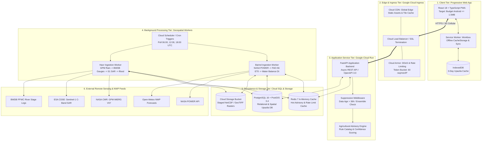

# Ritucast: System Architecture & Topology Specification

## 1. Executive Summary & Topology Overview

Ritucast is engineered as a **Decoupled Modular Architecture**: a lightweight, containerized Python/FastAPI application service paired with asynchronous background geospatial processing workers, a unified spatial datastore (PostgreSQL 16 with PostGIS 3.4), an in-memory caching tier (Redis 7), and an offline-capable Progressive Web App (PWA) client distributed via global edge Content Delivery Networks (CDN).

This topology delivers the ideal balance between operational simplicity, geospatial processing power, low hosting cost, and resilience over variable 3G rural mobile networks.

---

## 2. Evaluation of Architectural Alternatives

Before selecting the Decoupled Modular Architecture, four candidate topologies were systematically evaluated against Ritucast's operational and scientific constraints:

| Evaluation Dimension | Option A: Monolithic Server-Rendered App (Django / Rails) | Option B: Microservices Mesh (Kubernetes / Istio) | Option C: Pure Serverless Functions (AWS Lambda / Cloud Functions) | Option D (Selected): Decoupled Modular Architecture (FastAPI + Workers + PWA) |
| :--- | :--- | :--- | :--- | :--- |
| **Development Complexity** | Low to Moderate | **Extreme** (Service orchestration, distributed tracing, network overhead). | Moderate (Cold starts, deployment fragmentation). | **Low to Moderate** (Single codebase, clean module boundaries). |
| **Geospatial Processing** | Good (Monolithic worker processes). | Good (Dedicated geospatial microservice). | **Poor** (Container size limits, GDAL/GEOS cold start penalties $\ge 8\text{s}$). | **Excellent** (Heavy geospatial libraries contained in background workers). |
| **Rural Mobile Performance** | Poor (Server-rendered HTML payloads $\ge 3\text{MB}$ overwhelm 3G connections). | Moderate (High API network hop latency). | Moderate (API latency jitter). | **Outstanding** (Static PWA $<1.5\text{MB}$, instant local caching, edge CDN). |
| **Operational & Hosting Cost** | Low ($20–40/mo VPS). | **Prohibitive** ($300–800/mo minimum for cluster overhead). | Variable (High cost under frequent raster polling). | **Very Low** ($\le \$45–65/mo$ on Google Cloud Run + Cloud SQL). |
| **Failure Isolation** | Poor (A stuck raster download blocks web threads). | High (Isolated service boundaries). | High (Function-level isolation). | **High** (Web API strictly decoupled from background ingestion workers via Redis). |
| **Decision Outcome** | **Rejected**: Server-rendered HTML violates bundle and offline PWA requirements. | **Rejected**: Unjustified operational overhead and cost for a pilot phase (`DEC-01`). | **Rejected**: Cold starts and binary package limits break GDAL/Rasterio workloads. | **SELECTED**: Optimal fit for Phase 5 through Phase 18 lifecycle. |

---

## 3. Master System Architecture Topology

---

## 4. End-to-End Operational Data Flows

### 4.1 Flow 1: Asynchronous Scheduled Ingestion Flow (Backend $\rightarrow$ Database)
1. **Trigger**: Google Cloud Scheduler emits a signed pub/sub trigger every 6 hours ($00:00, 06:00, 12:00, 18:00\text{ UTC}$).
2. **Task Dispatch**: Celery / Redis worker queue assigns tasks to specialized containerized workers:
   - `task_ingest_barind_meteorology`: Fetches Open-Meteo forecasts and NASA POWER solar radiation for Barind bounding box; runs FAO-56 Penman-Monteith equation (`EQN-ET0-01`); computes daily water balance ($D_t$) for Godagari and Tanore upazilas.
   - `task_ingest_haor_hydrology`: Queries GPM IMERG 48h catchment precipitation over Meghalaya; scrapes BWDB Surma/Kushiyara river gauge stages; checks ESA CDSE for new Sentinel-1 GRD passes; calculates composite $I_{\text{flood}}$ (`IDX-FLD-01`).
3. **Quality & Validation Gate**: Worker runs 5-stage automated quality checks (`data-quality-validation.md`): physical bounds check, coordinate verification, timestamp parsing.
4. **Persistence & Cache Invalidation**: Processed records are inserted into PostGIS tables with full provenance metadata; hot upazila summary JSON payloads are pushed into Redis cache with a $6\text{-hour}$ TTL.

### 4.2 Flow 2: Mobile Client Advisory Query Flow (Client $\rightarrow$ API)
1. **User Action**: SAAO or lead farmer opens Ritucast PWA on Android device and selects an upazila (e.g., Godagari).
2. **Edge Ingress**: Request hits Cloud CDN. If the static PWA shell is cached, it renders immediately.
3. **API Request**: Client issues an HTTPS GET request to `/api/v1/upazilas/BD-50-28/advisories?crop=boro_rice&stage=vegetative_tillering`.
4. **Rate Limit & Ingress**: Cloud Armor validates request rate ($\le 60\text{ req/min}$ per IP).
5. **Contextual Gating Validation**: FastAPI validates request parameters (`upazila_id`, `crop`, `stage`) via Pydantic v2 schemas (`DEC-17`).
6. **Suppression Middleware Evaluation**:
   - Inspects timestamp of latest weather data. If $>36\text{ hours}$ old (`NFR-REL-03`), suppresses active advisory and returns standard fallback copy.
   - Computes multi-model ensemble spread ($S_{\text{spread}}$). If $>50\%$ with rain prob between $40\%$ and $60\%$, withholds definitive postponement card.
7. **Cache-Aside Lookup**: Backend checks Redis key `adv:BD-50-28:boro_rice:vegetative_tillering`. If hit, returns pre-rendered JSON payload ($<15\text{KB}$) in $<40\text{ ms}$. If miss, computes from PostGIS and caches in Redis.
8. **Client Presentation**: React client renders the 4-tier cards: Tier 1 Observations, Tier 2 Indicators, Tier 3 Predictions, and Tier 4 Actionable Recommendation with the calculated Confidence Badge (`DEC-08`, `DEC-18`).

### 4.3 Flow 3: Offline Field Visit Flow (No Cellular Coverage)
1. **Field Entry**: SAAO travels to remote Haor beel or Barind village with zero 3G signal.
2. **Local Cache Interception**: Service Worker intercepts network request and falls back to `CacheStorage` / `IndexedDB`.
3. **Offline Rendering**: Displays the last synchronized 3 days of weather forecasts, moisture status, and emergency flood guidance with an explicit **"অফলাইন মোড — সংরক্ষিত তথ্য" (Offline Mode - Cached Data)** banner and synchronization timestamp.

---

## 5. Architectural Fault Tolerance & Recovery Strategies

| Failure Mode | Detection Mechanism | Automated Recovery & Resilience Strategy |
| :--- | :--- | :--- |
| **Upstream Provider Outage (NASA / ESA / Open-Meteo API down)** | Worker HTTP timeout ($10\text{s}$), retry exhaustion (3 attempts with exponential backoff). | Worker logs error to Cloud Logging (`P2 Alert`); retains previous day's forecast in PostGIS; if outage persists $>36\text{h}$, Suppression Middleware automatically displays safe fallback notice to users. |
| **Worker Container Crash (Out of Memory on large GeoTIFF)** | Docker container exit code 137 (OOMKilled) monitored by Cloud Run. | Cloud Run restarts worker container automatically; Celery task returns to dead-letter queue; raster processing tasks enforce streaming chunking via Rasterio/Windowing to cap worker RAM at $\le 1.5\text{GB}$. |
| **Redis In-Memory Cache Flush / Crash** | FastAPI cache lookup raises connection timeout ($150\text{ms}$). | System gracefully degrades: FastAPI catches Redis connection error and falls back directly to PostgreSQL queries without failing user requests. |
| **Database Network Partition** | SQLAlchemy async pool connection error. | FastAPI returns structured HTTP 503 error with Retry-After header; client Service Worker serves cached IndexedDB data. |
