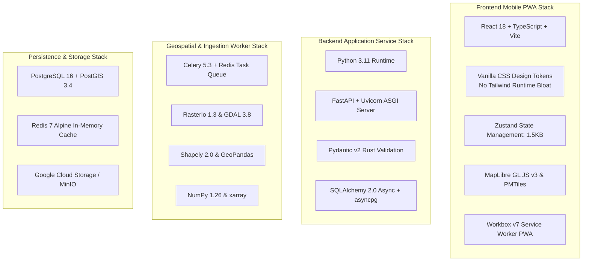

# Ritucast: Technology Stack Specification & Selection Rationale

## 1. Executive Summary & Philosophy

A technology stack is not a fashion statement. Every dependency introduced into Ritucast represents an operational liability, a potential security vector, and an ongoing maintenance burden.

In accordance with project core principles ("Prioritize practical implementation", "Enforce client hardware and payload budgets", "Use primary sources"), Ritucast's technology stack is chosen according to three strict engineering rules:
1. **Lightweight & Standards-Based**: Prefer vanilla web standards, lightweight modern libraries, and native runtime capabilities over monolithic bloated frameworks.
2. **Strict Spatial Separation of Concerns**: Heavy geospatial and data-science libraries (GDAL, Rasterio, xarray) reside **strictly inside backend worker containers** and are never bundled into client applications.
3. **Reproducible & Cost-Effective**: 100% open-source core stack with zero proprietary vendor lock-in, deployable on standard container runtimes (Google Cloud Run / Docker) for under $\$65/\text{month}$ during the pilot phase.

---

## 2. Master Technology Stack Matrix

---

## 3. Technology Evaluation & Selection Rationale

### 3.1 Frontend Tier: Web Client & PWA

| Layer | Selected Technology | Alternative Considered | Selection Rationale & Trade-Off Analysis |
| :--- | :--- | :--- | :--- |
| **Core Framework** | **React 18 + TypeScript** | Vue 3, Svelte, Plain Vanilla JS | React with TypeScript provides the optimal combination of massive ecosystem support, strict type safety, predictable virtual DOM rendering, and seamless component testing. TypeScript prevents runtime null/undefined errors across complex 4-tier advisory payload objects. |
| **Build Tooling** | **Vite 5** | Webpack 5, Create-React-App | Vite uses native ES modules during development for instant Hot Module Replacement (HMR) and Rollup for tree-shaken, highly optimized production bundles. Compiles the entire client application into $<450\text{KB}$ gzipped chunks. |
| **Styling & CSS** | **Vanilla CSS with Custom Design Tokens** | Tailwind CSS, Styled-Components | **Zero Runtime Overhead**: Tailwind introduces utility class bloat and configuration complexity. In accordance with system instructions, Ritucast uses handcrafted Vanilla CSS (`index.css` design system with CSS custom properties: colors, spacing, Bangla typography). Guarantees complete control over bundle size ($\le 1.5\text{MB}$ limit, `DEC-09`). |
| **State Management** | **Zustand (1.5KB)** | Redux Toolkit (35KB), MobX | Zustand is an ultra-lightweight, hook-based state store with zero boilerplate and negligible footprint ($<2\text{KB}$ vs Redux's $>30\text{KB}$). Perfect for managing active upazila, selected crop stage, and offline synchronization status. |
| **PWA & Offline** | **Workbox v7** | Custom SW script | Workbox provides battle-tested service worker caching strategies (`StaleWhileRevalidate` for weather forecasts; `CacheFirst` for static vector tiles and fonts; `NetworkOnly` for dynamic forms). |
| **Mapping Engine** | **MapLibre GL JS v3** | Mapbox GL JS, Leaflet | Mapbox GL JS v2+ enforces proprietary telemetry, commercial licensing, and token costs. MapLibre GL JS is completely open-source (BSD-3-Clause), hardware-accelerated via WebGL, and supports lightweight vector tile streaming (`PMTiles`) without expensive tile server infrastructure. Leaflet is retained as a low-memory fallback for legacy devices. |

---

### 3.2 Backend Tier: Application Service & REST API

| Layer | Selected Technology | Alternative Considered | Selection Rationale & Trade-Off Analysis |
| :--- | :--- | :--- | :--- |
| **Language Runtime** | **Python 3.11** | Node.js (TypeScript), Go | While Go and Node.js have fast raw I/O, Python is the uncontested global standard for Earth observation, remote sensing, and agronomic science. Python enables seamless sharing of validated Phase 4 scientific models (`EQN-ET0-01`, `IDX-FLD-01`) between research and backend production without language translation bugs. Python 3.11 delivers a $25–40\%$ performance gain over Python 3.9. |
| **API Framework** | **FastAPI** | Django REST Framework, Flask | FastAPI uses asynchronous ASGI (`async`/`await`), natively generating interactive OpenAPI 3.0 / Swagger documentation. It achieves performance comparable to Node.js and Go for I/O-bound web requests, while offering automatic request validation. |
| **Schema Validation** | **Pydantic v2** | Marshmallow, Cerberus | Pydantic v2 has its core validation engine written in Rust, executing schema parsing 5–15x faster than v1. Enforces strict input validation on upazila IDs, coordinates, and physical ranges (`data-quality-validation.md`). |
| **Database Driver** | **SQLAlchemy 2.0 (async) + asyncpg** | psycopg2, Tortoise ORM | `asyncpg` is the fastest PostgreSQL driver in the Python ecosystem. SQLAlchemy 2.0 provides modern typed async query expressions, connection pooling, and seamless Alembic database migration management. |

---

### 3.3 Scientific & Geospatial Processing Tier (Background Workers)

| Library / Tool | Role in Ritucast | Strict Architectural Isolation Rule |
| :--- | :--- | :--- |
| **GDAL 3.8 & Rasterio 1.3** | Reading, windowing, and reprojection of Sentinel-1 C-band SAR GRD GeoTIFFs and GPM IMERG grids. | **Worker Container Only**: Never bundled in web API container or client. Raster reads are performed in streaming chunks (windows) to prevent worker RAM spikes. |
| **Shapely 2.0 & GeoPandas** | Spatial vector operations: checking bounding box overlaps, computing intersection areas ($A_i$), and zonal statistics across 495 upazila polygons (`DATA-BND-01`). | High-speed C-extension execution; spatial calculations are pre-computed during ingestion and persisted to PostGIS. |
| **NumPy 1.26 & xarray** | Numerical evaluation of FAO-56 Penman-Monteith equations, net radiation arrays, and multi-dimensional NetCDF meteorological cubes. | Vectorized array math; executes daily in $<2\text{ seconds}$ per regional bounding box. |
| **Celery 5.3 + Redis** | Distributed task queue orchestrating scheduled ingestion, rate-limited polling, and cache warming. | Manages concurrency to respect external rate limits (e.g., NASA POWER 30 req/min limit, `RSK-14`). |

---

### 3.4 Persistence, Caching & Infrastructure Tier

| Component | Selected Technology | Deployment Topology | Operational Rationale |
| :--- | :--- | :--- | :--- |
| **Spatial Database** | **PostgreSQL 16 + PostGIS 3.4** | Managed Cloud SQL (1 vCPU, 3.75GB RAM) | World-standard spatial database. PostGIS spatial indices (`GIST`) enable microsecond polygon lookups (`ST_Intersects`, `ST_Area`). |
| **In-Memory Cache** | **Redis 7 (Alpine)** | Managed Cloud Memorystore or Container (1GB) | Serves pre-computed upazila advisory JSON payloads in $<20\text{ ms}$; token-bucket rate limiting ($60\text{ req/min}$); Celery task broker. |
| **Object Storage** | **Google Cloud Storage (GCS)** | Standard Multi-Regional Bucket | Staging raw satellite downloads (7-day lifecycle auto-delete); serving pre-rendered PMTiles vector maps. MinIO used for local dev. |
| **Serverless Compute** | **Google Cloud Run** | Multi-Container Serverless (Min: 0, Max: 5 instances) | Auto-scales to zero during nighttime low-traffic hours; eliminates idle server costs; deploys immutable Docker container images. |
| **Code Formatting** | **Ruff (Python) & Prettier (JS/CSS)** | Black, flake8, isort | Ruff is 10–100x faster than legacy Python linters, enforcing unified formatting and lint rules across the repository. |
