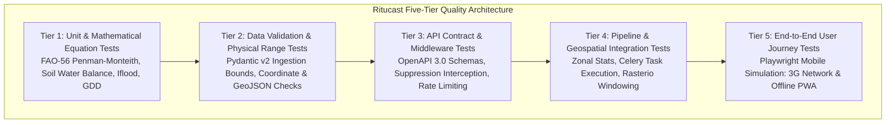
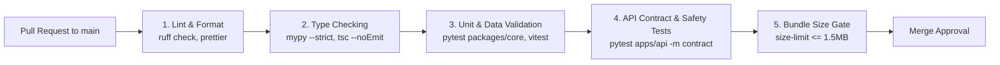

# Ritucast: Testing & Quality Assurance Architecture

## 1. Executive Summary & Testing Philosophy

In a decision-support system that directly influences agricultural survival and household food security, software defects are safety-critical risks. A broken API route or an inverted inequality in a flood calculation can lead to catastrophic field losses.

Ritucast establishes a rigorous **Five-Tier Testing Pyramid** coupled with a strict distinction between **Software Correctness** and **Scientific Validity**:
- **Software Correctness**: Verifies that code executes as written without runtime crashes, syntax errors, or schema regressions (covered by this document).
- **Scientific Validity**: Verifies that calculated outputs accurately reflect empirical biophysical realities in Bangladesh (governed by [scientific-validation-plan.md](file:///Users/kazi/Projects/RITUCAST/docs/science/scientific-validation-plan.md)).

---

## 2. Five-Tier Testing Pyramid Architecture

---

### 2.1 Tier 1: Unit & Mathematical Equation Tests
- **Scope**: Verifies isolated mathematical formulations, agronomic equations, and logical rules in `packages/core`.
- **Target Algorithms**:
  - `EQN-ET0-01`: FAO-56 Penman-Monteith $ET_0$ calculation against standard FAO benchmark tables.
  - `EQN-ETC-01`: Dynamic $K_c$ interpolation across Boro growth days.
  - `EQN-SWD-01`: Soil water balance depletion $D_t$ and USDA SCS effective rain formulas.
  - `IDX-FLD-01`: Composite Haor Flash Flood Hazard Index $I_{\text{flood}}$ sub-indices.
  - `DEC-18`: Exponential confidence decay math ($\lambda = 0.12$) and multi-model ensemble spread penalties.
- **Tooling**: `pytest`, `pytest-cov`.
- **Target Coverage**: **$\ge 95\%$ code coverage** across `packages/core`.

### 2.2 Tier 2: Data Validation & Physical Bounds Tests
- **Scope**: Verifies that all external data ingestion parsers reject corrupt, incomplete, or physically impossible data feeds (`docs/data/data-quality-validation.md`).
- **Target Checks**:
  - Air temperature range checks ($T_{\text{max}}, T_{\text{min}} \in [5.0, 50.0]^\circ\text{C}$).
  - Relative humidity range checks ($RH \in [5.0, 100.0]\%$).
  - Precipitation non-negativity ($P \ge 0.0\text{ mm}$).
  - Coordinate bounding box checks (points must fall within $20.5–26.7^\circ\text{N}, 88.0–92.7^\circ\text{E}$).
  - GeoJSON boundary topology validity (`ST_IsValid`).
- **Tooling**: `pydantic v2`, `shapely`.

### 2.3 Tier 3: API Contract & Suppression Middleware Tests
- **Scope**: Tests FastAPI endpoints, request validation, cache interaction, and safety interception.
- **Target Scenarios**:
  - Request with missing `crop` or `stage` parameters returns HTTP 422 (`MISSING_CONTEXT_PARAMETER`).
  - Request with weather data older than 36 hours triggers **Automated Suppression Middleware**, returning `is_suppressed: true` and localized fallback text (`DEC-10`, `NFR-REL-03`).
  - Request with multi-model ensemble spread $>50\%$ withholds definitive postponement cards.
  - Rate-limit testing: 61st request from single IP within 60 seconds returns HTTP 429 (`RATE_LIMIT_EXCEEDED`).
- **Tooling**: `pytest-asyncio`, `httpx`, `fakeredis`.

### 2.4 Tier 4: Pipeline & Geospatial Integration Tests
- **Scope**: Tests background Celery task execution, PostGIS database transactions, and raster processing.
- **Target Scenarios**:
  - Test streaming windowed extraction of synthetic Sentinel-1 GeoTIFF rasters using Rasterio.
  - Verify that area-weighted zonal statistics accurately sum grid intersections across Godagari and Tahirpur boundaries.
  - Verify task retry behavior and dead-letter queueing on mock upstream API timeouts.
- **Tooling**: `pytest`, Docker Testcontainers (PostGIS + Redis).

### 2.5 Tier 5: End-to-End (E2E) & Usability Tests
- **Scope**: Simulates real-world mobile user journeys on budget hardware profiles over volatile cellular connections.
- **Target Scenarios**:
  - **Journey 1 (Barind Lead Farmer)**: Selects Godagari $\rightarrow$ Boro Rice $\rightarrow$ Tillering $\rightarrow$ Receives `RULE-IRR-01` Postpone Irrigation Card with High Confidence badge $\rightarrow$ Inspects "কেন এই পরামর্শ?" explanation modal.
  - **Journey 2 (Haor SAAO Offline Mode)**: Opens app online in Sunamganj $\rightarrow$ Syncs Tahirpur data $\rightarrow$ Disables network connection (Airplane Mode) $\rightarrow$ Navigates through 3-day weather cards $\rightarrow$ Verifies offline banner and accurate data display from IndexedDB.
  - **Performance Audit**: Verifies initial production bundle size $\le 1.5\text{MB}$ and peak browser heap memory $\le 45\text{MB}$.
- **Tooling**: `Playwright` with Chromium mobile emulation (Pixel 5, throttled 3G network profile).

---

## 3. Automated Continuous Integration (CI) Pipeline Blueprint

The testing architecture is orchestrated via automated GitHub Actions workflows executing on every pull request to `main`:

### Pull Request Quality Gates:
1. **Linting & Formatting**: Zero Ruff or Prettier warnings (`ruff check .`, `ruff format --check .`).
2. **Type Safety**: Zero TypeScript compiler errors (`tsc --noEmit`) and strict Python type compliance (`mypy --strict`).
3. **Unit Tests**: 100% test pass rate with $\ge 90\%$ line coverage across `packages/core`.
4. **Safety Regression Check**: Automated verification that suppression middleware fires under stale data simulation.
5. **Bundle Budget Audit**: Production build must pass bundle size check (`size-limit` verifies production JS/CSS $\le 1.5\text{MB}$).
