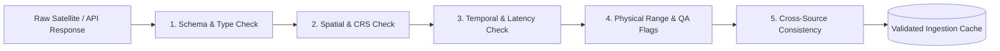

# Ritucast: Data Quality & Validation Protocols

## 1. Quality Assurance Framework

To prevent corrupted, uncalibrated, or out-of-range sensor readings from entering the agronomic analytics core, Ritucast enforces a five-stage automated data validation pipeline prior to advisory generation.

---

## 2. Stage-by-Stage Quality Control Protocols

---

### Stage 1: Schema & Structural Validation
- **Requirement**: Every incoming payload must validate against its defined JSON Schema or NetCDF/HDF5 data model.
- **Checks**:
  - Verification of mandatory keys (`geometry`, `properties.parameter`, `time_start`).
  - Strict type checking (e.g., temperatures must be floats, timestamps ISO-8601 strings).
  - Fill value detection: All values matching documented fill codes (e.g., `-999.0` in NASA POWER, `-9999.9` in IMERG) must be converted to `NULL` / `NaN` before downstream mathematical operations.

---

### Stage 2: Geographic & Spatial Extent Validation
- **Requirement**: All spatial points and bounding boxes must lie strictly within the geographic domain of Bangladesh and its transboundary hydrologic catchments.
- **Checks**:
  - WGS84 coordinates must satisfy: $88.0^\circ\text{E} \le \text{Longitude} \le 92.8^\circ\text{E}$ and $20.5^\circ\text{N} \le \text{Latitude} \le 26.7^\circ\text{N}$ (or upstream catchments up to $26.0^\circ\text{N}, 93.0^\circ\text{E}$ for Meghalaya).
  - Coordinate Reference System (CRS) must be explicitly verified as EPSG:4326 before geometry intersecting.

---

### Stage 3: Temporal & Latency Validation
- **Requirement**: Datasets must not be stale or contain temporal discontinuities.
- **Checks**:
  - Observation timestamp must match requested target date.
  - Data Latency Ceiling: Forecast observations must be $<18\text{ hours}$ old; if $>36\text{ hours}$ old, trigger automated recommendation suppression (`NFR-REL-03`).
  - Monotonicity: Time-series observations must be strictly sorted by date with zero duplicate date keys.

---

### Stage 4: Physical Value Range & Sensor Quality Control Flags
- **Requirement**: Every variable must fall within scientifically plausible meteorological and agronomic boundaries for Bangladesh. Out-of-bounds readings indicate sensor corruption or processing errors.

| Parameter Identifier | Target Physical Variable | Valid Minimum | Valid Maximum | Documented Fill / Null Value | Target Sensor QA Flag Requirement |
| :--- | :--- | :---: | :---: | :---: | :--- |
| `T2M_MAX` / `T2M_MIN` | 2m Air Temperature | $0.0^\circ\text{C}$ | $48.0^\circ\text{C}$ | `-999.0` | NASA POWER quality check bit clean. |
| `ALLSKY_SFC_SW_DWN` | Solar Insolation | $0.0\text{ MJ/m}^2/\text{day}$ | $35.0\text{ MJ/m}^2/\text{day}$ | `-999.0` | Shortwave clear/cloud radiance flag valid. |
| `PRECTOTCORR` / `precipitationCal` | Daily Precipitation | $0.0\text{ mm/day}$ | $600.0\text{ mm/day}$ | `-9999.9` | IMERG `precipitationQualityIndex` $>0.4$. |
| `RH2M` | Relative Humidity | $10.0\%$ | $100.0\%$ | `-999.0` | Dew point physically consistent with $T_{\text{air}}$. |
| `WS2M` | 2m Wind Speed | $0.0\text{ m/s}$ | $55.0\text{ m/s}$ (Tropical Cyclone) | `-999.0` | Valid boundary layer vector. |
| `soil_moisture` (SMAP) | Volumetric Soil Moisture | $0.02\text{ m}^3/\text{m}^3$ | $0.60\text{ m}^3/\text{m}^3$ | `-9999.0` | `retrieval_qual_flag` bit 0 = 0 (Recommended). |
| $\sigma^\circ_{\text{VV}}, \sigma^\circ_{\text{VH}}$ (Sentinel-1) | Radar Backscatter Intensity | $-35.0\text{ dB}$ | $+5.0\text{ dB}$ | `0 / NaN` | Valid radiometric calibration & orbit ephemeris. |

---

### Stage 5: Cross-Source Consistency Checks
- **Requirement**: Cross-reference independent observations to catch severe anomalies.
- **Checks**:
  1. *Rainfall vs Humidity Consistency*: If precipitation $>20\text{mm}$ is reported, relative humidity ($RH$) must be $\ge 70\%$. A report of $50\text{mm}$ rain with $25\% RH$ triggers an automatic data corruption quarantine flag.
  2. *Radar Inundation vs River Stage*: An emergency flood inundation alert triggered by Sentinel-1 SAR is cross-checked against BWDB upstream river gauge trends. If BWDB gauges report river falling below danger levels and GPM reports zero rain, the SAR watermask is flagged for possible wind-roughening artifacts.
  3. *Temperature Diurnal Range*: $T_{\text{max}}$ must strictly exceed $T_{\text{min}}$ by at least $1.5^\circ\text{C}$. If $T_{\text{max}} \le T_{\text{min}}$, the record is discarded.

## 3. Data Quarantine & Error Telemetry

When an incoming record fails validation:
1. The record is written to a designated `data_quarantine_log` with the failure code.
2. The ingestion service automatically falls back to secondary sources or the previous day's persistence model.
3. If primary and fallback sources fail simultaneously for an Upazila, all automated action advisories for that Upazila are suppressed, displaying the safe manual consultation disclaimer.

---

## 4. Phase 8 Implementation Architecture & Automated Auditing

In Phase 8, the 5-stage validation protocol is programmatically instantiated across three production-ready Python modules:
1. **Structural Schema Validation (`pipelines/validation/schema_validator.py`)**:
   - Pydantic v2 schemas (`MeteorologyDailySchema`, `ForecastHourlySchema`, `CatchmentRainfallSchema`, `Sentinel1MetadataSchema`, `SoilMoistureDailySchema`, `HydrologyReadingSchema`).
   - Strict ISO date formatting, coordinate ranges, and cross-field validation ($T_{\text{max}} \ge T_{\text{min}}$).
2. **Semantic Boundary Verification (`pipelines/validation/semantic_validator.py`)**:
   - Programmatic physical bounds checking against Table 2 limits.
   - Immediate rejection of impossible negative rainfall, solar insolation $>35\text{ MJ}/\text{m}^2/\text{day}$, and soil moisture $>0.60\text{ m}^3/\text{m}^3$.
3. **Audit Reporter & Quarantine Telemetry (`pipelines/validation/quality_reporter.py`)**:
   - Compiles batch run metrics (records checked, passed, rejected, warnings).
   - Generates machine-readable `quality_report.json` and human-readable Markdown summaries.
   - Integrated into the automated test suite ([test_schema_validator.py](file:///Users/kazi/Projects/RITUCAST/tests/unit/test_schema_validator.py), [test_semantic_validator.py](file:///Users/kazi/Projects/RITUCAST/tests/unit/test_semantic_validator.py)).

