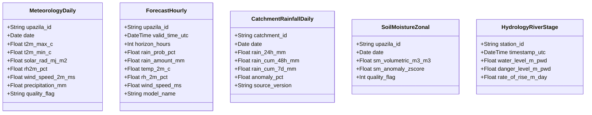

# Phase 8: Feature Preparation Specification for Phase 9 Analytics

## 1. Executive Summary & Boundaries

Feature preparation in Phase 8 produces clean, strongly typed, and well-documented analytical tables (stored as columnar Parquet files in `data/processed/`) that serve as the input catalog for Phase 9 (Agricultural Analytics and Recommendation Engine).

**Strict Boundary Rule**: Phase 8 does **not** compute derived agronomic indices ($ET_0, D_t, I_{\text{flood}}$) or generate farming recommendations. It prepares the raw and standardized forcing features required by Phase 9's scientific equations (`EQN-ET0-01`, `EQN-SWD-01`, `IDX-FLD-01`).

---

## 2. Analytical Feature Table Catalog

---

## 3. Schemas & Variable Definitions

### 3.1 `meteorology_daily_upazila.parquet`
Feeds directly into FAO-56 Penman-Monteith Reference Evapotranspiration ($ET_0$, `EQN-ET0-01` in Phase 9).

| Column Name | Type | Units | Physical Bounds | Source | Description |
| :--- | :--- | :---: | :---: | :---: | :--- |
| `upazila_id` | `VARCHAR(16)` | Text | BBS Code | `DATA-BND-01` | Administrative Upazila identifier. |
| `date` | `DATE` | ISO Date | 2000-01-01+ | `DATA-MET-01` | Observation date (BST day boundary). |
| `t2m_max_c` | `FLOAT32` | $^\circ\text{C}$ | $[-5.0, 55.0]$ | `DATA-MET-01` | Maximum daily air temperature at 2m. |
| `t2m_min_c` | `FLOAT32` | $^\circ\text{C}$ | $[-5.0, 50.0]$ | `DATA-MET-01` | Minimum daily air temperature at 2m. |
| `solar_rad_mj_m2` | `FLOAT32` | $\text{MJ}/\text{m}^2/\text{d}$ | $[0.0, 35.0]$ | `DATA-MET-01` | All-sky surface downward shortwave radiation. |
| `rh2m_pct` | `FLOAT32` | $\%$ | $[0.0, 100.0]$ | `DATA-MET-01` | Mean daily relative humidity at 2m. |
| `wind_speed_2m_ms` | `FLOAT32` | $\text{m}/\text{s}$ | $[0.0, 40.0]$ | `DATA-MET-01` | Mean daily wind speed at 2m height. |
| `precipitation_mm` | `FLOAT32` | $\text{mm}$ | $[0.0, 500.0]$ | `DATA-MET-01` | Daily precipitation gauge/satellite correction. |
| `quality_flag` | `VARCHAR(16)` | Text | `PASSED`/`EST` | Pipeline | Validation quality flag (`PASSED`, `ESTIMATED`). |

---

### 3.2 `forecast_hourly_pilot.parquet`
Feeds directly into 48h tubewell pumping postponement advice (`RULE-IRR-01` in Phase 9).

| Column Name | Type | Units | Physical Bounds | Source | Description |
| :--- | :--- | :---: | :---: | :---: | :--- |
| `upazila_id` | `VARCHAR(16)` | Text | BBS Code | `DATA-BND-01` | Administrative Upazila identifier. |
| `valid_time_utc` | `TIMESTAMP` | UTC | Current + 7d | `DATA-FCST-01` | Forecast target valid timestamp. |
| `horizon_hours` | `INT16` | Hours | $[0, 168]$ | `DATA-FCST-01` | Lead time from initialization run. |
| `rain_prob_pct` | `FLOAT32` | $\%$ | $[0.0, 100.0]$ | `DATA-FCST-01` | Probability of precipitation $\ge 0.1\text{mm}$. |
| `rain_amount_mm` | `FLOAT32` | $\text{mm}$ | $[0.0, 150.0]$ | `DATA-FCST-01` | Expected precipitation amount. |
| `temp_2m_c` | `FLOAT32` | $^\circ\text{C}$ | $[5.0, 50.0]$ | `DATA-FCST-01` | Temperature at 2m. |
| `model_name` | `VARCHAR(32)` | Text | `ecmwf`/`gfs` | `DATA-FCST-01` | Numerical Weather Prediction ensemble model. |

---

### 3.3 `catchment_rainfall_daily.parquet`
Feeds directly into Haor Transboundary Catchment Flood Hazard Index ($I_{\text{flood}}$, `IDX-FLD-01` in Phase 9).

| Column Name | Type | Units | Physical Bounds | Source | Description |
| :--- | :--- | :---: | :---: | :---: | :--- |
| `catchment_id` | `VARCHAR(32)` | Text | `MEGHALAYA_ESCARP` | Pipeline | Transboundary hydrological basin identifier. |
| `date` | `DATE` | ISO Date | 2000-01-01+ | `DATA-PCP-01` | Observation date. |
| `rain_24h_mm` | `FLOAT32` | $\text{mm}$ | $[0.0, 600.0]$ | `DATA-PCP-01` | Spatially averaged 24h basin rainfall. |
| `rain_cum_48h_mm` | `FLOAT32` | $\text{mm}$ | $[0.0, 1000.0]$ | `DATA-PCP-01` | Rolling 48h cumulative rainfall ($P_{\text{cat}}$). |
| `rain_cum_7d_mm` | `FLOAT32` | $\text{mm}$ | $[0.0, 2500.0]$ | `DATA-PCP-01` | Rolling 7-day cumulative rainfall. |
| `is_early_run` | `BOOLEAN` | Bool | `true`/`false` | `DATA-PCP-01` | True if GPM Early (<6h), False if Final. |

---

### 3.4 `hydrology_river_stage.parquet`
Feeds directly into Haor River Surge Rate of Rise and Early Harvest Warnings (`RULE-FLD-01` in Phase 9).

| Column Name | Type | Units | Physical Bounds | Source | Description |
| :--- | :--- | :---: | :---: | :---: | :--- |
| `station_id` | `VARCHAR(16)` | Text | `BWDB-177` | `DATA-HYD-01` | BWDB gauge station identifier (Sunamganj). |
| `timestamp_utc` | `TIMESTAMP` | UTC | ISO-8601 | `DATA-HYD-01` | Gauge reading timestamp. |
| `water_level_m_pwd` | `FLOAT32` | $\text{m PWD}$ | $[0.0, 25.0]$ | `DATA-HYD-01` | Observed water level in meters Public Works Datum. |
| `danger_level_m_pwd`| `FLOAT32` | $\text{m PWD}$ | Constant | `DATA-HYD-01` | Official BWDB danger level threshold ($8.25\text{m}$). |
| `freeboard_m` | `FLOAT32` | $\text{m}$ | $[-5.0, 15.0]$ | Pipeline | Margin below danger level ($\text{DL} - \text{OWL}$). |
| `rate_of_rise_24h` | `FLOAT32` | $\text{m}/\text{d}$ | $[-3.0, 5.0]$ | Pipeline | 24-hour rate of water level rise ($\Delta H/\Delta t$). |
