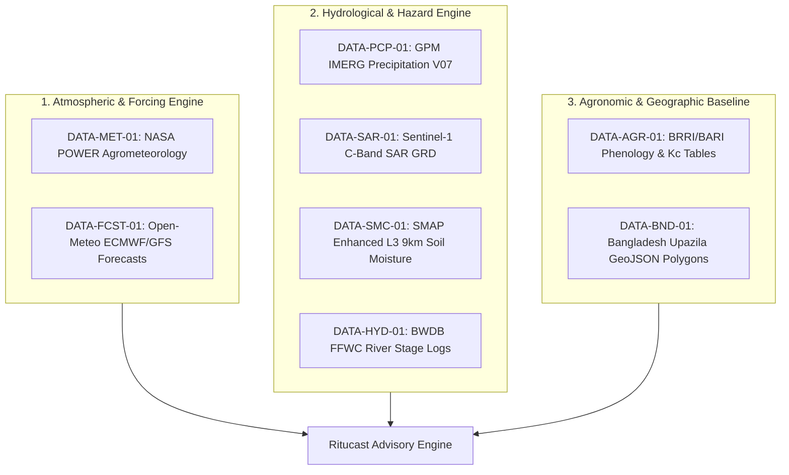

# Ritucast: Initial Dataset Stack & Selection Rationale

## 1. Selection Methodology & Criteria

To avoid data bloat and ensure that every ingestion dependency directly supports an approved user requirement, datasets are selected against twelve strict operational criteria:
1. **Direct Requirement Mapping**: Must trace to an active functional requirement in the PRD.
2. **Empirically Verified Bangladesh Coverage**: Verified bounding box $88.0^\circ - 92.8^\circ\text{E}$, $20.5^\circ - 26.7^\circ\text{N}$.
3. **Decoupled Informational Resolution**: Grid spacing must be scientifically justifiable for the intended advisory.
4. **Actionable Latency**: Must arrive fast enough to influence 24–72h farming decisions.
5. **Multi-Year Climatology**: Minimum 5–10 years of consistent historical records for anomaly benchmarking.
6. **Open Data Mandate & Zero Licensing Fees**: Public domain or permissive open-data license.
7. **Documented Ground Validation**: Peer-reviewed validation studies in South Asia or Bangladesh.
8. **Low Processing Complexity**: Manageable within containerized lightweight ingestion services.
9. **Bandwidth Budget Compatibility**: Raw ingestion pipelines must not overload memory or client bundles.
10. **Zero Redundancy**: Avoid pulling multiple identical sensors for the same physical variable.
11. **Scientific Suitability**: Sensor physics must align with the target phenomenon.
12. **Maintenance Simplicity**: Stable API versioning and reliable institutional custodians.

---

## 2. Group A: Selected Initial-Release Dataset Stack (Core Engine)

The following 8 datasets comprise the **Minimum Defensible Data Stack** required to power the Minimum Complete Product (MCP):

---

### 1. `DATA-MET-01`: NASA POWER Daily Agrometeorology
- **Requirement Supported**: `FR-ENV-01`, `FR-ADV-01`, `DR-MET-01`
- **Role in Stack**: Provides physical atmospheric forcing ($T_{\text{max}}$, $T_{\text{min}}$, solar radiation, relative humidity, wind speed) to drive the FAO-56 Penman-Monteith Reference Evapotranspiration ($ET_0$) calculation.
- **Why Essential**: Solar radiation is unavailable from standard public weather APIs without costly subscriptions; NASA POWER provides open, calibrated all-sky solar insolation nationwide.
- **Fallback Pathway if Unavailable**: If NASA POWER endpoint experiences downtime, calculate $ET_0$ using the Hargreaves-Samani temperature-based approximation driven by Open-Meteo maximum and minimum temperatures, with a flagged confidence penalty.

---

### 2. `DATA-FCST-01`: Open-Meteo Operational NWP Forecast Feeds (ECMWF / GFS)
- **Requirement Supported**: `FR-ENV-01`, `FR-ADV-01`, `FR-ADV-03`
- **Role in Stack**: Delivers 7-day daily and hourly forecasted rainfall probability, precipitation amounts ($mm$), temperature extremes, and wind speed.
- **Why Essential**: Farmers need forward-looking projections to decide whether to pump tubewell irrigation over the next 48–72 hours.
- **Fallback Pathway if Unavailable**: NOAA GFS direct 0.25° GRIB2 download or regional BMD synoptic forecast bulletins.

---

### 3. `DATA-PCP-01`: GPM IMERG Multi-Satellite Precipitation (V07)
- **Requirement Supported**: `FR-ENV-02`, `FR-ADV-02`, `DR-PCP-01`
- **Role in Stack**: Ingests IMERG Early Run ($<6\text{h}$ latency) for tracking transboundary cloudbursts in upstream Meghalaya catchments and IMERG Final Daily for rolling 7-day cumulative rainfall anomaly calculations.
- **Why Essential**: Captures intense localized precipitation across un-gauged border escarpments that generate flash floods in the Haor basin.
- **Fallback Pathway if Unavailable**: Fall back to BMD synoptic rain gauge records and satellite GSMaP (JAXA) precipitation estimates.

---

### 4. `DATA-SAR-01`: Sentinel-1 C-Band SAR GRD Radar Imagery
- **Requirement Supported**: `FR-ENV-04`, `FR-ADV-02`, `DR-SAR-01`
- **Role in Stack**: Provides 100% cloud-penetrating radar backscatter ($\sigma^\circ$) to map standing floodwater extent and lowland inundation in the Haor basin (Sunamganj).
- **Why Essential**: Between April and September, heavy cloud cover completely blinds optical satellites (Sentinel-2, MODIS). SAR is the only satellite modality capable of seeing water through monsoon clouds.
- **Fallback Pathway if Unavailable**: If Sentinel-1 passes are delayed, rely on upstream GPM rainfall accumulation and BWDB river stage trends to estimate inundation risk.

---

### 5. `DATA-SMC-01`: SMAP Enhanced L3 9km Radiometer Soil Moisture (`SPL3SMP_E`)
- **Requirement Supported**: `FR-ENV-03`, `FR-ADV-01`, `DR-SMC-01`
- **Role in Stack**: Provides regional volumetric soil moisture anomaly curves (top 0–5 cm) for the Barind Tract pilot zone.
- **Why Essential**: Benchmarks regional drought progression and helps detect multi-day soil dry spells.
- **Fallback Pathway if Unavailable**: Fall back to continuous hydrological soil water-balance modeling ($P_{\text{eff}} - ET_c$) parameterized by Barind clay soil texture.

---

### 6. `DATA-AGR-01`: BRRI & BARI Crop Phenology & Coefficient Tables
- **Requirement Supported**: `FR-LOC-02`, `FR-ADV-01`, `DR-AGR-01`
- **Role in Stack**: Supplies official duration tables and stage-specific crop coefficients ($K_c$) for mega-varieties (BRRI dhan28, dhan29, dhan89, potato, mustard).
- **Why Essential**: Transforms generic atmospheric water loss ($ET_0$) into biological crop-specific water demand ($ET_c = K_c \times ET_0$).
- **Fallback Pathway if Unavailable**: Standard FAO-56 generic rice crop coefficient defaults ($K_{c,\text{ini}}=1.05$, $K_{c,\text{mid}}=1.20$, $K_{c,\text{end}}=0.90$).

---

### 7. `DATA-BND-01`: Bangladesh Administrative Boundary GeoJSON (Level 0–3)
- **Requirement Supported**: `FR-LOC-01`, `DR-AGR-01`
- **Role in Stack**: Supplies official administrative polygon boundaries for all 8 Divisions, 64 Districts, and 495 Upazilas.
- **Why Essential**: Enables spatial routing, coordinate-to-upazila centroid lookups, and administrative aggregation.
- **Fallback Pathway if Unavailable**: Official Survey of Bangladesh shapefile baseline.

---

### 8. `DATA-HYD-01`: BWDB FFWC River Stage & Flood Gauge Network
- **Requirement Supported**: `FR-ENV-04`, `FR-ADV-02`
- **Role in Stack**: Ground reference data supplying observed river water levels (m PWD) and danger levels along the Surma, Kushiyara, and Kangsha rivers.
- **Why Essential**: Ground-truths upstream flood wave arrival and calibrates flash-flood warning thresholds.
- **Fallback Pathway if Unavailable**: Remote sensing radar backscatter change detection only.

---

## 3. Group B: Optional & Supplementary Sources (Phase 12–15)

The following datasets offer valuable supplementary insights but are **not strictly required** to operate the Minimum Complete Product:

1. **`DATA-VEG-01` (MODIS 250m 16-Day NDVI/EVI — `MOD13Q1.061`)**:
   - *Role*: Regional vegetation vigor benchmarking during the clear-sky dry season (December–March Rabi/Boro season).
   - *Why Secondary*: Unusable during cloudy monsoon months; 250m pixels represent mixed smallholder plots.
2. **`DATA-YLD-01` (BBS Yearbook of Agricultural Statistics)**:
   - *Role*: Macro-economic district-level production and yield context for regional reporting.
   - *Why Secondary*: Published at annual district-level aggregates with 1–2 year reporting lags; cannot guide daily farm decisions.

---

## 4. Group C: Deferred & Rejected Datasets

| Candidate Dataset | Status | Decision Rationale |
| :--- | :---: | :--- |
| **Sentinel-2 MSI Level-2A** | **DEFER** | Optical bands are 80–90% occluded by monsoon clouds during peak Aman season; massive scene size (1GB/tile) strains processing budgets. Deferred to Phase 12 for dry-season high-resolution pilots. |
| **SRDI / SoilGrids Soil Maps** | **DEFER** | Static soil texture properties provide baseline calibration for water retention models, but do not change daily. Deferred to Phase 4 scientific validation. |
| **DAM Agricultural Market Prices** | **DEFER** | Market price dynamics are valuable for long-term harvest sales decisions, but outside the agro-climatic physical risk scope of the initial release (Horizon 2). |
| **Crop Micro-Insurance Claims** | **REJECT** | Proprietary, commercially restricted, and irrelevant to daily on-farm agronomic decision support. |
| **Farmer Loan Repayment Logs** | **REJECT** | Confidential personal financial records; violates Ritucast's zero-PII privacy-by-design policy (`NFR-SEC-01`). |
| **CROP-CASMA Platform** | **REJECT** | US-only (CONUS) tool developed by USDA NASS; does not provide coverage or data streams for Bangladesh. |
