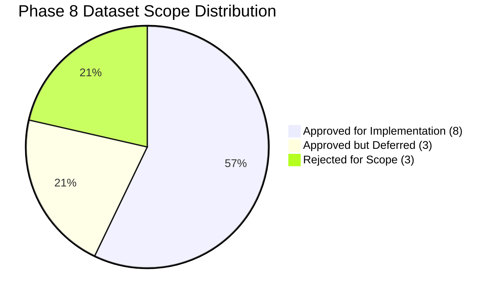

# Phase 8: Dataset Implementation Scope & Decision Rationale

## 1. Executive Summary

This document establishes the definitive dataset implementation scope for **Phase 8: Data Ingestion and Processing Pipeline**. Re-evaluating the candidate inventory from Phase 3 ([dataset-inventory.md](file:///Users/kazi/Projects/RITUCAST/docs/data/dataset-inventory.md), [initial-dataset-stack.md](file:///Users/kazi/Projects/RITUCAST/docs/data/initial-dataset-stack.md)) and the agronomic requirements from Phase 4 ([crop-and-regional-context.md](file:///Users/kazi/Projects/RITUCAST/docs/science/crop-and-regional-context.md)), each source is classified into a strict implementation category with explicit access parameters, variable catalogs, physical limits, and fallback pathways.

---

## 2. Dataset Implementation Classification Matrix

| Source ID | Source Name | Provider | Classification | Access Method | Role in Initial Pipeline |
| :--- | :--- | :--- | :---: | :--- | :--- |
| **`DATA-MET-01`** | **NASA POWER Agrometeorology** | NASA Langley | **Approved for Implementation** | REST JSON API | Daily atmospheric forcing ($T_{\text{max}}, T_{\text{min}}, R_s, RH, u_2$) for FAO-56 $ET_0$. |
| **`DATA-FCST-01`** | **Open-Meteo Weather Forecast** | Open-Meteo / ECMWF / GFS | **Approved for Implementation** | REST JSON API | 7-day hourly & daily rainfall probability, rain amount ($mm$), temp extremes. |
| **`DATA-PCP-01`** | **GPM IMERG Precipitation (V07)** | NASA GES DISC / GSFC | **Approved for Implementation** | CMR OData / GeoTIFF / NetCDF | Early Run transboundary Meghalaya catchment rain & Final Run rolling 7d anomalies. |
| **`DATA-SAR-01`** | **Sentinel-1 C-Band SAR GRD** | ESA CDSE | **Approved for Implementation** | CDSE OData REST API | Cloud-penetrating radar backscatter ($\sigma^\circ$) & surface water inundation in Haor. |
| **`DATA-SMC-01`** | **SMAP Enhanced L3 9km Soil Moisture** | NASA JPL / NSIDC | **Approved for Implementation** | Earthdata CMR / HDF5 / NetCDF | Regional topsoil (0–5cm) volumetric moisture anomaly in High Barind Tract. |
| **`DATA-BND-01`** | **Bangladesh Upazila Boundaries** | BBS / HDX | **Approved for Implementation** | Local GeoJSON / WGS84 | Vector polygon geometries for 495 Upazilas (focus on 4 pilot testbeds). |
| **`DATA-AGR-01`** | **BRRI/BARI Phenology & $K_c$ Tables** | BRRI / BARI / DAE | **Approved for Implementation** | Curated JSON / Parquet | Crop coefficients ($K_c$) and thermal duration for Boro rice varieties. |
| **`DATA-HYD-01`** | **BWDB FFWC River Stage Gauge Logs** | BWDB FFWC | **Approved for Implementation** | Web Bulletin / Tabular CSV | Surma/Kushiyara observed water level (m PWD) vs danger level. |
| **`DATA-VEG-01`** | **MODIS 250m 16-Day NDVI (`MOD13Q1`)** | NASA LP DAAC | **Approved but Deferred** | LP DAAC AppEEARS | Deferred to Phase 12; clouded during monsoon; dry-season vegetation benchmarking. |
| **`DATA-YLD-01`** | **BBS Agricultural Yearbook Statistics** | BBS | **Approved but Deferred** | Annual Census PDF / CSV | Deferred to Phase 9/13; annual district aggregates with 1–2 year lag. |
| **`DATA-OPT-01`** | **Sentinel-2 MSI Level-2A** | ESA CDSE | **Approved but Deferred** | CDSE OData | Deferred to Phase 12; 80–90% cloud cover during monsoon; massive scene volume. |
| **`DATA-REJ-01`** | **CROP-CASMA Platform** | USDA NASS | **Rejected** | N/A | US-only (CONUS) tool; zero coverage in Bangladesh. |
| **`DATA-REJ-02`** | **Crop Micro-Insurance Claims** | Commercial Insurers | **Rejected** | N/A | Proprietary, commercially restricted; outside daily farmer decision support. |
| **`DATA-REJ-03`** | **Farmer Loan Repayment Logs** | Microfinance Institutions | **Rejected** | N/A | Confidential financial data; violates zero-PII privacy mandate (`NFR-SEC-01`). |

---

## 3. Detailed Parameter Catalog for Approved Datasets

### 3.1 `DATA-MET-01`: NASA POWER Daily Agrometeorology
- **Endpoint**: `https://power.larc.nasa.gov/api/temporal/daily/point`
- **Community**: `AG` (Agroclimatology)
- **Requested Variables & Units**:
  - `T2M`: Temperature at 2 Meters ($^\circ\text{C}$)
  - `T2M_MAX`: Maximum Temperature at 2 Meters ($^\circ\text{C}$)
  - `T2M_MIN`: Minimum Temperature at 2 Meters ($^\circ\text{C}$)
  - `ALLSKY_SFC_SW_DWN`: All Sky Surface Shortwave Downward Irradiance ($\text{MJ}/\text{m}^2/\text{day}$)
  - `RH2M`: Relative Humidity at 2 Meters ($\%$)
  - `WS2M`: Wind Speed at 2 Meters ($\text{m}/\text{s}$)
  - `PRECTOTCORR`: Precipitation Corrected ($\text{mm}/\text{day}$)
- **Resolution**: $0.5^\circ \times 0.625^\circ$ global grid (~50km).
- **Latency & Refresh**: T+24 to T+48 hours daily update.
- **Physical Bounds**: Temp: $-5$ to $55^\circ\text{C}$; Solar: $0$ to $35\text{ MJ}/\text{m}^2/\text{day}$; RH: $0$ to $100\%$; Wind: $0$ to $40\text{ m}/\text{s}$; Rain: $0$ to $500\text{ mm}$.
- **Fallback Pathway**: If NASA POWER times out, derive $ET_0$ via Hargreaves-Samani method using Open-Meteo $T_{\text{max}}, T_{\text{min}}$ with an automated epistemic confidence penalty.

---

### 3.2 `DATA-FCST-01`: Open-Meteo Operational NWP Ensemble Forecasts
- **Endpoint**: `https://api.open-meteo.com/v1/forecast`
- **Models**: `ecmwf_ifs025` (0.25° ECMWF), `gfs_seamless` (0.25° NOAA GFS).
- **Requested Variables & Units**:
  - `precipitation_probability` ($\%$, hourly 0–100)
  - `precipitation` ($\text{mm}$, hourly and daily sum)
  - `temperature_2m` ($^\circ\text{C}$)
  - `temperature_2m_max`, `temperature_2m_min` ($^\circ\text{C}$)
  - `relative_humidity_2m` ($\%$)
  - `wind_speed_10m` ($\text{km}/\text{h}$ or $\text{m}/\text{s}$)
- **Resolution**: $0.25^\circ \times 0.25^\circ$ (~28km over Bangladesh).
- **Latency & Refresh**: Updated 4 times daily (00, 06, 12, 18 UTC).
- **Physical Bounds**: Rain Prob: $0$ to $100\%$; Rain: $0$ to $300\text{ mm}/\text{day}$; Temp: $5$ to $50^\circ\text{C}$.
- **Fallback Pathway**: Primary ECMWF model falls back to GFS; if Open-Meteo is unavailable, serve cached 24h forecast marked with stale warning badge (`ST-03`).

---

### 3.3 `DATA-PCP-01`: GPM IMERG Precipitation (V07)
- **Catalogs**: NASA GES DISC CMR OData / Earthdata.
- **Collections**:
  - `GPM_3IMERGDE` (Early Run, <6h latency, transboundary catchment warning).
  - `GPM_3IMERGDF` (Final Run, calibrated multi-satellite + gauge).
- **Spatial Domain**:
  - National Bounding Box: $88.0^\circ–92.8^\circ\text{E}, 20.5^\circ–26.7^\circ\text{N}$.
  - Meghalaya Transboundary Catchment: $90.0^\circ–92.8^\circ\text{E}, 25.0^\circ–26.2^\circ\text{N}$.
- **Resolution**: $0.1^\circ \times 0.1^\circ$ (~10km) half-hourly and daily.
- **Physical Bounds**: Rainfall: $0.0$ to $600.0\text{ mm}/\text{day}$. Negative values rejected.
- **Fallback Pathway**: If GPM API is delayed, fall back to Open-Meteo historical reanalysis or BMD border station telemetry.

---

### 3.4 `DATA-SAR-01`: Copernicus Sentinel-1 C-Band SAR GRD
- **Provider**: European Space Agency (ESA) Copernicus Data Space Ecosystem (CDSE).
- **Product Type**: Level-1 Ground Range Detected (GRD), Interferometric Wide (IW) swath.
- **Polarizations**: VV (vertical transmit/vertical receive) + VH (cross-polarized).
- **Resolution**: $10\text{m} \times 10\text{m}$ spatial pixel resolution.
- **Revisit Frequency**: 6 to 12 days over Haor basin (Sunamganj).
- **Target Variable**: Radar backscatter intensity ($\sigma^\circ$ in dB) and binary water mask ($<-14\text{ dB}$ threshold).
- **Physical Bounds**: Backscatter: $-35\text{ dB}$ to $+5\text{ dB}$.
- **Fallback Pathway**: If SAR pass is between cycles, hydrologic warning model couples upstream GPM rainfall with BWDB gauge surges.

---

### 3.5 `DATA-SMC-01`: SMAP Enhanced L3 9km Radiometer Soil Moisture (`SPL3SMP_E`)
- **Provider**: NASA JPL / NSIDC DAAC.
- **Product**: Daily composite on EASE-Grid 2.0 (9km grid cell).
- **Target Variable**: Surface soil moisture in top 0–5 cm ($\text{m}^3/\text{m}^3$ volumetric water content).
- **Resolution**: 9km EASE-Grid 2.0.
- **Physical Bounds**: Volumetric soil moisture: $0.02$ to $0.55\text{ m}^3/\text{m}^3$. Quality flag `retrieval_qual_flag == 0` (recommended quality).
- **Limitation Guardrail**: Must be labelled as *regional macro-drought indicator* for Barind upland soils, not sub-acre flooded paddy status (`RSK-13`).

---

### 3.6 `DATA-BND-01`: Bangladesh Administrative Boundaries (Level 0–3)
- **Source**: BBS / Survey of Bangladesh / UN OCHA HDX verified baseline.
- **Format**: GeoJSON in EPSG:4326 (WGS84).
- **Key Fields**: `division_id`, `division_name`, `district_id`, `district_name`, `upazila_id`, `upazila_name`, `upazila_name_bn`, `geometry`.
- **Target Pilot Upazilas**:
  - `BD-50-20-30`: Godagari (Rajshahi District, High Barind Tract)
  - `BD-50-20-90`: Tanore (Rajshahi District, High Barind Tract)
  - `BD-60-90-86`: Sunamganj Sadar (Sunamganj District, Haor Basin)
  - `BD-60-90-89`: Tahirpur (Sunamganj District, Haor Basin)

---

### 3.7 `DATA-AGR-01`: BRRI/BARI Phenology & Crop Coefficient Tables
- **Source**: Bangladesh Rice Research Institute (BRRI) & Bangladesh Agricultural Research Institute (BARI).
- **Anchor Crop**: Boro Rice (*Oryza sativa L.*). Varieties: BRRI dhan28, BRRI dhan29, BRRI dhan89, Banglamati.
- **Target Variables**: Thermal durations (GDD in $^\circ\text{C}\cdot\text{day}$), stage days, stage-specific crop coefficients ($K_{c,\text{ini}}, K_{c,\text{mid}}, K_{c,\text{end}}$), root-zone depths ($Z_r$), allowable depletion fractions ($p$).
- **Format**: Structured JSON / Relational Lookup.

---

### 3.8 `DATA-HYD-01`: BWDB FFWC River Stage & Flood Gauge Network
- **Source**: Bangladesh Water Development Board (BWDB) Flood Forecasting and Warning Centre (FFWC).
- **Target Gauge Stations**:
  - Station 177: Surma River at Sunamganj (Danger Level = $8.25\text{ m PWD}$)
  - Station 178: Surma River at Chhatak (Danger Level = $10.95\text{ m PWD}$)
  - Station 139: Kushiyara River at Sheola (Danger Level = $13.05\text{ m PWD}$)
- **Target Variables**: Hourly/Daily Observed Water Level (OWL in $\text{m PWD}$), Danger Level (DL), 24h Rate of Rise ($\Delta H/\Delta t$).
- **Physical Bounds**: Water level: $0.0$ to $25.0\text{ m PWD}$. Rate of rise: $-3.0$ to $+5.0\text{ m}/\text{day}$.
