# Phase 8: Data Pipeline Architecture & Component Topology

## 1. Executive Summary & Flow Topology

The Ritucast data pipeline implements a modular, resilient, and traceable data pipeline engineered specifically for the agro-climatic realities of Bangladesh. Conforming to Phase 5 architecture decisions ([system-architecture.md](file:///Users/kazi/Projects/RITUCAST/docs/architecture/system-architecture.md), [ADR-09](file:///Users/kazi/Projects/RITUCAST/docs/architecture/decisions/ADR-09-celery-scheduled-ingestion.md)), the pipeline strictly decouples ingestion, validation, spatial/temporal transformation, and feature publication.

```mermaid
flowchart TD
    subgraph Sources [1. Upstream Data Providers]
        S1[NASA POWER REST API]
        S2[Open-Meteo Ensemble API]
        S3[GPM IMERG GES DISC]
        S4[ESA CDSE Sentinel-1 OData]
        S5[SMAP NSIDC DAAC]
        S6[BWDB River Gauge Telemetry]
        S7[BBS Admin GeoJSON]
        S8[BRRI Phenology Tables]
    end

    subgraph Ingestion [2. Ingestion Adapters]
        I1[nasa_power.py]
        I2[open_meteo.py]
        I3[gpm_imerg.py]
        I4[sentinel1_sar.py]
        I5[smap_soil_moisture.py]
        I6[hydrology_ffwc.py]
        I7[administrative.py]
        I8[agronomic_reference.py]
    end

    subgraph StorageRaw [3. Raw / Interim Storage]
        R1[(data/raw/<dataset>/<date>/)]
    end

    subgraph Validation [4. Schema & Data-Quality Validation]
        V1[schema_validator.py: Pydantic v2 Types & Schemas]
        V2[semantic_validator.py: Physical Bounds & Sanity Checks]
        V3[quality_reporter.py: Completeness & Fill-Value Audit]
    end

    subgraph Processing [5. Spatial & Temporal Processing]
        P1[spatial.py: EPSG:4326 Reprojection & Upazila Zonal Intersect]
        P2[temporal.py: Daily Resampling, Rolling Climatology & GDD Integration]
    end

    subgraph FeaturePrep [6. Feature Preparation & Publication]
        F1[feature_prep.py: Analytical Feature Tables Parquet/JSON]
    end

    subgraph Provenance [7. Provenance & Handoff]
        M1[provenance.py: SHA-256 Checksums, Run Manifests & Metadata]
        OUT[(Phase 9 Input Catalog: data/processed/)]
    end

    Sources --> Ingestion
    Ingestion --> StorageRaw
    StorageRaw --> Validation
    Validation --> Processing
    Processing --> FeaturePrep
    FeaturePrep --> Provenance
    Provenance --> OUT
```

---

## 2. Component Responsibilities & Boundaries

### 2.1 Ingestion Layer (`pipelines/ingestion/`)
- **Responsibility**: Connects to external upstream APIs and local reference archives.
- **Key Invariants**:
  - Encapsulates provider-specific HTTP headers, query parameters, query chunking, and pagination.
  - Implements client-side rate-limiting (`RateLimiter`) respecting service constraints (e.g., 30 requests/min for NASA POWER).
  - Handles transient network failures via exponential backoff (max 3 retries, base delay 1.0s).
  - Emits immutable raw response payloads to `data/raw/` with full response headers and capture timestamps.
  - Never logs credentials, API keys, or personal tokens (`NFR-SEC-01`).

### 2.2 Validation Layer (`pipelines/validation/`)
- **Responsibility**: Gatekeeper ensuring corrupted, schema-drifted, or physically absurd records never enter the analytical pipeline.
- **Two-Tier Validation Gate**:
  1. *Structural Validation*: Pydantic v2 schemas validating record field existence, types, ISO-8601 timestamps, and coordinate bounds.
  2. *Semantic Validation*: Physical boundary checks parameterized by scientific ranges approved in Phase 4 Table 2 (e.g., rejecting negative rainfall, solar radiation $>35\text{ MJ}/\text{m}^2/\text{day}$).
- **Missing Data Handling**: Fill values (`-999.0`, `NaN`, `null`) are explicitly mapped to typed missingness representations; missing environmental observations are never silently converted to zero.
- **Artifacts**: Generates machine-readable `quality_report.json` and human-readable `quality_report.md` for each batch run.

### 2.3 Spatial Processing Layer (`pipelines/processing/spatial.py`)
- **Responsibility**: Standardizes all spatial geometries to WGS84 (EPSG:4326), validates administrative boundaries, and calculates zonal statistics.
- **Operations**:
  - Loads official Bangladesh Upazila polygon geometries (`DATA-BND-01`).
  - Implements bounding box filtering and Shapely polygonal intersection.
  - Computes zonal aggregations (spatial mean, max, sum) for pilot testbeds:
    - High Barind Tract: Godagari (`BD-50-20-30`), Tanore (`BD-50-20-90`).
    - Haor Basin: Sunamganj Sadar (`BD-60-90-86`), Tahirpur (`BD-60-90-89`).
  - Computes Meghalaya transboundary upstream catchment rainfall ($90.0^\circ–92.8^\circ\text{E}, 25.0^\circ–26.2^\circ\text{N}$).
  - Strictly preserves original sensor resolution metadata, attaching coarse-grid disclaimers to prevent false micro-precision (`RSK-03`).

### 2.4 Temporal Processing Layer (`pipelines/processing/temporal.py`)
- **Responsibility**: Aligns heterogeneous satellite revisits (daily, half-hourly, 6–12 day SAR) into consistent analytical observation frames.
- **Operations**:
  - Reconciles UTC observation timestamps with Bangladesh Standard Time (BST, UTC+6).
  - Daily temporal resampling: rainfall sums, temperature extrema ($T_{\text{max}}, T_{\text{min}}$), daily mean humidity and solar radiation.
  - Rolling accumulation: 24h, 48h, and 7-day cumulative rainfall metrics ($P_{\text{cum}}$).
  - Missing period auditing: Identifies gaps and marks temporal coverage flags.
  - Phenological time tracking: Computes Growing Degree Days ($\text{GDD} = \max(0, \frac{T_{\text{max}}+T_{\text{min}}}{2} - T_{\text{base}})$) for Boro rice varieties.

### 2.5 Feature Preparation Layer (`pipelines/processing/feature_prep.py`)
- **Responsibility**: Assembles clean, typed analytical tables (Parquet and JSON) designed as direct inputs for Phase 9.
- **Boundary Rule**: Does **not** compute Phase 9 derived indicators (e.g. FAO-56 Penman-Monteith $ET_0$, Soil Deficit $D_t$, Haor Flash-Flood Index $I_{\text{flood}}$) or recommendation rules. Emits clean forcing variables ready for scientific modeling.

### 2.6 Provenance & Manifest Ledger (`pipelines/common/provenance.py`)
- **Responsibility**: Guarantees end-to-end scientific auditability and reproducibility.
- **Manifest Fields**: UUID run ID, execution timestamp, Git commit SHA, dataset versions, query bounding boxes, source URLs, file SHA-256 checksums, validation summary, and output record counts.
