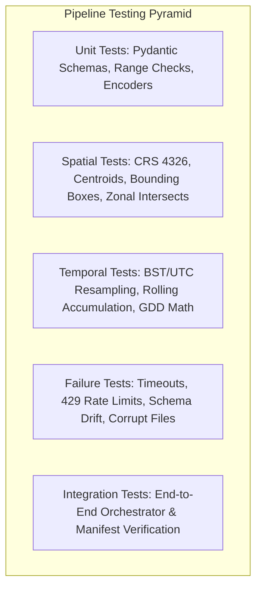

# Phase 8: Data Pipeline Testing Strategy & Test Suite Specification

## 1. Executive Summary & Testing Pyramid

The Ritucast data pipeline employs a multi-tier testing strategy designed to verify software correctness, spatial geometry, temporal aggregation math, network failure recovery, and scientific range safety without requiring continuous live internet connections.



---

## 2. Test Suite Architecture & Directory Layout

```text
tests/
├── conftest.py                   # Shared pytest fixtures, sample JSON loaders
├── unit/
│   ├── test_schema_validator.py  # Pydantic v2 field types, ISO dates, coordinate ranges
│   ├── test_semantic_validator.py# Physical limits: rain bounds, temperature, solar insolation
│   ├── test_quality_reporter.py  # Record acceptance counts, missingness auditing
│   └── test_rate_limiter.py      # Token-bucket / interval rate limiter behavior
├── spatial/
│   ├── test_crs_and_domains.py   # WGS84 coordinate bounds, Meghalaya catchment box
│   ├── test_upazila_polygons.py  # GeoJSON loading, pilot Upazila centroid lookups
│   └── test_zonal_aggregation.py # Point-in-polygon assignment, spatial mean calculations
├── temporal/
│   ├── test_timezone_align.py    # BST (UTC+6) vs UTC day boundary conversion
│   ├── test_rolling_windows.py   # 24h, 48h, 7d cumulative precipitation math
│   └── test_gdd_phenology.py     # Rice base-10°C Growing Degree Day accumulation
├── failure/
│   ├── test_network_retry.py     # Mocked HTTP 500/503 errors and backoff behavior
│   ├── test_rate_limit_429.py    # Mocked HTTP 429 response handling
│   ├── test_corrupt_payload.py   # Malformed JSON, truncated streams, missing mandatory keys
│   └── test_physical_violations.py# Negative rain, impossible 75°C temperature rejections
└── integration/
    ├── test_ingestion_adapters.py# Ingestion adapters parsing mock fixtures
    ├── test_feature_prep.py      # Conversion from validated inputs to Parquet feature tables
    └── test_orchestrator_e2e.py  # End-to-end dry run and fixture pipeline execution
```

---

## 3. Mocking & Synthetic Fixture Strategy

In strict adherence to testing best practices, routine CI/CD and local development tests **never make live network calls** to NASA, Open-Meteo, or ESA.

- **Synthetic Fixtures**: Stored in `data/sample/`:
  - `nasa_power_sample.json`: Realistically formatted point response for Godagari.
  - `open_meteo_sample.json`: Multi-model hourly forecast for Sunamganj.
  - `gpm_imerg_sample.json`: Daily precipitation records for transboundary catchment.
  - `sentinel1_metadata_sample.json`: CDSE OData product metadata with backscatter stats.
  - `smap_sample.json`: 9km volumetric soil moisture observations.
  - `bangladesh_pilot_upazilas.geojson`: Precise polygon boundaries for the 4 pilot Upazilas.
  - `brri_phenology_boro.json`: Verified BRRI crop duration and $K_c$ tables.
  - `bwdb_gauge_sample.json`: River water level series for Surma River at Sunamganj.
- **Network Mocking**: Implemented via `unittest.mock` patching `requests.Session.get` or custom mock adapters.

---

## 4. Test Execution & Pass Criteria

```bash
# Execute entire test suite with coverage
python3.10 -m pytest tests/ -v
```

### Mandatory Pass Criteria
1. **Pass Rate**: $100\%$ of automated tests must pass.
2. **Schema Coverage**: Every implemented dataset must have structural and semantic tests.
3. **Execution Speed**: Full test suite must execute in $<10\text{ seconds}$ locally.
4. **Deterministic**: Zero test flakiness or dependence on external network states.
