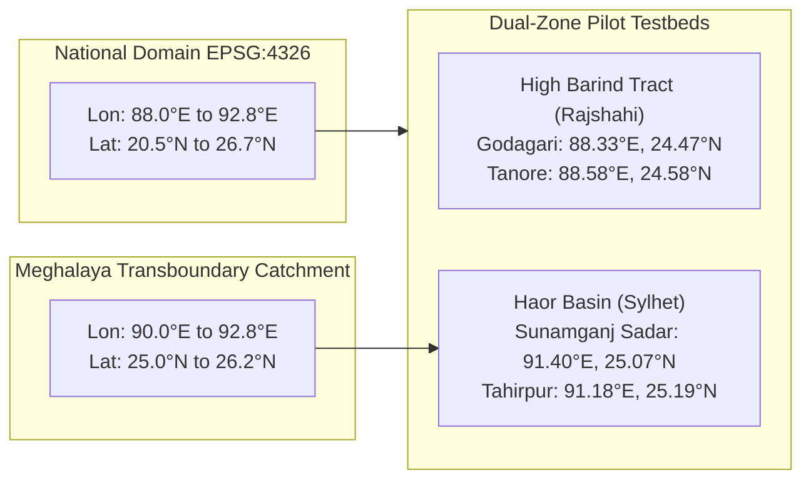

# Phase 8: Spatial Processing Specification

## 1. Executive Summary & Coordinate Standards

Spatial processing in Ritucast reconciles satellite pixel grids (from 10m Sentinel-1 to 50km NASA POWER) with administrative decision units (Upazilas and Unions). 

- **Target Coordinate Reference System (CRS)**: **WGS84 (EPSG:4326)** — Standard Geographic Lat/Lon.
- **Projected Planar Calculations (Area/Buffering)**: **BTM / Gulshan 303 (EPSG:3106)** — Bangladesh Transverse Mercator (used when metric distance or area weighting is required).
- **Transformation Tooling**: Pure Python via `shapely` (v2.1+) geometry operations, GeoJSON vector handling, and mathematical polygon centroid/bounding box queries.

---

## 2. Spatial Domains & Bounding Boxes

### Official Domain Coordinates
1. **National Bangladesh Bounding Box**:
   - $\text{Min Lon} = 88.0^\circ\text{E}, \quad \text{Min Lat} = 20.5^\circ\text{N}$
   - $\text{Max Lon} = 92.8^\circ\text{E}, \quad \text{Max Lat} = 26.7^\circ\text{N}$
2. **Meghalaya Upstream Transboundary Catchment** (Pre-monsoon runoff feeder for Haor basin):
   - $\text{Min Lon} = 90.0^\circ\text{E}, \quad \text{Min Lat} = 25.0^\circ\text{N}$
   - $\text{Max Lon} = 92.8^\circ\text{E}, \quad \text{Max Lat} = 26.2^\circ\text{N}$
   - Area: $\sim 14,200\text{ km}^2$ covering southern Meghalaya hills draining into the Surma-Kushiyara basin.

---

## 3. Pilot Upazila Centroids & Spatial Geometries

| Upazila ID | Upazila Name | District | Division | Pilot Zone | Centroid (Lon, Lat) | Area ($\text{km}^2$) | Primary Risk Phenomenon |
| :--- | :--- | :--- | :--- | :--- | :---: | :---: | :--- |
| `BD-50-20-30` | **Godagari** | Rajshahi | Rajshahi | High Barind Tract | $(88.3315^\circ\text{E}, 24.4682^\circ\text{N})$ | $472.1$ | Groundwater drought, AWD deficit |
| `BD-50-20-90` | **Tanore** | Rajshahi | Rajshahi | High Barind Tract | $(88.5786^\circ\text{E}, 24.5831^\circ\text{N})$ | $295.4$ | Groundwater drought, AWD deficit |
| `BD-60-90-86` | **Sunamganj Sadar** | Sunamganj | Sylhet | Haor Basin | $(91.4034^\circ\text{E}, 25.0682^\circ\text{N})$ | $268.5$ | Flash-flood river surge, Boro submergence |
| `BD-60-90-89` | **Tahirpur** | Sunamganj | Sylhet | Haor Basin | $(91.1768^\circ\text{E}, 25.1947^\circ\text{N})$ | $315.3$ | Escarpment cloudburst, Tanguar Haor flooding |

---

## 4. Spatial Aggregation & Zonal Operations

### 4.1 Point & Grid-to-Polygon Zonal Aggregation
For gridded products (NASA POWER 50km, Open-Meteo 28km, GPM IMERG 10km, SMAP 9km), the pipeline performs **polygon intersection and zonal averaging**:

$$\bar{V}_{\text{upazila}} = \frac{1}{\sum w_i} \sum_{i=1}^{N} w_i \cdot V_i$$

Where:
- $V_i$ is the value of grid cell or sampling point $i$.
- $w_i$ is the intersection weight (or area overlap fraction) between grid cell $i$ and the Upazila polygon $P$.
- For coarse grids where an Upazila falls entirely within a single pixel (e.g. NASA POWER $0.5^\circ$), $\bar{V}_{\text{upazila}} = V_{\text{centroid}}$, taking the interpolated point value at the official administrative centroid.

### 4.2 Upstream Catchment Zonal Integration
For the Haor Flash-Flood Early Warning system, the transboundary catchment precipitation index ($P_{\text{cat}}$) is computed by spatially integrating GPM IMERG grid cells across the Meghalaya catchment polygon:

$$P_{\text{cat}}(t) = \frac{1}{A_{\text{cat}}} \iint_{\Omega_{\text{cat}}} P(x, y, t) \, dA \approx \frac{1}{M} \sum_{k=1}^{M} P_k(t)$$

Where $M$ is the number of valid $0.1^\circ$ GPM grid points covering the Meghalaya steep escarpment domain.

### 4.3 Coarse Resolution Scientific Guardrail (`RSK-03`, `DEC-08`)
- Every aggregated record in the analytical dataset includes a mandatory field `spatial_resolution_km` (e.g., `50.0` for NASA POWER, `10.0` for GPM, `9.0` for SMAP).
- The pipeline explicitly forbids upsampling or interpolating coarse satellite rasters to sub-acre farm parcels. Outputs are strictly labelled as **Regional Upazila Areal Indicators**.
