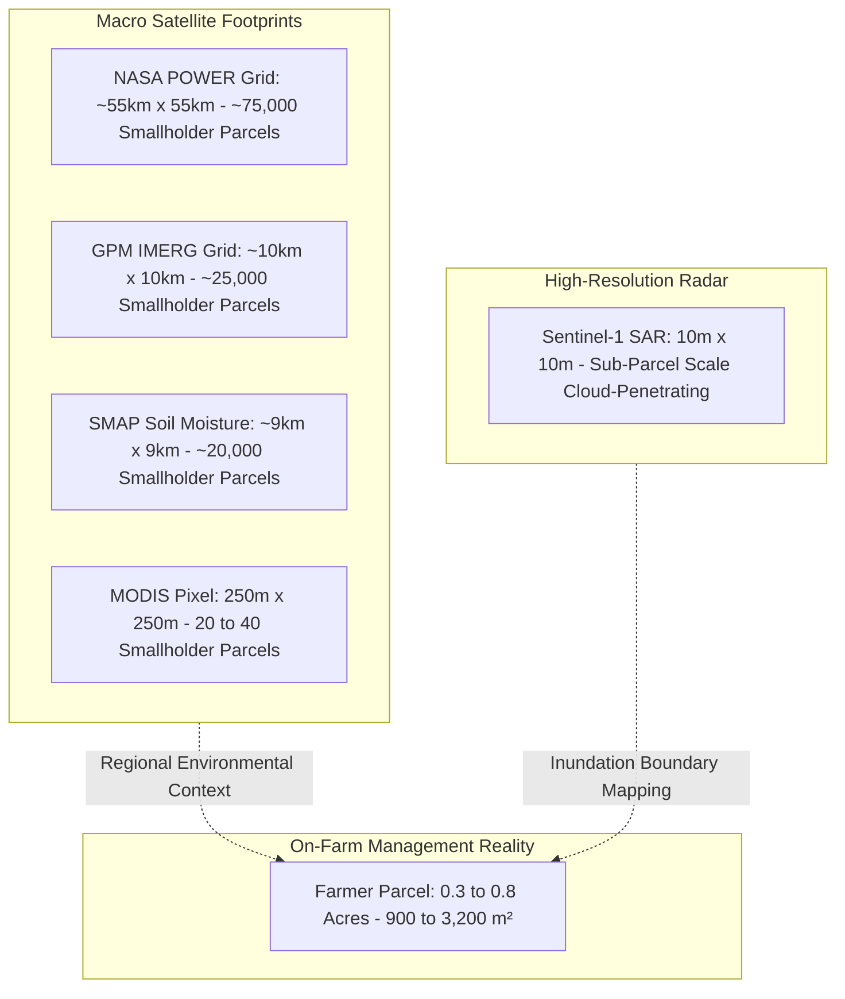

# Ritucast: Spatial and Temporal Aggregation Requirements

## 1. Spatial Resolution Realities in Bangladesh Agriculture

### The Smallholder Landscape and the Mixed-Pixel Problem
In Bangladesh, net cultivable land is divided among millions of smallholder farming families, with an average field plot measuring between $0.2\text{ to }0.8\text{ acres}$ ($\approx 800 - 3,200\text{ m}^2$). Within a single village, adjacent plots cultivate diverse varieties (e.g., short-duration BRRI dhan28 next to long-duration BRRI dhan29), manage differing irrigation dates, and maintain varying bund heights.

This fragmented agrarian reality creates a fundamental **scale mismatch** when compared with Earth observation satellite footprints:

### The Anti-False-Precision Principle
> **Scientific Rule**: Resampling, bilinearly interpolating, or upsampling a coarse raster (e.g., SMAP 9km or IMERG 10km) to a finer grid (e.g., 10m or 30m) produces a visually smoother image, but **creates zero new independent observational detail**. 

Ritucast strictly adheres to the following aggregation constraints:
1. Coarse satellite variables (SMAP soil moisture, IMERG rain, POWER weather) are computed and presented strictly at the **Upazila and Union administrative level** as **regional environmental baselines**.
2. The platform will **never display individual-field plot boundaries overlaid with coarse radiometer pixels**, as doing so falsely implies that an 800-meter sensor is reading an individual farmer's 30-meter vegetable bed.

---

## 2. Spatial Aggregation Methodology: Raster to Upazila Vector

To translate gridded Earth observations into administrative decision units for the 495 Upazilas of Bangladesh, Ritucast applies standardized zonal aggregation protocols:

### 1. Area-Weighted Zonal Mean (Standard for IMERG & SMAP)
For continuous physical variables spanning multiple grid cells across an Upazila polygon:

$$\bar{V}_{\text{Upazila}} = \frac{\sum_{i=1}^{N} (V_i \times A_i)}{\sum_{i=1}^{N} A_i}$$

Where $V_i$ is the value of grid cell $i$ and $A_i$ is the fractional intersection area of cell $i$ within the Upazila polygon boundary.

### 2. Upazila Centroid Bilinear Sampling (Standard for NASA POWER)
NASA POWER's $0.5^\circ$ resolution represents regional atmospheric forcing (temperature, solar radiation, humidity). Because atmospheric variables exhibit high spatial autocorrelation over flat delta plains, querying the **geometric centroid** of each Upazila via NASA POWER's API provides an optimal balance between accuracy and computational latency.

### 3. Binary Watermask Fractional Coverage (Standard for Sentinel-1 SAR)
For high-resolution Sentinel-1 radar flood mapping:
1. Calibrated backscatter $\sigma^\circ_{\text{VV}}$ is thresholded at $<-15\text{dB}$ to produce a binary watermask raster ($1 = \text{Standing Water}, 0 = \text{Land}$).
2. The **Inundated Crop Area Fraction** ($F_{\text{inundated}}$) is computed by clipping the watermask to the Upazila agricultural mask:

$$F_{\text{inundated}} = \frac{\text{Count of Inundated Crop Pixels}}{\text{Total Crop Pixels in Upazila}} \times 100\%$$

---

## 3. Temporal Aggregation & Derived Indicator Rules

Environmental observations arrive at differing temporal cadences. Ritucast standardizes these into three operational time horizons:

| Aggregation Tier | Cadence | Source Feeds | Calculation Methodology | Primary Agronomic Use |
| :--- | :--- | :--- | :--- | :--- |
| **Daily Operational** | 24-Hour Sum / Extremes | NASA POWER, Open-Meteo, IMERG | Daily $T_{\text{max}}$, $T_{\text{min}}$, cumulative rain ($mm/day$), mean wind, mean RH. | Daily 7-day forecast cards (`FR-ENV-01`), spray windows (`FR-ADV-03`). |
| **Rolling 7-Day Window** | 7-Day Rolling Sum & Anomaly | GPM IMERG, NASA POWER | $\sum_{t=-7}^{0} P_t$ compared against 10-year historical mean for the same calendar week. | 7-day rainfall anomaly gauge (`FR-ENV-02`), dry-spell moisture deficit tracking (`FR-ENV-03`). |
| **Dekadal (10-Day)** | 10-Day Rolling Mean | NASA POWER, SMAP | 10-day rolling mean of $ET_0$ and soil moisture deficit. | Calibration of FAO-56 seasonal crop water balances (`MET-SCI-03`). |

---

## 4. Missing Observation Imputation & Fallback Rules

1. **Short Gaps (1 to 2 Days)**: If a daily satellite feed (e.g., SMAP) has an orbital gap, fill using backward-looking linear temporal interpolation combined with local hydrological water balance ($P - ET_c$).
2. **Medium Gaps (3 to 5 Days)**: If an entire satellite pass is missing, fall back to the Upazila centroid's 10-year historical seasonal climatology, accompanied by an explicit "মাঝারি আস্থা" (Moderate Confidence) badge.
3. **Severe Gaps (>36 Hours for Weather Forecasts)**: If operational weather forecast feeds are unavailable for $>36\text{ hours}$, trigger **Automated Recommendation Suppression** (`DEC-10`, `NFR-REL-03`). Do not attempt forward extrapolation of outdated weather models.
