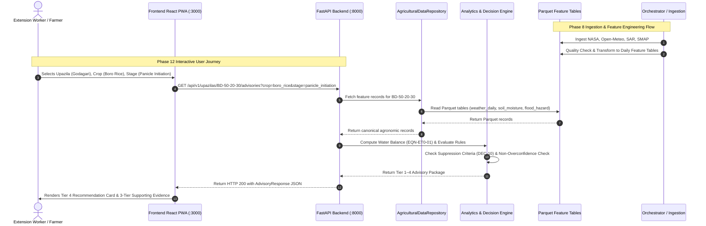

# End-to-End Data Flow — Ritucast System Integration

## 1. Traceable Data Lifecycle

Ritucast transforms distributed raw environmental signals into calibrated agronomic advisories through a five-stage lifecycle:

---

## 2. Step-by-Step Data Transformation Analysis

### Stage 1: Data Ingestion and Validation
- **Source Input**: External HTTP requests to Open-Meteo, NASA POWER, or local sample fixtures (`data/sample/`).
- **Validation**:
  - Coordinate sanity checks ($20.5^\circ\text{N} \le \text{lat} \le 26.7^\circ\text{N}$, $88.0^\circ\text{E} \le \text{lon} \le 92.7^\circ\text{E}$).
  - Temperature range $[-10^\circ\text{C}, 55^\circ\text{C}]$; Precipitation $[0\text{mm}, 500\text{mm}]$.
  - Date validation format (ISO-8601 `YYYY-MM-DD`).

### Stage 2: Feature Transformation and Storage
- **Transformer**: `FeatureTransformer` aggregates hourly weather observations into daily aggregates ($T_{\text{max}}, T_{\text{min}}, T_{\text{mean}}, \text{RH}_{\text{mean}}, U_{2}, R_s, P$).
- **Storage Artifacts**:
  - `data/processed/weather_daily.parquet`
  - `data/processed/soil_moisture_daily.parquet`
  - `data/processed/flood_hazard_daily.parquet`
  - `data/processed/crop_phenology.parquet`
- **Compression**: Snappy compression, partitioned by canonical Upazila ID.

### Stage 3: Data Access Layer (`AgriculturalDataRepository`)
- Resolves Upazila geocodes (`BD-50-20-30` for Godagari, `BD-60-90-89` for Tahirpur).
- Injects validated soil physical parameters (AEZ-26 clay loam vs AEZ-21 silt loam).
- Provides fallback to sample fixtures when live Parquet tables are being updated.

### Stage 4: Analytics and Recommendation Engine
- **FAO-56 Penman-Monteith Equation**:
  $$ET_0 = \frac{0.408 \Delta (R_n - G) + \gamma \frac{900}{T + 273} u_2 (e_s - e_a)}{\Delta + \gamma(1 + 0.34 u_2)}$$
- **Soil Water Deficit Equation**:
  $$D_{t} = D_{t-1} + ET_c - P_{\text{eff}} - I_{\text{irr}} + RO$$
- **Haor Transboundary Flood Hazard Index**:
  $$I_{\text{flood}} = 0.35 f_P + 0.30 f_S + 0.20 f_I + 0.15 f_M$$
- **Rule Selection**: Matches active stage and triggers `RULE-IRR-01` or `RULE-FLD-01`.

### Stage 5: Backend API Presentation
- Serializes response into strongly validated Pydantic models.
- Attaches data latency metadata (`data_age_hours`), confidence tiers, and scientific provenance.
- Injects mandatory Bengali field verification disclaimer (`DEC-10`).

### Stage 6: Frontend Rendering
- Consumes API JSON payload through typed `apiClient`.
- Enforces four-tier visual segregation (`DEC-08`).
- Renders responsive components with localized Bengali numerical values and typography.
