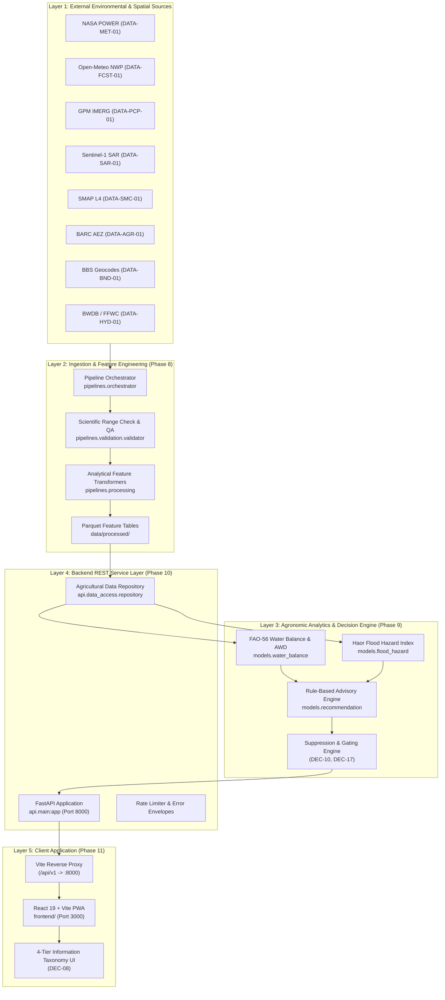

# Phase 12: System Integration Overview — Ritucast

## 1. Executive Summary

Phase 12 validates the complete end-to-end integration of **Ritucast**, an evidence-based agricultural intelligence and decision-support platform for smallholders and extension workers in Bangladesh. The platform unifies satellite observations, numerical weather predictions, and soil-moisture datasets across an unbroken, scientifically governed pipeline:

$$\text{Approved Sources} \longrightarrow \text{Pipeline Ingestion} \longrightarrow \text{Feature Tables (Parquet)} \longrightarrow \text{Analytics Engine} \longrightarrow \text{FastAPI Service} \longrightarrow \text{React PWA}$$

This document records the architectural cohesion, interface boundaries, scientific gating policies, and verification evidence established across Phases 1 through 11.

---

## 2. Integrated System Architecture

The Ritucast system operates across five core architectural layers, verified under Phase 12 testing:

---

## 3. Verified System Boundaries and Pilot Testbeds

Per project governance [AGENTS.md](file:///Users/kazi/Projects/RITUCAST/AGENTS.md) and [DEC-01](file:///Users/kazi/Projects/RITUCAST/docs/planning/decision-log.md), Ritucast enforces strict geographic bounding across two representative pilot zones in Bangladesh:

1. **High Barind Tract (AEZ-26, Rajshahi Division)**:
   - Target Upazilas: Godagari (`BD-50-20-30`), Tanore (`BD-50-20-94`).
   - Agronomic Hazard: Deep groundwater depletion, delayed monsoon, water deficit during Boro rice flowering.
   - Core Mechanism: FAO-56 Dual Crop Coefficient Alternate Wetting and Drying (AWD) irrigation scheduling (`RULE-IRR-01`).
2. **Haor Basin (AEZ-21, Sylhet Division)**:
   - Target Upazilas: Tahirpur (`BD-60-90-89`), Sunamganj Sadar (`BD-60-90-90`).
   - Agronomic Hazard: Pre-monsoon transboundary flash floods inundating mature Boro rice before harvest.
   - Core Mechanism: Multi-factor transboundary flood hazard index $I_{\text{flood}}$ and emergency harvest alert (`RULE-FLD-01`).

---

## 4. Scientific Integrity Enforcement

Phase 12 system testing verifies that all data flows respect core scientific constraints:

1. **Four-Tier Information Taxonomy (`DEC-08`)**:
   - Every system advisory is strictly segmented into Tier 1 (Empirical Observations), Tier 2 (Derived Agronomic Indicators), Tier 3 (Probabilistic Forecasts), and Tier 4 (Actionable Recommendations).
2. **Contextual Gating (`DEC-17`)**:
   - The backend rejects advisory requests missing verified Upazila ID, crop ID, and phenological stage with HTTP 422 `REQUEST_VALIDATION_ERROR`.
3. **Automated Advisory Suppression (`DEC-10`)**:
   - Advisories are automatically suppressed whenever data latency exceeds 36 hours (`NFR-REL-03`) or NWP multi-model ensemble spread exceeds 50% with rain probability between 40% and 60%.
4. **Mandatory Field Verification Copy**:
   - Advisories enforce client rendering of the mandatory anti-overconfidence field check: *"সেচ বন্ধ করার আগে জমির আইল এবং মাটির রস নিজে হাত দিয়ে পরীক্ষা করুন।"*
5. **Strict Scope Boundaries (`DEC-06`)**:
   - Zero parcel-level yield predictions, zero chemical pesticide recommendations, and zero remote tubewell actuator controls.

---

## 5. Verification Artifacts & Test Coverage Summary

- System E2E Automated Tests: [test_system_e2e.py](file:///Users/kazi/Projects/RITUCAST/tests/integration/test_system_e2e.py) (7/7 passed).
- Live Upstream API Smoke Tests: [test_live_smoke.py](file:///Users/kazi/Projects/RITUCAST/tests/integration/test_live_smoke.py) (2/2 passed).
- Frontend User Journey E2E Tests: [e2e_user_journey.test.tsx](file:///Users/kazi/Projects/RITUCAST/frontend/src/test/e2e_user_journey.test.tsx) (3/3 passed).
- Full Test Suite: 95 Python backend tests, 17 Frontend Vitest tests, 100% passing across 112 automated checks.
