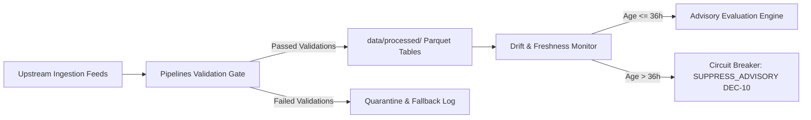

# Data Pipeline Reliability & Ingestion Runbook — Ritucast

## 1. Overview & Data Sources Architecture

Ritucast depends on an asymmetric data ingestion pipeline that transforms multi-source Earth observations and numerical weather predictions into localized, tabular feature files:
- **NASA POWER Daily Agroclimatology**: Daily solar radiation, relative humidity, temperature, and wind speed ($0.5^\circ\times 0.5^\circ$ resolution, ~24h latency).
- **Open-Meteo / ECMWF IFS / GFS Ensemble**: Hourly and daily weather forecasts (lead times 24h–168h, updated 4 times daily).
- **Copernicus Sentinel-1 SAR C-band**: Synthetic Aperture Radar surface water backscatter (~6–12 day revisit, ~2–4h processing latency).
- **BWDB / FFWC River Telemetry**: Surma River staff gauge records at Sunamganj (`Station #268`) for real-time flood cresting.

All ingested data is cleansed, validated, aggregated to Upazila polygons, and saved as columnar Parquet feature tables under `data/processed/`.

---

## 2. Ingestion Cadences & Staleness Thresholds



| Dataset Name | Ingestion Cadence | Primary Artifact | Warning Threshold | Critical Suppression Limit (`DEC-10`) |
| :--- | :--- | :--- | :--- | :--- |
| **Meteorology Daily** | Once daily at 06:00 BST | `meteorology_daily_upazila.parquet` | Age $>30.0\text{ hours}$ | **$>36.0\text{ hours}$** |
| **Hourly Forecast** | 6-hourly (00, 06, 12, 18 UTC) | `forecast_hourly_pilot.parquet` | Age $>12.0\text{ hours}$ | **$>24.0\text{ hours}$** |
| **Catchment Rainfall** | Daily at 07:00 BST | `catchment_rainfall_daily.parquet` | Age $>24.0\text{ hours}$ | **$>36.0\text{ hours}$** |
| **Hydrology River Stage**| 6-hourly (rapid Haor cycle) | `hydrology_river_stage.parquet` | Age $>8.0\text{ hours}$ | **$>18.0\text{ hours}$** |

---

## 3. Data Quality & Physical Validation Bounds

Before any record is appended to a processed Parquet table, the [`SemanticValidator`](file:///Users/kazi/Projects/RITUCAST/pipelines/validation/semantic_validator.py) audits every numerical parameter against physical boundaries:

```python
PHYSICAL_BOUNDS = {
    "temperature_c": (-5.0, 55.0),
    "precipitation_mm": (0.0, 600.0),
    "solar_rad_mj_m2": (0.0, 35.0),
    "rh_pct": (0.0, 100.0),
    "wind_speed_ms": (0.0, 45.0),
    "soil_moisture_m3_m3": (0.02, 0.60),
    "water_level_m_pwd": (0.0, 25.0),
    "backscatter_db": (-40.0, 10.0),
}
```

- **Fill-Value Detection**: Sensor fill values (`-999.0`, `-9999.0`, `9999.0`, `-1.0e30`) are intercepted and converted to `NaN` or quarantined. Missing values are never silently fabricated or filled with arbitrary constants.
- **Duplicate Detection**: The [`PipelineDriftMonitor`](file:///Users/kazi/Projects/RITUCAST/pipelines/validation/drift_monitor.py) verifies zero duplicate date/upazila composite primary keys.

---

## 4. Circuit Breakers & Automated Suppression (`DEC-10`)

The circuit breaker enforces agronomic safety when data pipelines encounter delays:
1. **Tripping Condition**:
   - Any required Parquet table is missing or 0 bytes.
   - The age of any critical meteorological table exceeds 36.0 hours.
   - Numerical weather ensemble spread exceeds 50% divergence with rain probability between 40% and 60%.
2. **Circuit Breaker Action**:
   - Sets `circuit_breaker_tripped = True`.
   - Transitions operational recommendations to `SUPPRESSED`.
   - UI renders amber fallback card instructing the farmer to inspect field soil moisture directly by hand.

---

## 5. Pipeline Recovery & Rerun Procedures

If an upstream provider (NASA POWER or Open-Meteo) experiences an outage, execute the following recovery SOP:

### Step 1: Diagnose Pipeline Health
```bash
python -c "
from pathlib import Path
from pipelines.validation.drift_monitor import PipelineDriftMonitor
report = PipelineDriftMonitor.audit_pipeline(Path('data/processed'))
print(report.to_dict())
"
```

### Step 2: Test Live Upstream Connectivity
```bash
# Verify Open-Meteo endpoint
curl -s "https://api.open-meteo.com/v1/forecast?latitude=24.40&longitude=88.33&daily=temperature_2m_max&timezone=Asia%2FDhaka" | jq .daily

# Verify NASA POWER endpoint
curl -s "https://power.larc.nasa.gov/api/temporal/daily/point?parameters=T2M,PRECTOTCORR&community=AG&longitude=88.33&latitude=24.40&start=20261001&end=20261008&format=JSON" | jq .header
```

### Step 3: Trigger Scheduled Ingestion Workflow
If upstream APIs are healthy, trigger the scheduled pipeline manually:
```bash
# Run deterministic ingestion test
pytest tests/integration/test_orchestrator_integration.py -v

# Run live smoke workflow via GitHub CLI
gh workflow run live-data-smoke.yml
```
