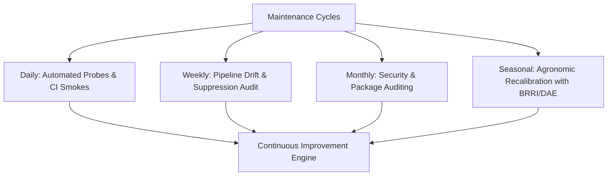
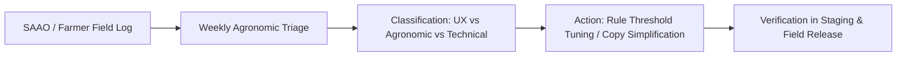

# Production Maintenance & Continuous Improvement Runbook — Ritucast

## 1. Overview & Maintenance Framework

Continuous maintenance guarantees that **Ritucast** remains scientifically credible, secure, compliant, and performant throughout seasonal changes in Bangladesh. Maintenance operations are organized across four operational cycles:
1. **Daily Automated Checks**: Real-time health probes, daily upstream smoke tests, and staleness monitoring.
2. **Weekly Operational Audits**: Data pipeline drift audits, advisory suppression rate reviews, and SAAO feedback triage.
3. **Monthly Dependency & Security Scans**: Software supply chain auditing (`pip-audit`, `npm audit`), container vulnerability patches, and Cloud Run quota reviews.
4. **Seasonal Agronomic Re-calibrations**: Post-harvest ground-truth comparisons against BMD, BWDB, and BRRI field data before entering the subsequent rice season (e.g., Aman or Aus).

---

## 2. Maintenance Cadence Schedule



| Frequency | Maintenance Task | Responsible Role | Verification Method | Action Trigger Threshold |
| :--- | :--- | :--- | :--- | :--- |
| **Daily** | Liveness, readiness, and deep diagnostic health checks | Automated Probe | `/health/deep` JSON probe | Status $\ne$ "healthy" |
| **Daily** | Live upstream public satellite API smoke check | GitHub Actions | `live-data-smoke.yml` workflow | Network failure / timeout |
| **Weekly** | Parquet feature table staleness & outlier audit | Pipeline Engineer | [`PipelineDriftMonitor`](file:///Users/kazi/Projects/RITUCAST/pipelines/validation/drift_monitor.py) | Age $>30\text{h}$ or missing values $>5\%$ |
| **Weekly** | Advisory rule firing and suppression rate review | Science Lead | Advisory log aggregation | Suppression rate $>30\%$ |
| **Monthly** | Python & Node.js dependency vulnerability scan | DevOps / Security | `pip-audit` & `npm audit` | Any High or Critical CVE |
| **Monthly** | Production container image size and bundle budget audit | Frontend Lead | `npm run build` wire size audit | Bundle wire size $>300\text{ kB}$ |
| **Seasonal** | Retrospective ground-truth benchmark comparison | Agronomist / Data Lead | [`GroundTruthValidator`](file:///Users/kazi/Projects/RITUCAST/analytics/validation/ground_truth_validator.py) | $ET_0\text{ RMSE} > 0.65\text{ mm}$ or $\text{POD} < 85\%$ |

---

## 3. Security Patching & Supply Chain SOP

When upstream CVEs are reported in application dependencies:
1. **Audit Active Packages**:
   ```bash
   pip-audit -r requirements.txt
   cd frontend && npm audit
   ```
2. **Update Pinned Versions**: Update `requirements.txt` or `package.json` to the minimum non-breaking patched version.
3. **Execute Full Deterministic Regression Suites**:
   ```bash
   pytest -m "not smoke"
   cd frontend && npm test && npm run build
   ```
4. **Trigger Staged Deployment**: Merge via pull request to `main` and execute the approval-gated GitHub Actions release workflow ([`release.yml`](file:///Users/kazi/Projects/RITUCAST/.github/workflows/release.yml)).

---

## 4. Upstream Schema Drift & Provider Outage Response

If NASA POWER, Open-Meteo, or Sentinel-1 CDSE changes an API response structure:
1. **Symptoms**: Scheduled pipeline fails; logs report Pydantic `ValidationError` or `KeyError`.
2. **Diagnosis**: Run isolated adapter tests:
   ```bash
   pytest tests/pipelines/ -v
   ```
3. **Remediation**:
   - Update the respective adapter schema under `pipelines/adapters/`.
   - Re-run validation: `pytest tests/unit/test_schema_validator.py`.
   - Replay ingestion for the current day.

---

## 5. Farmer & SAAO Feedback Integration Protocol

Feedback collected from pilot cohorts during field visits (via SAAO weekly block reports or courtyard meetings) is processed through a structured 4-step pipeline:



1. **Ingestion**: SAAO field feedback logged via standardized 5-point Likert forms ([`docs/uat/field-readiness-assessment.md`](file:///Users/kazi/Projects/RITUCAST/docs/uat/field-readiness-assessment.md)).
2. **Triage**: Weekly review by UX Lead and Agronomy Lead.
3. **Categorization**:
   - *Bengali Language Clarity*: Refine phrasing of action items or disclaimers.
   - *Agronomic Nuance*: Adjust crop growth stage date intervals or AWD drying limits.
   - *Technical Glitch*: Log in defect register with priority rating.
4. **Deployment**: Changes release through regular CI/CD gates after automated regression verification.
