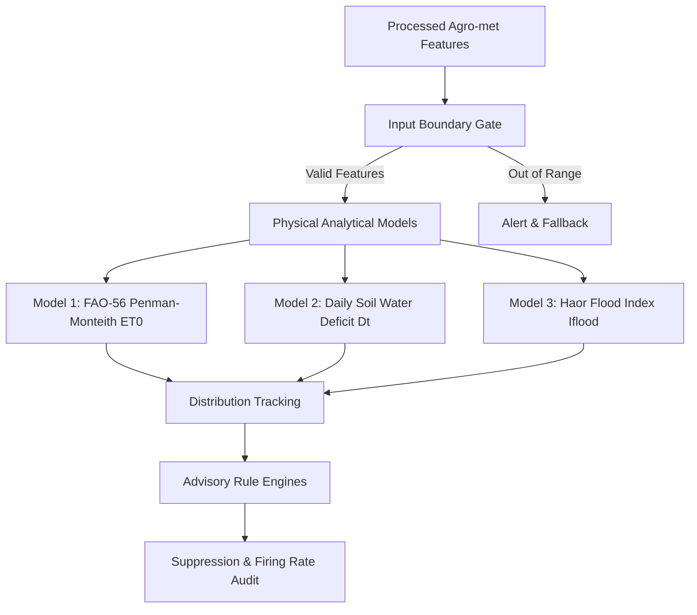

# Model & Recommendation Monitoring Specification — Ritucast

## 1. Scope & Monitoring Objectives

Ritucast operates calibrated physical agro-meteorological equations, dynamic crop coefficients ($K_c$), hydrological index composites ($I_{\text{flood}}$), and rule-based agronomic advisory engines. Although the platform strictly excludes unexplainable black-box machine learning models per `DEC-06`, its analytical models must be monitored continuously in production for:
1. **Input-Feature Boundary Compatibility**: Detecting missing, out-of-range, or corrupted environmental variables before they enter physical formulas.
2. **Output Distribution & Drift**: Tracking daily reference evapotranspiration ($ET_0$), soil water deficit ($D_t$), and flood hazard scores to identify statistical drift or calculation instability.
3. **Automated Suppression Frequency**: Auditing how often recommendations are suppressed due to high NWP ensemble spread ($>50\%$) or stale data ($>36\text{h}$) per `DEC-10`.
4. **Retrospective Ground-Truth Performance**: Evaluating simulated outputs against seasonal observation logs from BMD, BWDB, and BRRI.

---

## 2. Monitored Physical Models & Expected Parameter Distributions

### 2.1 Model Parameters & Distribution Baselines

| Model Name | Governing Equation | Primary Output Metric | Expected Physical Range | Baseline Mean (Boro Season) | Anomaly Alert Trigger |
| :--- | :--- | :--- | :--- | :--- | :--- |
| **Reference ET** | FAO-56 Penman-Monteith (`EQN-ET0-01`) | $ET_0$ (mm/day) | $1.0\text{ to }8.5\text{ mm/day}$ | $3.5\text{ to }5.2\text{ mm/day}$ | $ET_0 < 0.5$ or $>9.0\text{ mm/day}$ |
| **Soil Water Deficit** | FAO-56 Daily Balance (`EQN-SWD-01`) | $D_t$ (mm) | $0.0\text{ to }85.0\text{ mm}$ (TAW) | $15.0\text{ to }45.0\text{ mm}$ | $D_t < 0.0$ or $>85.0\text{ mm}$ |
| **Haor Flood Index** | Composite Multi-Sensor (`IDX-FLD-01`) | $I_{\text{flood}}$ (dimensionless) | $0.0\text{ to }1.0$ | Normal: $<0.20$ | Sudden jump $\Delta I > 0.40$ in $<12\text{h}$ |
| **Thermal Stress** | Heat/Cold Index (`RULE-STR-01/02`) | Hours above $35^\circ\text{C}$ or below $10^\circ\text{C}$ | $0\text{ to }24\text{ hours}$ | $0\text{ to }4\text{ hours}$ | Unseasonable spike during flowering |

---

## 3. Advisory Rule Firing Rates & Suppression Auditing

The recommendation engine evaluates five master rules (`RULE-IRR-01` through `RULE-FLD-01`). In production, rule firing frequencies are audited weekly across the two pilot testbeds:

1. **RULE-IRR-01 (Postpone Irrigation)**: Fires when $D_t < \text{RAW}$ ($42.5\text{mm}$) and 48h rain probability $\ge 60\%$. Expected firing rate: 10%–25% of Boro cycles.
2. **RULE-IRR-02 (Apply Irrigation)**: Fires when $D_t \ge \text{RAW}$ and rain probability $<40\%$. Expected firing rate: 20%–40% of Boro cycles.
3. **RULE-FLD-01 (Haor Emergency Harvest Alert)**: Fires when $I_{\text{flood}} \ge 0.70$ during dough/maturity stage. Expected firing rate: Rare emergency trigger (1–3 times per season in April).
4. **Suppression Frequency (`DEC-10`)**: If suppression exceeds **$30\%$ of total advisory requests over a rolling 7-day period**, an operational incident is opened to investigate NWP forecast instability or upstream data ingestion latency.

---

## 4. Retrospective Ground-Truth Performance Auditing

Retrospective evaluation compares model outputs with recorded ground truth:
- **BMD Rajshahi & Sylhet Stations**: Compare $ET_0$ with Class-A pan evaporation and synoptic temperature ($T_{\text{max}}, T_{\text{min}}$). Target: $\text{RMSE} \le 0.65\text{ mm/day}, R^2 \ge 0.85$.
- **BWDB Sunamganj Surma Gauge**: Compare $I_{\text{flood}}$ surges with actual river crestings. Target: $\text{POD} \ge 85\%, \text{FAR} \le 20\%$.
- **BRRI AWD Micro-Plots**: Compare $D_t$ with field tube water drops. Target: Agreement $\ge 90\%$.

All retrospective benchmarks are executed via [`analytics/validation/ground_truth_validator.py`](file:///Users/kazi/Projects/RITUCAST/analytics/validation/ground_truth_validator.py).

---

## 5. Model Maintenance & Recalibration Procedures

- **No Uncontrolled Production ML**: Ritucast does not deploy auto-retraining machine learning models that update weights dynamically without human oversight.
- **Crop Coefficient ($K_c$) Recalibration**: Recalibration of BRRI crop coefficients or soil parameters (TAW, RAW) requires formal review by an agronomist and update of `api/data_access/repository.py`.
- **Pre-Release Verification**: Any parameter update must execute the full automated test suite (`pytest -m "not smoke"`) before container deployment.
