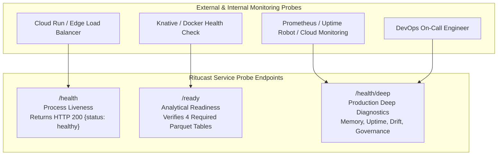

# Production Monitoring & Telemetry Specification — Ritucast

## 1. Overview & Monitoring Philosophy

Ritucast is an agricultural intelligence platform delivering localized, decision-critical advice to smallholder farmers and extension officers (SAAOs) in Bangladesh. Because untimely or incorrect farming guidance can lead to crop loss or wasted fuel expenditures, system monitoring must maintain continuous visibility into:
1. **Service Availability & Health**: Ensuring API endpoints and client applications are online and responsive.
2. **Data Pipeline Freshness**: Ensuring environmental observations from NASA, ECMWF, and BWDB are updated within the strict 36-hour safety window (`DEC-10`).
3. **Scientific Model Integrity**: Guaranteeing physical calculations ($ET_0, D_t, I_{\text{flood}}$) operate within calibrated boundaries without silent numeric degradation.
4. **Client & Infrastructure Resources**: Tracking memory, CPU, and payload constraints on Google Cloud Run and budget mobile clients (`DEC-09`).

---

## 2. Monitoring Architecture & Probe Endpoints



### 2.1 Endpoint Catalog

| Endpoint Path | Purpose | Method | Target Response Time | Success HTTP Code | Failure Action |
| :--- | :--- | :--- | :--- | :--- | :--- |
| `/health` (or `/api/v1/health`) | Process liveness check | `GET` | $<5\text{ms}$ | `200 OK` | Container restart by Cloud Run if 3 consecutive failures occur. |
| `/ready` (or `/api/v1/ready`) | Analytical dependency check | `GET` | $<20\text{ms}$ | `200 OK` (or `503 Service Unavailable`) | Traffic withheld from container until Parquet tables are mounted and verified. |
| `/health/deep` (or `/api/v1/health/deep`) | Comprehensive diagnostic probe | `GET` | $<40\text{ms}$ | `200 OK` (or `503` if critical circuit breaker tripped) | Alerts on-call engineer; identifies stale or missing data files. |

---

## 3. Service Level Indicators (SLIs) & Objectives (SLOs)

| Metric Category | Service Level Indicator (SLI) | Target SLO | Monitoring Interval | Threshold Alert Condition |
| :--- | :--- | :--- | :--- | :--- |
| **Availability** | Percentage of successful HTTP 2xx/3xx responses across all endpoints | **$\ge 99.5\%$** uptime | 1-minute window | Error rate $>1.0\%$ over 5 minutes |
| **API Latency** | 95th percentile ($P_{95}$) response duration on advisory endpoints | **$\le 150\text{ms}$** | Continuous | $P_{95} > 250\text{ms}$ over 10 minutes |
| **Data Freshness** | Maximum elapsed age of processed Parquet feature tables | **$\le 36.0\text{ hours}$** (`DEC-10`) | Hourly check | Age $>30.0\text{ hours}$ (Warning); $>36.0\text{ hours}$ (Critical Trip) |
| **Client Wire Size** | Total gzipped JavaScript and CSS payload delivered to mobile | **$\le 1500\text{ kB}$** (`DEC-09`) | Per CI build | Build bundle wire size $>300\text{ kB}$ (Warning); $>1500\text{ kB}$ (Block) |
| **Memory Footprint** | Cloud Run container RSS memory utilization | **$\le 256\text{ MB}$** | Continuous | Peak RSS $>200\text{ MB}$ (Warning); $>230\text{ MB}$ (Restart) |

---

## 4. Deep Probe (`/health/deep`) Diagnostic Fields

The `/health/deep` endpoint delivers a rich operational JSON payload:

```json
{
  "status": "healthy",
  "version": "1.0.0",
  "uptime_seconds": 3840.5,
  "system_metrics": {
    "memory_max_rss_mb": 58.4,
    "rate_limit_enabled": true,
    "payload_max_bytes": 1048576
  },
  "components": {
    "data_store": {
      "status": "ready",
      "verified_tables_count": 4,
      "missing_tables_count": 0
    },
    "analytics_engine": {
      "status": "ready",
      "fao56_penman_monteith": "CALIBRATED (EQN-ET0-01)",
      "soil_water_deficit": "CALIBRATED (EQN-SWD-01)",
      "haor_flood_hazard": "CALIBRATED (IDX-FLD-01)"
    },
    "geographic_resolver": {
      "status": "ready",
      "pilot_regions": ["High Barind Tract (AEZ-26)", "Haor Basin (AEZ-21)"],
      "pilot_upazilas_count": 4
    }
  },
  "pipeline_health": {
    "evaluated_at_utc": "2026-10-10T18:40:00Z",
    "overall_status": "HEALTHY",
    "circuit_breaker_tripped": false,
    "recommended_action": "PROCEED",
    "stale_tables_count": 0,
    "missing_tables_count": 0,
    "table_details": { ... }
  },
  "governance": {
    "context_gating": "ENFORCED (DEC-17)",
    "suppression_policy": "ACTIVE (DEC-10)",
    "pii_posture": "ZERO_PII (DEC-60)",
    "hardware_budget": "<=1.5MB wire payload (DEC-09)"
  }
}
```

---

## 5. Inspection & Verification Commands

1. **Verify Liveness**:
   ```bash
   curl -s http://localhost:8000/health | jq .
   ```
2. **Verify Readiness**:
   ```bash
   curl -s http://localhost:8000/ready | jq .
   ```
3. **Inspect Deep Diagnostics**:
   ```bash
   curl -s http://localhost:8000/health/deep | jq .
   ```
4. **Execute Automated Probe Tests**:
   ```bash
   pytest tests/monitoring/test_health_and_probes.py -v
   ```
