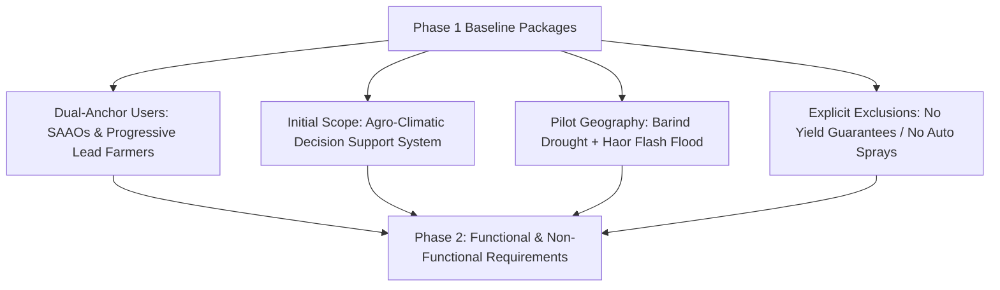

# Phase 1 to Phase 2: Project Handoff Document

## 1. Executive Summary & Purpose

- **Delivered By**: Phase 01 — Project Discovery and Problem Definition
- **Received By**: Phase 02 — Requirements and Product Strategy
- **Handoff Status**: **Ready for Phase 2 Inception (Awaiting Project Lead Review)**
- **Baseline Established**: Comprehensive discovery documentation package covering agricultural problem ranking, dual-anchor user profiles, product vision, initial scope boundaries, pilot testbeds, risk/assumption registers, and success metrics.

---

## 2. Core Baselines Handed Off to Phase 2

Phase 2 must adopt and build upon the following locked Phase 1 baselines:

1. **Target User Archetypes**:
   - Primary: DAE Frontline Extension Officers (SAAOs) and Progressive Lead Farmers / Tubewell Operators.
   - Secondary: Marginal Smallholders (reached via SAAO relay) and Haor Farmer Cooperatives.
   - *Phase 2 Action*: Develop detailed persona profiles, daily operational empathy maps, and end-to-end user journey flows.
2. **Initial Product Scope**:
   - Location-based agro-weather synthesis, SMAP/POWER crop water balance calculations (irrigation timing), and Sentinel-1/GPM flash-flood early harvest alerts.
   - *Phase 2 Action*: Break these high-level capabilities into granular functional requirements (FRs) and user stories with clear Gherkin acceptance criteria.
3. **Pilot Geography & Cropping System**:
   - Zone 1: Barind Tract (Rajshahi - Godagari/Tanore) focused on Boro rice & Rabi cash crops (irrigation water deficit).
   - Zone 2: Haor Basin (Sylhet - Sunamganj Sadar/Tahirpur) focused on Boro rice pre-monsoon flash floods.
   - *Phase 2 Action*: Map specific administrative boundaries (GeoJSON requirements), local language nuances, and seasonal calendar triggers for these pilot upazilas.
4. **Non-Functional Requirements (NFR) Constraints**:
   - Maximum initial client bundle size: $<1.5\text{MB}$.
   - Time to Interactive (TTI): $<3.5\text{s}$ on 3G cellular network.
   - Offline resilience: Must support local caching of the latest 72-hour upazila advisories.
   - Complete Bangla localization of farmer-facing text cards.

---

## 3. Prioritized Phase 2 Deliverables Checklist

When Phase 2 is formally initiated, the team must produce:
1. **User Persona Profiles & Empathy Maps**: Granular specifications for SAAO "Tariqul Islam" and Lead Farmer "Rafiqul Alam".
2. **User Journey Maps**: Step-by-step user interaction blueprints for the "Dry-Spell Irrigation Check" and "Haor Flash Flood Emergency Warning" flows.
3. **Comprehensive Functional Requirements Specification (FRS)**: Complete breakdown of data querying, advisory rules engine, explainability drawer, and user settings.
4. **Non-Functional Requirements (NFR) Baseline**: Latency, accessibility, browser compatibility (Chrome Android 80+), and security specifications.
5. **Phase 2 Validation Report & Handoff to Phase 3** (Dataset Research and Validation).

---

## 4. Open Questions & Prerequisites Requiring User Approval

Before initiating Phase 2, the project owner should review and confirm the following strategic decisions:
- [ ] **Confirmation of the Dual-Zone Pilot Selection**: Confirmation that focusing initial detailed calibration on Rajshahi (Barind) and Sunamganj (Haor) aligns with business and institutional goals.
- [ ] **Confirmation of Scope Exclusions**: Confirmation of the formal exclusion of farm-level yield predictions and direct automated pesticide recommendations from the initial product scope.
- [ ] **Formal Approval to Begin Phase 2**: Confirmation that Phase 1 acceptance criteria are satisfied and Phase 2 may commence.

---

## 5. Traceability Links to Phase 1 Artifacts

- [Project Overview](file:///Users/kazi/Projects/RITUCAST/docs/project/project-overview.md)
- [Problem Definition & Ranked Inventory](file:///Users/kazi/Projects/RITUCAST/docs/project/problem-definition.md)
- [Target User Analysis](file:///Users/kazi/Projects/RITUCAST/docs/project/target-users.md)
- [Product Vision & Positioning](file:///Users/kazi/Projects/RITUCAST/docs/project/product-vision.md)
- [Initial Scope & Boundaries](file:///Users/kazi/Projects/RITUCAST/docs/project/initial-scope.md)
- [Geographic & Agricultural Scope](file:///Users/kazi/Projects/RITUCAST/docs/project/geographic-agricultural-scope.md)
- [Success Metrics Framework](file:///Users/kazi/Projects/RITUCAST/docs/project/success-metrics.md)
- [Long-Term Product Direction](file:///Users/kazi/Projects/RITUCAST/docs/project/long-term-direction.md)
- [Assumptions Register](file:///Users/kazi/Projects/RITUCAST/docs/planning/assumptions-register.md)
- [Risk Register](file:///Users/kazi/Projects/RITUCAST/docs/planning/risk-register.md)
- [Decision Log](file:///Users/kazi/Projects/RITUCAST/docs/planning/decision-log.md)
- [18-Phase Project Roadmap](file:///Users/kazi/Projects/RITUCAST/docs/planning/roadmap.md)
- [Phase 1 Validation Report](file:///Users/kazi/Projects/RITUCAST/docs/phases/phase-01/validation-report.md)
