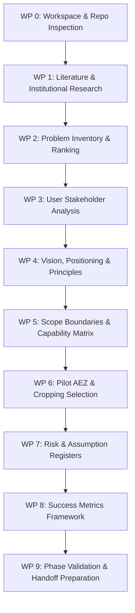

# Phase 1 Plan: Project Discovery and Problem Definition

## 1. Phase Metadata

- **Phase ID**: Phase 01
- **Phase Name**: Project Discovery and Problem Definition
- **Lead Role**: Senior Product Strategist, Agricultural Technology Researcher, Software Architect
- **Status**: **Completed**
- **Date**: 2026-10-10

---

## 2. Objectives and Work Breakdown

The purpose of Phase 1 is to establish a rigorous, evidence-grounded baseline for Ritucast without jumping ahead into system architecture or implementation.

### Key Objectives
1. **Repository Inspection & Preservation**: Verify current workspace state, version control, and existing assets.
2. **Agricultural Problem Identification**: Conduct an evidence-based assessment of farming challenges in Bangladesh.
3. **User Segmentation & Prioritization**: Map the agricultural stakeholder ecosystem and select primary initial user archetypes.
4. **Vision, Mission & Positioning**: Define core value proposition and foundational product principles.
5. **Initial Scope & Boundary Definition**: Determine essential capabilities, explicit exclusions, and non-goals.
6. **Geographic & Cropping Scope**: Establish pilot testbeds and representative cropping systems.
7. **Feasibility, Risks & Assumptions**: Compile structured registers for assumptions and prioritized risks.
8. **Success Metrics Definition**: Establish a 4-tier measurement framework separating tech reliability from agricultural impact.
9. **Project Governance & Documentation**: Implement directory structure, roadmap tracking, decision log, and Phase 2 handoff package.

---

## 3. Work Package Execution Sequence

---

## 4. Phase Boundaries and Non-Goals

- **Strict Boundary**: Phase 1 does **NOT** design database schemas, configure cloud infrastructure, write application code, implement machine learning models, or create production UI designs.
- **Dataset Boundary**: Potential data sources (NASA POWER, Sentinel-1/2, SMAP, GPM IMERG) are evaluated for contextual feasibility only; exhaustive API querying and dataset validation belong strictly to Phase 3.
- **Scientific Boundary**: Agronomic rules and crop coefficients ($K_c$) are identified conceptually; algorithmic calibration belongs to Phase 4 and Phase 9.
