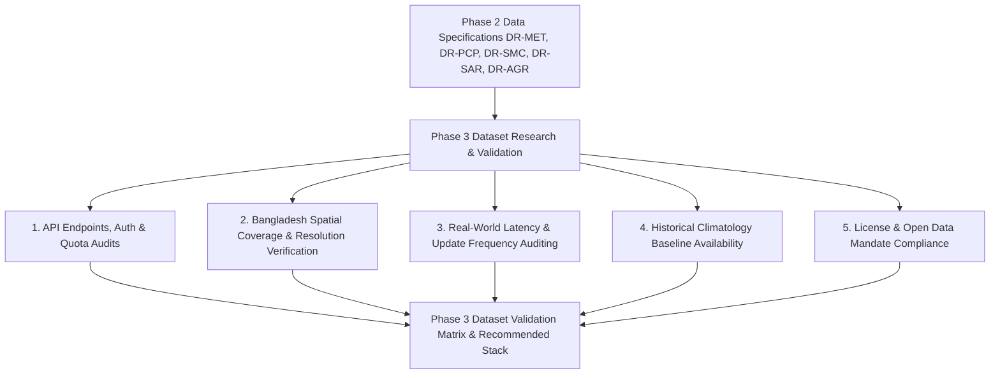

# Phase 2 to Phase 3: Project Handoff Document

## 1. Executive Summary & Purpose

- **Delivered By**: Phase 02 — Requirements and Product Strategy
- **Received By**: Phase 03 — Dataset Research and Validation
- **Handoff Status**: **Ready for Phase 3 Inception (Awaiting Project Lead Review)**
- **Baseline Established**: Comprehensive Product Requirements Document (PRD), 15 Functional Requirements, 19 Non-Functional Requirements, 5-tier Feature Prioritization Matrix, Minimum Complete Product (MCP) scope, Requirements Traceability Matrix (RTM), Product-Level Data Requirements, Recommendation Safety Rules, and Success Measurement Plan.

---

## 2. Prioritized Mandate for Phase 3 (Dataset Research & Validation)

Phase 3 must take the product-level data requirements defined in [data-requirements.md](file:///Users/kazi/Projects/RITUCAST/docs/requirements/data-requirements.md) and conduct an exhaustive technical audit of actual data streams, APIs, access quotas, spatial coverage, temporal latency, and format compatibility.

---

## 3. Top Prioritized Dataset Investigation Questions

Phase 3 must answer the following critical questions whose answers could materially affect product scope and feasibility:

### Priority Question 1: Sentinel-1 SAR Cloud-Penetrating Inundation Pipeline (`DR-SAR-01`)
- **Core Investigation**: Can Sentinel-1 C-band SAR Level-1 GRD imagery be queried, downloaded, and processed over the Haor basin (Sunamganj/Sylhet) through the ESA Copernicus Data Space Ecosystem (CDSE) API without prohibitive rate limits or latency $>12\text{ hours}$?
- **Impact if Infeasible**: If SAR latency is $>24\text{ hours}$ or rate limits are restrictive, Haor emergency flash-flood harvest alerts must rely primarily on GPM IMERG upstream rainfall tracking and hydrological runoff models rather than near-real-time satellite radar watermasks.

### Priority Question 2: NASA POWER Agrometeorology Grid Accuracy vs BMD Stations (`DR-MET-01`)
- **Core Investigation**: Does NASA POWER daily meteorological data (solar radiation, $T_{\text{max}}$, $T_{\text{min}}$, relative humidity, wind speed) correlate adequately ($r \ge 0.85$, bias $<15\%$) with historical ground synoptic observations from the Bangladesh Meteorological Department (BMD) station in Rajshahi?
- **Impact if Infeasible**: If NASA POWER solar radiation exhibits large systematic bias, FAO-56 Penman-Monteith Reference Evapotranspiration ($ET_0$) will be skewed, requiring local empirical bias-correction coefficients in Phase 4.

### Priority Question 3: SMAP Downscaled Soil Moisture Feasibility for Barind Clay Soils (`DR-SMC-01`)
- **Core Investigation**: Which publicly available SMAP product (e.g., SMAP L3 9km/36km, SMAP-Sentinel high-res 1km, or NASA-USDA global soil moisture) provides uninterrupted, valid coverage over Northwest Bangladesh? Can it distinguish regional dry spells despite smallholder plot fragmentation?
- **Impact if Infeasible**: If SMAP data over Northwest Bangladesh suffers from continuous missing data or ponding artifacts from adjacent flooded rice paddies, soil moisture deficit must be computed via water-balance modeling ($P - ET_c$) using rainfall and meteorological forcing rather than direct satellite radiometer values.

### Priority Question 4: GPM IMERG Real-Time Latency for Transboundary Rain Tracking (`DR-PCP-01`)
- **Core Investigation**: What is the actual operational latency of the GPM IMERG Early Run product covering the transboundary Meghalaya plateau (India) and Bangladesh? Is the NASA GES DISC API open, free, and stable for automated daily polling?
- **Impact if Infeasible**: If IMERG Early Run latency exceeds 8 hours, flood warning lead time for Haor farmers drops from 48 hours to under 24 hours.

### Priority Question 5: Open Administrative GeoJSON Boundaries & Official Crop Calendars (`DR-AGR-01`)
- **Core Investigation**: Are clean, topologically sound GeoJSON boundary files for all 64 districts and 495 Upazilas available from open government sources (BBS / Survey of Bangladesh) without licensing restrictions? Are stage-specific crop coefficients ($K_c$) for BRRI dhan28, dhan29, and dhan89 fully documented?
- **Impact if Infeasible**: Topology errors will break upazila spatial queries in the backend; unverified $K_c$ values will invalidate crop water demand calculations.

---

## 4. Phase 3 Deliverables Checklist

When Phase 3 is formally initiated, the team must produce:
1. **Dataset Audit Matrix**: Comprehensive audit of NASA POWER, Sentinel-1 SAR, SMAP, GPM IMERG, MODIS, and BMD.
2. **Coverage and Spatial Fit Assessment**: Exact bounding box verification for Bangladesh ($20.5^\circ\text{N} - 26.7^\circ\text{N}$, $88.0^\circ\text{E} - 92.7^\circ\text{E}$) and upstream Meghalaya catchments.
3. **API Access & Quota Benchmark Report**: Measured latency, token renewal mechanisms, and rate limits.
4. **Historical Climatology Validation Report**: Audit of 10-year historical weather and precipitation records.
5. **Phase 3 Validation Report & Handoff to Phase 4** (Agricultural Knowledge & Scientific Validation Planning).

---

## 5. Traceability Links to Phase 2 Artifacts

- [Product Strategy](file:///Users/kazi/Projects/RITUCAST/docs/product/product-strategy.md)
- [User Needs & Critical Journeys](file:///Users/kazi/Projects/RITUCAST/docs/product/user-needs-and-journeys.md)
- [Product Requirements Document (PRD)](file:///Users/kazi/Projects/RITUCAST/docs/requirements/product-requirements.md)
- [Non-Functional Requirements (NFR)](file:///Users/kazi/Projects/RITUCAST/docs/requirements/nonfunctional-requirements.md)
- [Feature Prioritization Matrix](file:///Users/kazi/Projects/RITUCAST/docs/requirements/feature-prioritization.md)
- [Initial Release Strategy](file:///Users/kazi/Projects/RITUCAST/docs/product/release-strategy.md)
- [Requirements Traceability Matrix (RTM)](file:///Users/kazi/Projects/RITUCAST/docs/requirements/requirements-traceability.md)
- [Product-Level Data Requirements](file:///Users/kazi/Projects/RITUCAST/docs/requirements/data-requirements.md)
- [Recommendation Quality & Scientific Safety](file:///Users/kazi/Projects/RITUCAST/docs/requirements/recommendation-quality-and-safety.md)
- [Success Measurement Plan](file:///Users/kazi/Projects/RITUCAST/docs/product/success-measurement-plan.md)
- [Phase 2 Validation Report](file:///Users/kazi/Projects/RITUCAST/docs/phases/phase-02/validation-report.md)
