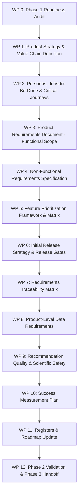

# Phase 2 Plan: Requirements and Product Strategy

## 1. Phase Metadata

- **Phase ID**: Phase 02
- **Phase Name**: Requirements and Product Strategy
- **Lead Role**: Senior Product Manager, Agricultural Technology Strategist, Business Analyst, UX Strategist, Technical Product Lead
- **Status**: **In Progress**
- **Date**: 2026-10-10
- **Preceding Phase**: Phase 01 (Completed & Audited)
- **Succeeding Phase**: Phase 03 (Dataset Research and Validation)

---

## 2. Phase 2 Objectives and Work Breakdown

Phase 2 transforms the strategic baseline from Phase 1 into granular, testable, and traceable requirements without executing subsequent architecture or engineering phases.

### Work Breakdown Packages (WPs)

---

## 3. Scope Boundaries & Anti-Scope Creep Rules

1. **No Code Implementation**: No frontend components, backend endpoints, database schemas, or ETL scripts will be written during Phase 2.
2. **No Visual Wireframe Finalization**: Detailed layouts, UI tokens, and high-fidelity mockups belong to Phase 6 (IA) and Phase 7 (Design System). Phase 2 defines user journeys, functional fields, and state flows at the requirements level.
3. **No Dataset Downloading or Ingestion**: Detailed API benchmarking and data ingestion pipelines belong strictly to Phase 3 and Phase 8. Phase 2 defines data needs and constraints only.
4. **Stable ID Enforcement**: Every requirement must be assigned a permanent, unique identifier (e.g., `FR-LOC-01`, `NFR-PERF-01`, `DR-WEA-01`) to support forward and backward traceability across the entire 18-phase lifecycle.
