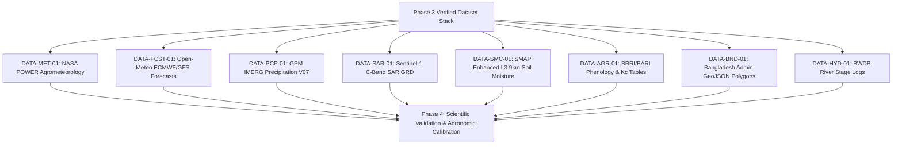

# Phase 3 to Phase 4: Project Handoff Document

## 1. Executive Summary & Purpose

- **Delivered By**: Phase 03 — Dataset Research and Validation
- **Received By**: Phase 04 — Agricultural Knowledge and Scientific Validation Planning
- **Handoff Status**: **Ready for Phase 4 Inception (Awaiting Project Lead Review)**
- **Baseline Established**: Verified Initial Dataset Stack (8 Core datasets, 2 Optional, 6 Deferred/Rejected), Master Dataset Comparison Matrix, Data Access Protocols & Licensing Governance, Data Quality Validation Framework (5-stage protocol), Spatial/Temporal Aggregation Requirements, Technical Source Registry, and Empirical API Verification Log.

---

## 2. Core Operational Dataset Stack Handed Off to Phase 4

Phase 4 inherits the following verified data foundation:

---

## 3. Prioritized Scientific Questions for Phase 4 Investigation

Phase 4 must take these verified data streams and design the mathematical and agronomic models that turn raw indicators into scientifically valid decision support:

### Priority Question 1: FAO-56 Penman-Monteith Evapotranspiration Calibration
- **Context**: In Phase 3, `DATA-MET-01` (NASA POWER) was verified to provide all-sky solar insolation, temperature, humidity, and wind speed.
- **Phase 4 Mandate**: Formulate the exact computational equations for daily Reference Evapotranspiration ($ET_0$) using FAO-56 Penman-Monteith; calibrate stage-specific crop coefficients ($K_c$) for Boro rice varieties (BRRI dhan28, dhan29, dhan89) across Barind agro-ecological conditions; benchmark against historical BMDA / BRRI pan evaporation and lysimeter records.

### Priority Question 2: Haor Basin Flash-Flood Early Warning Rule Formulation
- **Context**: In Phase 3, `DATA-SAR-01` (Sentinel-1 SAR) was verified with a 2h 05m publication latency, and `DATA-PCP-01` (GPM IMERG Early) was verified for upstream transboundary coverage.
- **Phase 4 Mandate**: Combine upstream 48-hour rainfall accumulation ($mm$) over the Meghalaya plateau with BWDB Surma/Kushiyara river gauge trends to establish the predictive flood risk index ($I_{\text{flood}}$) that triggers emergency early harvest warnings 48–72 hours prior to physical inundation.

### Priority Question 3: SMAP Radiometer Disaggregation for Fragmented Delta Soils
- **Context**: Phase 3 identified that L-band radiometers measure dielectric permittivity in the top 5cm, which saturates over flooded rice paddies while adjacent upland crops may be dry.
- **Phase 4 Mandate**: Define a hydrological water-balance model ($P_{\text{eff}} - ET_c$) to disaggregate regional SMAP soil moisture anomalies into actionable root-zone drying curves for non-flooded upland crops and Alternate Wetting and Drying (AWD) rice management.

### Priority Question 4: Uncertainty Quantification & Confidence Tier Algorithms
- **Context**: Phase 2 mandated 3 confidence tiers (`FR-ADV-05`) and automated suppression on high uncertainty (`DEC-10`).
- **Phase 4 Mandate**: Establish the mathematical formulation for advisory confidence decay based on forecast time horizons ($24\text{h} \rightarrow 48\text{h} \rightarrow 72\text{h}$) and numerical weather prediction ensemble spread.

---

## 4. Phase 4 Deliverables Checklist

When Phase 4 is formally initiated, the team must produce:
1. **Agronomic Model Specifications**: Formal mathematical definitions for FAO-56 Penman-Monteith $ET_0$, $ET_c$, and water balance deficit.
2. **Flash Flood Hydrologic Threshold Document**: Calibrated rainfall and river stage trigger curves for the Haor basin.
3. **Ground Truth Validation Protocol**: Benchmark comparison methodology against BMD synoptic stations, BMDA weather stations, and BWDB river gauges.
4. **Scientific Safety & Uncertainty Quantification Framework**: Formal algorithm for computing confidence scores and automated suppression triggers.
5. **Phase 4 Validation Report & Handoff to Phase 5** (System Architecture and Technology Decisions).

---

## 5. Traceability Links to Phase 3 Artifacts

- [Master Candidate Dataset Inventory](file:///Users/kazi/Projects/RITUCAST/docs/data/dataset-inventory.md)
- [Dataset Comparison Matrix](file:///Users/kazi/Projects/RITUCAST/docs/data/dataset-comparison-matrix.md)
- [Initial Dataset Stack](file:///Users/kazi/Projects/RITUCAST/docs/data/initial-dataset-stack.md)
- [Data Access, Licensing & Legal Governance](file:///Users/kazi/Projects/RITUCAST/docs/data/data-access-and-licensing.md)
- [Data Quality & Validation Protocols](file:///Users/kazi/Projects/RITUCAST/docs/data/data-quality-validation.md)
- [Spatial and Temporal Aggregation Requirements](file:///Users/kazi/Projects/RITUCAST/docs/data/spatial-temporal-requirements.md)
- [Technical Source Registry](file:///Users/kazi/Projects/RITUCAST/docs/data/source-registry.md)
- [Data Access Verification Log](file:///Users/kazi/Projects/RITUCAST/docs/phases/phase-03/verification-log.md)
- [Phase 3 Validation Report](file:///Users/kazi/Projects/RITUCAST/docs/phases/phase-03/validation-report.md)
