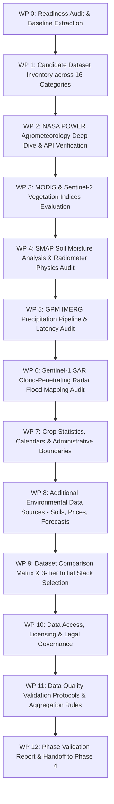

# Phase 3 Plan: Dataset Research and Validation

## 1. Phase Metadata

- **Phase ID**: Phase 03
- **Phase Name**: Dataset Research and Validation
- **Lead Role**: Senior Earth Observation Scientist, Agricultural Data Engineer, Geospatial Analyst, Remote-Sensing Researcher, Data Quality Specialist
- **Status**: **In Progress**
- **Date**: 2026-10-10
- **Preceding Phase**: Phase 02 (Requirements and Product Strategy — PASS)
- **Succeeding Phase**: Phase 04 (Agricultural Knowledge and Scientific Validation Planning)

---

## 2. Work Breakdown Packages (WPs)

---

## 3. Strict Boundary Controls

1. **No Code Implementation**: No production backend ingestion services, Celery workers, or database schemas will be constructed.
2. **No Bulk Dataset Storage**: Only tiny sample GeoJSON/JSON responses ($<500\text{KB}$) used to verify schemas will be inspected. No heavy GeoTIFFs, NetCDF, or HDF5 files will be committed to version control.
3. **Primary Source Auditing**: Every technical specification (units, scale factors, coordinate reference systems, fill values) must be validated against primary mission user guides and live API metadata.
