# Phase 4 to Phase 5: Project Handoff Document

## 1. Executive Summary & Purpose

- **Delivered By**: Phase 04 — Agricultural Knowledge and Scientific Validation Planning
- **Received By**: Phase 05 — System Architecture and Technology Decisions
- **Handoff Status**: **Ready for Phase 5 Inception (Awaiting Project Lead Review)**
- **Baseline Established**: Comprehensive evidence-based agricultural knowledge base, agro-ecological context for Barind and Haor testbeds, scientific interpretation of the 8 core datasets, mathematical formulations for FAO-56 Penman-Monteith $ET_0$, Soil Water Balance, Haor Flash Flood Index $I_{\text{flood}}$, Agricultural Rule Catalog (`RULE-IRR-01`, `RULE-FLD-01`, etc.), Ground-Truth Validation Plan, Evaluation Metrics, ML Readiness Guardrails, Uncertainty Decay Math, Recommendation Safety Framework, and Scientific Governance Registry.

---

## 2. Core Scientific Assets Handed Off to Phase 5

```mermaid
graph TD
    P4[Phase 4 Scientific Deliverables Package]
    
    subgraph Core_Equations[Physical Equations & Models]
        P4 --> E1[EQN-ET0-01: FAO-56 Penman-Monteith Daily ET0]
        P4 --> E2[EQN-ETC-01: Boro Rice Kc Dynamic Demand]
        P4 --> E3[EQN-SWD-01: Root-Zone Daily Soil Water Deficit Dt]
    end

    subgraph Composite_Indices[Hazard & Biometeorological Indices]
        P4 --> I1[IDX-FLD-01: Haor Flash Flood Hazard Index Iflood]
        P4 --> I2[IDX-TMP-01: Anthesis Terminal Heat Stress Index]
        P4 --> I3[IDX-TMP-02: Booting Stage Cold Shock Index]
    end

    subgraph Candidate_Rules[Operational Decision Rules]
        P4 --> R1[RULE-IRR-01: Pre-Rain Irrigation Postponement]
        P4 --> R2[RULE-IRR-02: Critical Root-Zone Moisture Deficit]
        P4 --> R3[RULE-FLD-01: 80% Maturity Early Harvest Alert]
    end

    subgraph Safety_Guardrails[Safety & Uncertainty Governance]
        P4 --> S1[Mandatory Contextual Gating: Upazila + Crop + Stage]
        P4 --> S2[Automated Suppression Trigger: Stale >36h or High Spread]
        P4 --> S3[4-Tier Taxonomy: Observations, Indicators, Forecasts, Advice]
    end
    
    E1 & E2 & E3 & I1 & I2 & I3 & R1 & R2 & R3 & S1 & S2 & S3 --> P5[Phase 5: System Architecture & Technology Decisions]
```

---

## 3. Architectural Constraints for Phase 5 System Design

Phase 5 must design a software architecture that directly satisfies the following scientific and agronomic constraints:

### Constraint 1: Dual-Zone Asymmetric Processing Pipelines
- The system backend cannot use a single homogeneous pipeline for all 495 upazilas.
- **Barind Pipeline**: Must execute daily FAO-56 Penman-Monteith $ET_0$, dynamic $K_c$ interpolation, and root-zone soil water balance depletion modeling to support irrigation scheduling (`RULE-IRR-01`, `RULE-IRR-02`).
- **Haor Pipeline**: Must execute multi-sensor spatial aggregation over the transboundary Meghalaya catchment ($P_{\text{cat}}$), monitor BWDB river stages (Surma/Kushiyara), and track Sentinel-1 SAR inundation masks to compute $I_{\text{flood}}$ (`RULE-FLD-01`).

### Constraint 2: Strict Data Freshness & Automated Suppression Middleware
- In accordance with `DEC-10` and `NFR-REL-03`, the backend architecture must track data ingestion timestamps for every variable.
- Phase 5 must architect an automated **Advisory Suppression Service / Middleware** that intercepts advisory requests and returns a standardized fallback notice whenever input weather data is $>36\text{ hours}$ old or ensemble spread exceeds $50\%$.

### Constraint 3: Four-Tier Information Taxonomy Schema
- In accordance with `DEC-08`, database schemas and API payload contracts must maintain separate tables or distinct payload blocks for:
  1. `observations` (raw physical satellite/station readings with sensor metadata).
  2. `derived_indicators` (computed $ET_0$, water balance, flood index).
  3. `forecasts` (probabilistic QPF, temperature with ensemble spread).
  4. `recommendations` (plain-language action cards with confidence badges).

### Constraint 4: Zero Direct Client-Side Upstream API Querying
- The client PWA must never query NASA POWER, ESA CDSE, or Open-Meteo directly from the mobile browser.
- Phase 5 must architect an intermediate caching backend (PostGIS / Object Storage) that ingests, aggregates, and serves lightweight, pre-computed JSON payloads to client devices, enforcing the $\le 1.5\text{MB}$ bundle budget (`DEC-09`).

### Constraint 5: Mandatory Traceability Metadata
- Every recommendation payload must carry a `provenance` metadata block recording:
  - Rule ID (e.g., `RULE-IRR-01`).
  - Input timestamps.
  - Calculated confidence score ($C_{\text{adv}}$) and tier (`High`, `Moderate`, `Low`).
  - Underlying equation versions (`MAJOR.MINOR.PATCH`).

---

## 4. Phase 5 Inception Checklist

When Phase 5 is formally initiated, the architecture team must produce:
1. **High-Level Component Architecture Diagram**: Connecting data ingestion workers, spatial database, advisory calculation service, REST API, and client PWA.
2. **Technology Stack Selection**: Concrete choices for programming languages, database engines (PostGIS), caching layers, and web application framework adhering to project constraints.
3. **Database Schema & Data Model Blueprints**: Entity-Relationship Diagrams (ERD) supporting the 4-tier taxonomy, spatial upazila polygons, time-series meteorological caches, and advisory logs.
4. **API Contract & Endpoint Specifications**: OpenAPI 3.0 blueprints for upazila weather, moisture deficit, flood risk, and advisory endpoints.
5. **Phase 5 Validation Report & Handoff to Phase 6** (*Information Architecture & User Journey Design*).

---

## 5. Traceability Links to Phase 4 Artifacts

- [Agricultural Knowledge Base](file:///Users/kazi/Projects/RITUCAST/docs/science/agricultural-knowledge-base.md)
- [Crop and Regional Context Specification](file:///Users/kazi/Projects/RITUCAST/docs/science/crop-and-regional-context.md)
- [Dataset Scientific Interpretation](file:///Users/kazi/Projects/RITUCAST/docs/science/dataset-scientific-interpretation.md)
- [Indicator Interpretation Framework](file:///Users/kazi/Projects/RITUCAST/docs/science/indicator-interpretation-framework.md)
- [Agricultural Rule Specifications Catalog](file:///Users/kazi/Projects/RITUCAST/docs/science/agricultural-rule-specifications.md)
- [Scientific Validation Plan](file:///Users/kazi/Projects/RITUCAST/docs/science/scientific-validation-plan.md)
- [Evaluation Metrics & Acceptance Criteria](file:///Users/kazi/Projects/RITUCAST/docs/science/evaluation-metrics-and-acceptance.md)
- [Modeling Readiness & Guardrails](file:///Users/kazi/Projects/RITUCAST/docs/science/modeling-readiness-and-guardrails.md)
- [Uncertainty & Risk Communication Framework](file:///Users/kazi/Projects/RITUCAST/docs/science/uncertainty-and-risk-communication.md)
- [Recommendation Safety Framework](file:///Users/kazi/Projects/RITUCAST/docs/science/recommendation-safety-framework.md)
- [Scientific Governance & Provenance Specification](file:///Users/kazi/Projects/RITUCAST/docs/science/scientific-governance.md)
- [Research Gaps Register](file:///Users/kazi/Projects/RITUCAST/docs/science/research-gaps.md)
- [Phase 4 Evidence Register](file:///Users/kazi/Projects/RITUCAST/docs/phases/phase-04/evidence-register.md)
- [Phase 4 Validation Report](file:///Users/kazi/Projects/RITUCAST/docs/phases/phase-04/validation-report.md)
