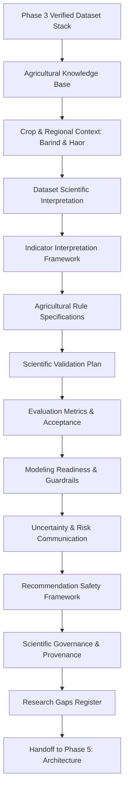

# Phase 4 Plan: Agricultural Knowledge and Scientific Validation Planning

## 1. Executive Summary & Objectives

- **Phase ID**: Phase 04
- **Phase Name**: Agricultural Knowledge and Scientific Validation Planning
- **Status**: **In Progress**
- **Lead Role**: Senior Agronomist, Remote-Sensing Scientist & Scientific Validation Lead
- **Mandate**: Transform the verified dataset stack and product requirements from Phases 1–3 into an evidence-based agronomic foundation, mathematical model specifications, indicator interpretation frameworks, rule governance protocols, ground-truth validation strategies, and scientific safety guardrails for Ritucast.
- **Strict Boundary**: Complete Phase 4 scientific planning and specifications only. **Do not execute Phases 5–18.** Do not write system architecture, backend/frontend code, ETL pipelines, or train machine learning models.

---

## 2. Phase 4 Scope & Structure

Phase 4 delivers the scientific blueprint for the Ritucast platform across 12 dedicated science specifications and 6 phase governance documents:

---

## 3. Work Breakdown Structure (WBS)

| Step | Work Item | Output Document | Primary Focus |
| :--- | :--- | :--- | :--- |
| **0.1** | Phase 4 Readiness & Baseline Audit | `readiness-assessment.md` | Audit Phase 1–3 deliverables, Git working tree, and data foundations. |
| **1.0** | Agricultural Evidence Base | `agricultural-knowledge-base.md` | Compile peer-reviewed and institutional literature (BRRI, BARI, FAO, BMD, BWDB). |
| **2.0** | Crop & Regional Agro-Ecological Context | `crop-and-regional-context.md` | Barind (AEZ 25–27) & Haor (AEZ 21) Boro rice phenology, soil hydrology, stress vulnerabilities. |
| **3.0** | Dataset Scientific Interpretation | `dataset-scientific-interpretation.md` | Physical meaning, band/variable mechanics, assumptions, and limits of the 8 core datasets. |
| **4.0** | Indicator Interpretation Framework | `indicator-interpretation-framework.md` | Mathematical specifications: FAO-56 Penman-Monteith $ET_0$, $ET_c$, Soil Water Balance, Haor Flash Flood Index $I_{\text{flood}}$, Cardinal Thermal Indices. |
| **5.0** | Agricultural Rule Specifications | `agricultural-rule-specifications.md` | Formal rule catalog: irrigation postponement, drought stress, early harvest, cold/heat stress. |
| **6.0** | Scientific Validation Plan | `scientific-validation-plan.md` | Ground-truth benchmarking: BMD synoptic stations, BMDA lysimeters, BWDB gauges, hindcast cases. |
| **7.0** | Evaluation Metrics & Acceptance | `evaluation-metrics-and-acceptance.md` | Task-specific metrics (MAE, RMSE, CSI, FAR, POD, Brier Score, Expert Concordance). |
| **8.0** | Modeling Readiness & Guardrails | `modeling-readiness-and-guardrails.md` | Rule-based baseline priority, ML prerequisites, spatial cross-validation, anti-leakage. |
| **9.0** | Uncertainty & Risk Communication | `uncertainty-and-risk-communication.md` | 4-Tier taxonomy adherence, forecast decay math, ensemble spread calibration, Bangla UX copy. |
| **10.0** | Recommendation Safety Framework | `recommendation-safety-framework.md` | Gating by crop/stage/upazila, automated suppression triggers, "Do No Harm" protocols. |
| **11.0** | Scientific Governance & Provenance | `scientific-governance.md` | Lifecycle status tracking, versioning, change control, scientific review gates. |
| **12.0** | Research Gaps & Uncertainty Register | `research-gaps.md` | Prioritized catalog of open scientific questions, required evidence, and phase assignments. |
| **13.0** | Governance Registers Update | `risk-register.md`, `assumptions-register.md`, `decision-log.md` | Update master risk register (`RSK-15`+), assumptions (`ASM-04/07/11`), log decisions (`DEC-15`+). |
| **14.0** | Phase 4 Quality Gate & Validation | `validation-report.md`, `deliverables-checklist.md` | Formal review against all 20 Phase 4 acceptance criteria. |
| **15.0** | Phase 5 Handoff Package | `handoff-to-phase-05.md`, `roadmap.md` | Architectural constraints, data flow requirements, Phase 5 activation mandate. |

---

## 4. Phase 4 Acceptance Thresholds

Phase 4 will achieve completion (**PASS**) only when:
1. Every major agronomic claim is backed by traceable peer-reviewed or institutional citations (BRRI/BARI/FAO/BMD).
2. The mathematical formulations for FAO-56 Penman-Monteith $ET_0$, water balance, and Haor flash-flood hazard index are fully specified.
3. Growth stages and phenological days for Boro rice varieties (BRRI dhan28, dhan29, dhan89) are documented for both Barind and Haor agro-ecological zones.
4. Ground-truth validation protocols are established against BMD synoptic stations, BMDA lysimeters, and BWDB river gauges.
5. Automated recommendation suppression criteria are algorithmically defined.
6. All deliverables pass formal quality verification and are committed to Git with clean traceability.
