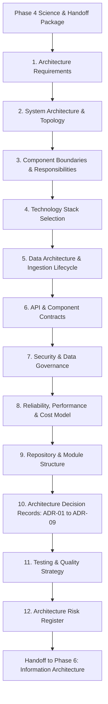

# Phase 5 Plan: System Architecture and Technology Decisions

## 1. Executive Summary & Objectives

- **Phase ID**: Phase 05
- **Phase Name**: System Architecture and Technology Decisions
- **Status**: **In Progress**
- **Lead Role**: Lead Systems Architect, Full-Stack Engineering Lead & Geospatial Systems Engineer
- **Mandate**: Transform the verified product requirements (Phase 2), dataset constraints (Phase 3), and agronomic science specifications (Phase 4) into a robust, maintainable, performant, and cost-effective system architecture for Ritucast.
- **Strict Boundary**: Complete Phase 5 architecture and technology decisions only. **Do not execute Phases 6–18.** Do not write production application code, build ETL pipelines, train ML models, implement backend REST endpoints, or build frontend UI views.

---

## 2. Phase 5 Scope & Deliverables Map

Phase 5 establishes the comprehensive system blueprints across 12 architectural specifications, an Architecture Decision Record (ADR) catalog, and 5 phase execution documents:

---

## 3. Work Breakdown Structure (WBS)

| Step | Work Item | Output Document | Primary Focus |
| :--- | :--- | :--- | :--- |
| **0.1** | Phase 5 Readiness & Baseline Audit | `docs/phases/phase-05/readiness-assessment.md` | Audit Phase 1–4 continuity, handoff constraints, and repository health. |
| **1.0** | Architectural Requirements | `docs/architecture/architecture-requirements.md` | Functional and non-functional requirements driving architecture. |
| **2.0** | System Architecture & Topology | `docs/architecture/system-architecture.md` | Architectural topology evaluation (modular monolith vs microservices vs serverless). |
| **3.0** | Component Boundaries | `docs/architecture/component-boundaries.md` | Responsibilities, inputs, outputs, failure modes of all 8 core system subsystems. |
| **4.0** | Technology Stack Selection | `docs/architecture/technology-stack.md` | Concrete language, framework, database, mapping, and caching choices. |
| **5.0** | Data Architecture | `docs/architecture/data-architecture.md` | End-to-end data lifecycle: Ingestion $\rightarrow$ Processing $\rightarrow$ Analytical Storage $\rightarrow$ Advisory. |
| **6.0** | API & Component Contracts | `docs/architecture/api-and-component-contracts.md` | OpenAPI 3.0 contract specifications for upazila weather, moisture deficit, flood risk, and advisories. |
| **7.0** | Security & Data Governance | `docs/architecture/security-and-data-governance.md` | Threat modeling, zero-PII enforcement, rate limiting, and open-source licensing. |
| **8.0** | Reliability, Performance & Cost | `docs/architecture/reliability-performance-and-cost.md` | Caching tiers, worker queues, latency budgets, cost optimization for Google Cloud. |
| **9.0** | Repository & Module Structure | `docs/architecture/repository-and-module-structure.md` | Concrete monorepo package layout, dependency rules, and coding standards. |
| **10.0** | Architecture Decision Records | `docs/architecture/decisions/ADR-*.md` | 9 Formal ADRs documenting major technology and architectural choices. |
| **11.0** | Testing & Quality Strategy | `docs/architecture/testing-and-quality-strategy.md` | 5-tier testing architecture, CI/CD pipeline blueprint, and scientific regression checks. |
| **12.0** | Architecture Risk Register | `docs/architecture/architecture-risk-register.md` | Dedicated architecture risk matrix with triggers and fallback mitigations. |
| **13.0** | Governance Registers Update | `roadmap.md`, `decision-log.md`, `risk-register.md` | Update master registers (`DEC-19`–`DEC-23`, `RSK-19`–`RSK-22`). |
| **14.0** | Quality Gate & Validation | `docs/phases/phase-05/validation-report.md` | Formal evaluation of all 18 Phase 5 acceptance criteria. |
| **15.0** | Phase 6 Handoff Package | `docs/phases/phase-05/handoff-to-phase-06.md` | Actionable constraints and recommendations for Information Architecture. |

---

## 4. Phase 5 Acceptance Thresholds

Phase 5 will achieve completion (**PASS**) only when:
1. Every architectural component maps directly to an approved Phase 2 requirement (`FR`/`NFR`).
2. The 5 architectural constraints from Phase 4 are fully accommodated in system and data blueprints.
3. Concrete technology stack choices are supported by trade-off analyses without ungrounded fashion choices.
4. Complete OpenAPI 3.0 contracts and database schemas support the 4-tier information taxonomy.
5. All 9 ADRs are documented with context, options, decision, trade-offs, and revisit triggers.
6. A clean validation report confirms zero premature code implementation or deployment.
