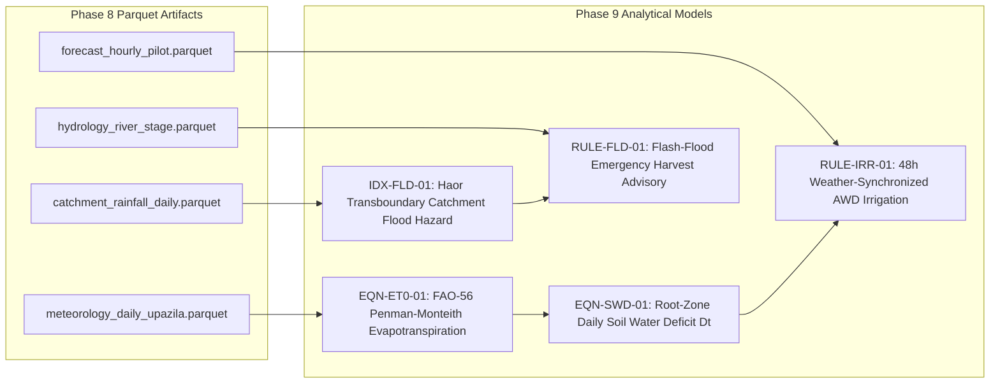

# Phase 8 to Phase 9 Technical Handoff: Agricultural Analytics & Recommendation Engine

## 1. Executive Summary & Purpose

This handoff document transitions the **Ritucast** project from **Phase 8: Data Ingestion and Processing Pipeline** to **Phase 9: Agricultural Analytics and Recommendation Engine**. It provides the incoming science and machine learning engineers with a rigorous catalog of genuinely available datasets, schema definitions, spatial/temporal aggregation characteristics, data limitations, and architectural invariants that Phase 9 must respect.

---

## 2. Inventory of Validated Processed Datasets Available for Phase 9

The following four analytical tables are published to `data/processed/` and verified ready for consumption:

### 2.1 `meteorology_daily_upazila.parquet`
- **Location**: `data/processed/meteorology_daily_upazila.parquet`
- **Source**: NASA POWER Agrometeorology (`DATA-MET-01`).
- **Target Consumer in Phase 9**: `EQN-ET0-01` (FAO-56 Penman-Monteith $ET_0$).
- **Variables**: `upazila_id`, `date`, `t2m_c`, `t2m_max_c`, `t2m_min_c`, `solar_rad_mj_m2`, `rh2m_pct`, `wind_speed_2m_ms`, `precipitation_mm`.
- **Spatial Resolution**: Point query at Upazila administrative centroid (representing $0.5^\circ \times 0.625^\circ$ grid cell).
- **Temporal Resolution**: Daily sum/extremes aligned with Bangladesh Standard Time (BST) day boundaries.

### 2.2 `forecast_hourly_pilot.parquet`
- **Location**: `data/processed/forecast_hourly_pilot.parquet`
- **Source**: Open-Meteo Operational NWP Feeds (`DATA-FCST-01`).
- **Target Consumer in Phase 9**: `RULE-IRR-01` (48h tubewell irrigation postponement logic) and Tier 3 forecast views.
- **Variables**: `upazila_id`, `valid_time_utc`, `horizon_hours` (0–168), `rain_prob_pct`, `rain_amount_mm`, `temp_2m_c`, `rh_2m_pct`, `wind_speed_kmh`, `model_name`.
- **Spatial Resolution**: Point query at Upazila centroid ($0.25^\circ$ resolution, ~28km).
- **Temporal Resolution**: Hourly forward-looking projections up to 7 days.

### 2.3 `catchment_rainfall_daily.parquet`
- **Location**: `data/processed/catchment_rainfall_daily.parquet`
- **Source**: GPM IMERG V07 Multi-Satellite Precipitation (`DATA-PCP-01`).
- **Target Consumer in Phase 9**: `IDX-FLD-01` (Haor Transboundary Catchment Flood Hazard Index $I_{\text{flood}}$).
- **Variables**: `catchment_id` (`MEGHALAYA_ESCARP`), `date`, `precipitation_mm`, `rain_24h_mm`, `rain_cum_48h_mm`, `rain_cum_7d_mm`, `quality_flag`.
- **Spatial Resolution**: Spatially integrated across the southern Meghalaya hills polygon ($90.0^\circ–92.8^\circ\text{E}, 25.0^\circ–26.2^\circ\text{N}$, ~14,200 km²).
- **Temporal Resolution**: Daily rolling 24h, 48h, and 7-day cumulative sums.

### 2.4 `hydrology_river_stage.parquet`
- **Location**: `data/processed/hydrology_river_stage.parquet`
- **Source**: BWDB FFWC River Stage Gauge Logs (`DATA-HYD-01`).
- **Target Consumer in Phase 9**: `RULE-FLD-01` (Haor Boro Rice Emergency Harvest Advisory).
- **Variables**: `station_id` (`BWDB-177`), `timestamp_utc`, `water_level_m_pwd`, `danger_level_m_pwd` ($8.25\text{m}$), `freeboard_m`, `rate_of_rise_24h_m`, `is_above_danger`.
- **Spatial Resolution**: Fixed telemetry river gauge station on Surma River at Sunamganj.
- **Temporal Resolution**: 6-hourly and daily observational readings.

---

## 3. Reference Datasets Available for Modeling

1. **Administrative Boundary GeoJSON (`data/sample/bangladesh_pilot_upazilas.geojson`)**:
   - Official polygon boundaries, centroids, and area metrics for the 4 pilot testbeds: Godagari, Tanore, Sunamganj Sadar, Tahirpur.
2. **BRRI Crop Phenology & $K_c$ Lookup (`data/sample/brri_phenology_boro.json`)**:
   - Stage duration days, thermal GDD requirements, stage-specific crop coefficients ($K_{c,\text{ini}}=1.05, K_{c,\text{dev}}=1.15, K_{c,\text{mid}}=1.25, K_{c,\text{late}}=1.10, K_{c,\text{mat}}=0.90$), root depths ($0.20\text{m} - 0.40\text{m}$), and depletion fractions ($p = 0.10 - 0.40$).

---

## 4. Modeling Readiness Assessment for Phase 9

| Analytical Capability | Readiness Status | Justification & Guardrails |
| :--- | :---: | :--- |
| **Descriptive Climatology & Monitoring** | **READY** | Daily historical observations, temperature extremes, and rolling cumulative rainfall windows are validated and formatted. |
| **Deterministic Physical Rules (`RULE-IRR-01`, `RULE-FLD-01`)** | **READY** | All required physical inputs for FAO-56 Penman-Monteith $ET_0$, Soil Water Deficit $D_t$, and BWDB river surge rates are present. |
| **Supervised Machine Learning (ML)** | **NOT READY** | **Strict Warning**: Ground-truth parcel-level crop yields and micro-field soil sensor telemetry are deliberately absent. In accordance with `DEC-06` and Phase 4 modeling guardrails ([modeling-readiness-and-guardrails.md](file:///Users/kazi/Projects/RITUCAST/docs/science/modeling-readiness-and-guardrails.md)), **no black-box supervised ML models may be trained in Phase 9**. All advisories must be driven by validated physical models. |

---

## 5. Known Gaps, Latencies & Risks for Phase 9

1. **NASA POWER Observational Lag (T+24 to T+48)**:
   - *Reality*: NASA POWER solar radiation and meteorological observations lag current time by 24 to 48 hours.
   - *Phase 9 Requirement*: For real-time daily water balance on Day $T$, Phase 9 must implement the Hargreaves-Samani fallback using Open-Meteo current $T_{\text{max}}, T_{\text{min}}$ observations, applying the documented epistemic uncertainty penalty (`DEC-10`).
2. **Data Leakage Safeguard in Rolling Windows**:
   - *Rule*: When computing rolling 48h or 7-day cumulative rainfall or hindcasting model predictions, Phase 9 must strictly enforce that observations from future timestamps ($T+1$) never leak into historical advisory states.
3. **Mandatory Contextual Gating (`DEC-17`)**:
   - Phase 9 recommendation generators must verify administrative Upazila, active crop (Boro rice), and active growth stage before emitting any advisory payload.
4. **Automated Suppression Middleware (`DEC-10`, `ADR-08`)**:
   - If input datasets are $>36\text{h}$ old or ensemble spread exceeds $50\%$, Phase 9 must flag the advisory as suppressed and emit the safe manual field inspection notice.

---

## 6. Recommended Next Steps for Phase 9

1. **Implement FAO-56 Penman-Monteith Algorithm (`EQN-ET0-01`)**:
   - Write vectorized Python routine in `packages/core/equations/penman_monteith.py` ingesting `meteorology_daily_upazila.parquet`.
2. **Implement Daily Soil Water Deficit Balance (`EQN-SWD-01`)**:
   - Model root-zone depletion $D_t = D_{t-1} - (P_t - RO_t) - I_t + ET_{c, t}$ parameterizing Barind heavy clay soil paleosols ($TAW = 56\text{mm}, RAW = 11.2\text{mm}$).
3. **Implement Haor Transboundary Hazard Score (`IDX-FLD-01`)**:
   - Couple 48h Meghalaya catchment rainfall ($P_{\text{cat}}$) with Surma river stage rate of rise ($\Delta H/\Delta t$).
4. **Implement Advisory Generation Rules**:
   - Formulate plain Bangla explainable advice cards conforming to the 5-section card anatomy (`CMP-CARD-01`, `DEC-30`).
