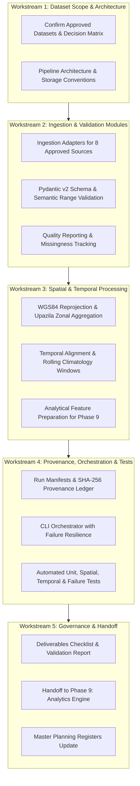

# Phase 8: Data Ingestion and Processing Pipeline — Phase Plan

## 1. Executive Summary & Mission

Phase 8 establishes the **reproducible, validated, and traceable data ingestion and processing foundation** for Ritucast. Following the architectural boundaries established in Phase 5 ([system-architecture.md](file:///Users/kazi/Projects/RITUCAST/docs/architecture/system-architecture.md), [ADR-09](file:///Users/kazi/Projects/RITUCAST/docs/architecture/decisions/ADR-09-celery-scheduled-ingestion.md)) and the scientific parameters approved in Phase 3 & 4 ([initial-dataset-stack.md](file:///Users/kazi/Projects/RITUCAST/docs/data/initial-dataset-stack.md), [indicator-interpretation-framework.md](file:///Users/kazi/Projects/RITUCAST/docs/science/indicator-interpretation-framework.md)), this phase implements the end-to-end pipeline required to extract, validate, clean, spatially aggregate, and temporally align environmental and agricultural datasets for the pilot testbeds in Bangladesh.

In strict adherence to the 18-phase governed lifecycle, **Phase 8 does not implement Phase 9 agricultural analytics or recommendation models**. Its mission is strictly bounded to transforming raw observations into high-integrity analytical tables and provenance-tracked outputs.

---

## 2. Phase 8 Work Breakdown Structure (WBS)

---

## 3. Milestones & Target Deliverables

| Milestone | Key Deliverables | Description | Target Date | Status |
| :--- | :--- | :--- | :---: | :---: |
| **M8.1: Scope & Arch** | `phase-08-dataset-implementation-scope.md` `pipeline-architecture.md` `storage-and-file-conventions.md` | Define source status, pipeline topology, directory layout, and `.gitignore` safety. | 2026-10-10 | In Progress |
| **M8.2: Ingestion & Validation** | `pipelines/ingestion/*` `pipelines/validation/*` `data-quality-validation.md` | Implement adapters for 8 approved sources, Pydantic schemas, and physical range checks. | 2026-10-10 | In Progress |
| **M8.3: Spatial & Temporal** | `pipelines/processing/*` `spatial-processing-specification.md` `temporal-processing-specification.md` `feature-preparation-specification.md` | Implement WGS84 Upazila zonal aggregation, daily temporal alignment, and analytical feature tables. | 2026-10-10 | In Progress |
| **M8.4: Provenance & Orchestrator** | `pipelines/orchestrator.py` `provenance-and-versioning.md` `pipeline-execution.md` `local-data-pipeline-setup.md` | Implement CLI runner, JSON metadata manifests, rate limiting, and local execution docs. | 2026-10-10 | In Progress |
| **M8.5: Testing & Verification** | `tests/*` `pipeline-testing-strategy.md` `performance-and-resource-guidelines.md` `data-licensing-and-scientific-safeguards.md` | Automated test suite covering unit, spatial, temporal, failure, and mocked network tests. | 2026-10-10 | In Progress |
| **M8.6: Governance Gate** | `validation-report.md` `deliverables-checklist.md` `handoff-to-phase-09.md` | Formal audit of 21 acceptance criteria and clean handoff to Phase 9. | 2026-10-10 | In Progress |

---

## 4. Architectural Invariants & Non-Goals

1. **Zero Premature Modeling**: No calculation of FAO-56 $ET_0$, Soil Deficit $D_t$, Haor Flood Hazard $I_{\text{flood}}$, or advisory generation in Phase 8. Feature preparation strictly emits clean forcing variables (e.g. $T_{\text{max}}, T_{\text{min}}, R_s, P, \sigma^\circ, \theta$).
2. **Deterministic & Idempotent**: Identical input parameters and date ranges must produce byte-identical analytical outputs with identical cryptographic manifests.
3. **Graceful Degradation (`RSK-22`)**: API network failures, rate limiting (NASA POWER 30 req/min), or invalid schema payloads must never crash the service silently; they must raise structured exceptions, trigger backoff, and record failed status in manifests.
4. **No Raw Satellite Bloat in Git**: All raw NetCDF, HDF5, GeoTIFF, and Parquet analytical tables are excluded from Git via `.gitignore`. Tests operate against curated, lightweight synthetic fixtures in `data/sample/`.
