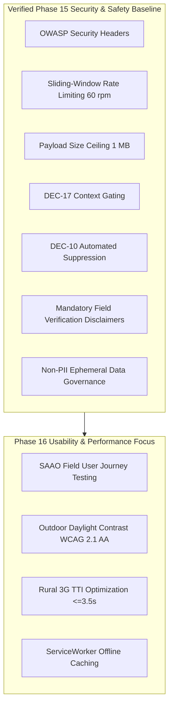

# Phase 15 Handoff to Phase 16 — Ritucast

## 1. Handoff Context & Phase 16 Objective

- **Delivered by**: **Phase 15: Security, Privacy, and Responsible Agricultural Intelligence**
- **Receiving Phase**: **Phase 16: Usability, Accessibility & Performance**
- **Current Git Branch**: `main`
- **System Stability**: Verified stable with 104 Python tests, 21 Vitest tests, and a production bundle of $89.3\text{ kB}$ gzip.

Per the master roadmap ([`docs/planning/roadmap.md`](file:///Users/kazi/Projects/RITUCAST/docs/planning/roadmap.md)), **Phase 16** focuses on field testing with Sub-Assistant Agriculture Officers (SAAOs) and lead farmers, fine-tuning user journeys on budget mobile devices, verifying WCAG 2.1 AA accessibility in rural outdoor daylight conditions, and optimizing 3G Time-to-Interactive (TTI $\le 3.5\text{s}$) and offline caching resilience.

---

## 2. Verified Capabilities Delivered by Phase 15

Phase 16 engineers can rely upon the following verified interfaces and safeguards:

1. **Defensive API Headers**: FastAPI backend injects OWASP headers (`nosniff`, `DENY`, `CSP`, `Permissions-Policy`, HSTS) via [`SecurityHeadersMiddleware`](file:///Users/kazi/Projects/RITUCAST/api/middleware/security.py).
2. **Abuse Mitigation**: Rate limiting (`RateLimitMiddleware`) throttles abusive queries to 60 req/min while exempting health probes. Request size limiting rejects bodies $>1\text{MB}$.
3. **Contextual Gating (`DEC-17`)**: Advisory queries strictly require Upazila, Crop, and Phenological Stage. Phase 16 usability workflows must preserve this required input sequence.
4. **Automated Suppression (`DEC-10`)**: Stale ($>36\text{h}$) or highly uncertain ($>50\%$ spread) forecast data automatically transitions cards to `SUPPRESSED`. Phase 16 UI flows must present this suppressed state with clear explanation copy.
5. **Mandatory Copy Standards**: All Tier 4 recommendation cards include the field inspection copy:
   *"সেচ বন্ধ করার আগে জমির আইল এবং মাটির রস নিজে হাত দিয়ে পরীক্ষা করুন।"*
   Prohibited overconfident words (*"১০০% নিশ্চিত"*, etc.) must remain banned in any new copy.
6. **Non-PII Privacy Baseline**: Zero farmer personal data or parcel-level cadastral plots are stored. Phase 16 usability studies must not introduce unconsented personal tracking or telemetry scripts.

---

## 3. Inviolable Governance Constraints for Phase 16

1. **Payload Budget (`DEC-09`)**: Initial client bundle size must remain $\le 1.5\text{MB}$. (Current build is $89.3\text{ kB}$ gzip, offering ample headroom).
2. **Time-to-Interactive (TTI)**: Must remain $\le 3.5\text{s}$ under simulated rural 3G network throttling.
3. **Heap Memory Ceiling**: Peak client heap memory must stay $\le 45\text{MB}$ on low-spec Android devices (2GB RAM).
4. **Scope Boundaries (`DEC-06`)**:
   - Do NOT introduce parcel-level yield prediction models (`MOD-YLD-01`).
   - Do NOT introduce automated pesticide diagnosis (`MOD-DIS-01`).
   - Do NOT connect remote pump hardware actuators.
   - Do NOT implement loan or insurance scoring algorithms.
5. **Clickable File Links**: Every reference to a project file must use standard Markdown links with the `file://` scheme and absolute paths.

---

## 4. Key Artifact Locations for Phase 16 Reference

- **Backend Middleware**: [`api/middleware/security.py`](file:///Users/kazi/Projects/RITUCAST/api/middleware/security.py)
- **Frontend Source**: [`frontend/src/App.tsx`](file:///Users/kazi/Projects/RITUCAST/frontend/src/App.tsx), [`frontend/src/components/`](file:///Users/kazi/Projects/RITUCAST/frontend/src/components/)
- **Security Tests**: [`tests/api/test_security_hardening.py`](file:///Users/kazi/Projects/RITUCAST/tests/api/test_security_hardening.py), [`frontend/src/test/security.test.tsx`](file:///Users/kazi/Projects/RITUCAST/frontend/src/test/security.test.tsx)
- **Security Assessment**: [`docs/security/phase-15-security-assessment.md`](file:///Users/kazi/Projects/RITUCAST/docs/security/phase-15-security-assessment.md)
- **Responsible AI Safeguards**: [`docs/responsible-ai/agricultural-recommendation-safeguards.md`](file:///Users/kazi/Projects/RITUCAST/docs/responsible-ai/agricultural-recommendation-safeguards.md)
- **Remaining Risks Register**: [`docs/security/remaining-risks.md`](file:///Users/kazi/Projects/RITUCAST/docs/security/remaining-risks.md)

Phase 16 is cleared to proceed upon authorized prompt from the project lead.
