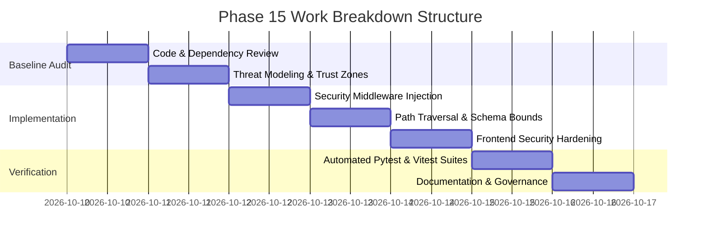

# Phase 15 Execution Plan — Ritucast
## Security, Privacy, and Responsible Agricultural Intelligence

## 1. Executive Summary

**Phase 15** establishes an empirical security, privacy, and responsible AI baseline for **Ritucast**. The objective is to evaluate and harden the software, data flow, software supply chain, and agronomic advisory delivery against malicious exploitation, data leakage, and agronomic misdirection before expanded deployment.

---

## 2. Scope & Governed Boundaries

### 2.1 In-Scope Deliverables
1. **Threat Model & Trust Boundaries**: Formalization of STRIDE threat analysis, asset registry, and network trust boundaries.
2. **API & Backend Hardening**: Implementation of OWASP security headers, request payload size limits, in-memory sliding-window client rate limiting, and path traversal guards.
3. **Frontend Security**: Verification of absence of raw HTML injection, XSS immunity, zero bundled private keys, and anti-deception network error handling.
4. **Data Privacy & Governance**: Audit of non-PII data minimization, ephemeral query processing, and zero third-party telemetry.
5. **Dataset Licensing & Provenance**: Audit of NASA, Open-Meteo, Copernicus, BWDB, and BRRI terms, caching rights, and UI attribution.
6. **Responsible Agricultural Intelligence**: Verification of the 4-tier information taxonomy, contextual gating (`DEC-17`), automated suppression (`DEC-10`), and anti-overconfidence copy.
7. **Automated Verification**: Pytest and Vitest test suites asserting all security controls.

### 2.2 Out-of-Scope (Strict Non-Goals)
- No user accounts or RBAC authentication systems (`DEC-06`: Ritucast is a public, read-only decision-support platform).
- No parcel-level yield predictions (`MOD-YLD-01`).
- No automated pesticide diagnostics (`MOD-DIS-01`).
- No remote pump hardware actuators.
- No commercial loan or insurance underwriting mechanisms.

---

## 3. Work Breakdown Structure

1. **Step 1: Baseline Audit & Threat Modeling**: Assess public endpoints, dependencies, Git history, and trust boundaries.
2. **Step 2: API & Backend Hardening**: Implement `SecurityHeadersMiddleware`, `RequestSizeLimitMiddleware`, `RateLimitMiddleware`, path traversal guards in repository, and schema bounds.
3. **Step 3: Frontend Security Verification**: Verify absence of `dangerouslySetInnerHTML`, confirm `apiClient.ts` does not silently use mock fallbacks, and enable node types.
4. **Step 4: Responsible AI Verification**: Audit contextual gating, suppression policies, and anti-overconfidence copy.
5. **Step 5: Automated Testing**: Execute 104 deterministic Python tests, 21 Vitest tests, and production build checks.
6. **Step 6: Comprehensive Governance Documentation**: Publish all 19 Phase 15 specifications and phase reports.

---

## 4. Phase Quality Gates

Phase 15 achieves a formal **PASS** when:
- All 19 required specification documents are authored and committed.
- Zero broken markdown links exist across repository documentation.
- Backend security tests and frontend security tests pass with 100% success.
- Production build succeeds with bundle size within the $1.5\text{MB}$ budget (`DEC-09`).
- Clean Git working tree with atomic commits.

Related documentation:
- [`docs/phases/phase-15/readiness-assessment.md`](file:///Users/kazi/Projects/RITUCAST/docs/phases/phase-15/readiness-assessment.md)
- [`docs/phases/phase-15/deliverables-checklist.md`](file:///Users/kazi/Projects/RITUCAST/docs/phases/phase-15/deliverables-checklist.md)
- [`docs/phases/phase-15/validation-report.md`](file:///Users/kazi/Projects/RITUCAST/docs/phases/phase-15/validation-report.md)
