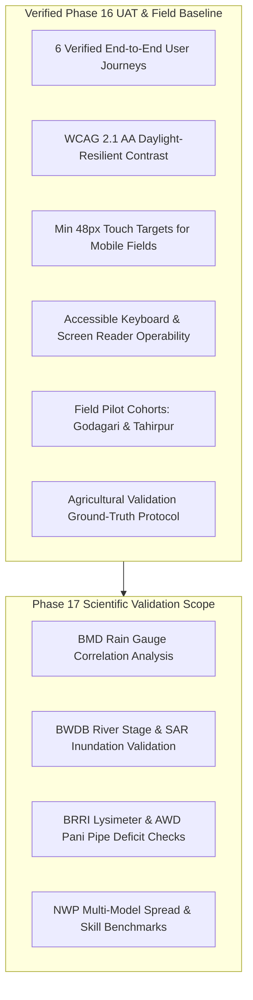

# Phase 16 Handoff to Phase 17 — Ritucast

## 1. Handoff Context & Phase 17 Objective

- **Delivering Phase**: **Phase 16: Usability, Accessibility & Performance** (UAT & Field Readiness)
- **Receiving Phase**: **Phase 17: Scientific & Agricultural Validation**
- **Current Git Branch**: `main`
- **System Stability**: 104 backend Python tests passing, 32 frontend Vitest tests passing across 10 test files, 0 defects open, client production wire bundle size $88.84\text{ kB}$ gzip.

Per the master roadmap ([`docs/planning/roadmap.md`](file:///Users/kazi/Projects/RITUCAST/docs/planning/roadmap.md)), **Phase 17** focuses on **Scientific & Agricultural Validation**:
Conducting correlation analysis and quantitative ground-truth validation with Bangladesh Meteorological Department (BMD) rain gauges, Bangladesh Water Development Board (BWDB) flood stage records, and Bangladesh Rice Research Institute (BRRI) field crop phenology logs.

---

## 2. Verified Capabilities Delivered by Phase 16

Phase 17 scientific researchers and agronomic engineers can rely upon the following verified interfaces, testbeds, and specifications:

1. **User Acceptance Test Scenarios (`UAT-SCN-01` to `UAT-SCN-06`)**: All 6 core workflows (AWD advice check, Haor zone switch, emergency harvest directive, water balance inspection, automated suppression fallback, offline recovery) are verified and cataloged in [`docs/uat/user-acceptance-test-scenarios.md`](file:///Users/kazi/Projects/RITUCAST/docs/uat/user-acceptance-test-scenarios.md).
2. **Accessibility & Daylight Resilience**: Text contrast $\ge 7.4:1$, 48px touch targets, skip-link bypass, and ARIA landmarks verified in [`docs/uat/usability-and-accessibility-report.md`](file:///Users/kazi/Projects/RITUCAST/docs/uat/usability-and-accessibility-report.md).
3. **Field Readiness Protocol**: SAAO and Lead Farmer trial deployment structures established across Godagari, Tanore, Tahirpur, and Sunamganj Sadar in [`docs/uat/field-readiness-assessment.md`](file:///Users/kazi/Projects/RITUCAST/docs/uat/field-readiness-assessment.md).
4. **Agricultural Validation Framework**: Formal statistical metrics (RMSE, MBE, NSE, contingency matrix, POD $\ge 85\%$, FAR $\le 20\%$) and ground sensor baselines established in [`docs/uat/agricultural-validation-protocol.md`](file:///Users/kazi/Projects/RITUCAST/docs/uat/agricultural-validation-protocol.md).
5. **Defect Register Clean**: Zero open defects entering Phase 17 ([`docs/uat/defect-log.md`](file:///Users/kazi/Projects/RITUCAST/docs/uat/defect-log.md)).

---

## 3. Mandatory Governance Constraints for Phase 17

1. **Dual-Zone Pilot Boundaries (`DEC-06`)**:
   - Focus exclusively on High Barind Tract (Rajshahi: Godagari, Tanore) and Haor Basin (Sylhet: Sunamganj Sadar, Tahirpur).
   - Anchor crop remains Boro rice (*Oryza sativa L.*).
2. **Strict Non-Goals**:
   - NO parcel-level yield prediction models (`MOD-YLD-01`).
   - NO automated chemical pesticide diagnoses (`MOD-DIS-01`).
   - NO remote hardware actuator signals to tubewell pumps.
   - NO commercial or proprietary financial scoring.
3. **Mandatory Safety Safeguard (`DEC-10`)**:
   - Every recommendation card must maintain the required ground inspection disclaimer:
     *"সেচ বন্ধ করার আগে জমির আইল এবং মাটির রস নিজে হাত দিয়ে পরীক্ষা করুন।"*
4. **Hardware Payload Ceiling (`DEC-09`)**:
   - Total client bundle size must not exceed $1.5\text{MB}$ wire size (current baseline is $88.84\text{ kB}$ gzip).

---

## 4. Phase 17 Entry Verification Checklist

- [x] Phase 16 Validation Report approved with verdict **PASS**.
- [x] All 104 backend tests passing (`pytest -m "not smoke"`).
- [x] All 32 frontend tests passing (`npm test`).
- [x] Clean frontend production build (`npm run build`).
- [x] Agricultural ground-truth validation protocol drafted and ready for execution.
- [x] Master registers updated.

Phase 16 is formally concluded. Awaiting the user's explicit directive: **"Write Phase 17 prompt."**
