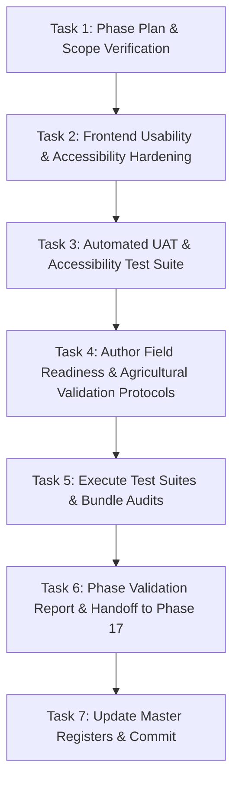

# Phase 16 Execution Plan: Usability, Accessibility & Performance (UAT & Field Readiness) — Ritucast

## 1. Verified Title & Master Governance Context

- **Master Roadmap Title**: **Phase 16: Usability, Accessibility & Performance**
- **Working Description**: **User Acceptance, Usability, and Field-Readiness Validation**
- **Governing Reference**: [`docs/planning/roadmap.md`](file:///Users/kazi/Projects/RITUCAST/docs/planning/roadmap.md), Section 2 (Row 16)
- **Preceding Milestone**: Phase 15 (**PASS** on all criteria; Git commit `148bdc8`)
- **Receiving Milestone**: Phase 17 (**Scientific & Agricultural Validation**)
- **Lifecycle Rule**: Sequential Phase Gating strictly enforced; zero premature Phase 17 implementation.

---

## 2. Baseline System State & Pre-conditions

At the start of Phase 16:
1. **Backend Layer**: 104 deterministic Python tests passing (`pytest -m "not smoke"` in 4.86s).
2. **Frontend Layer**: 21 Vitest unit & user journey tests passing in 4.04s.
3. **Build & Assets**: Vite production build generating 89.3 kB gzipped total wire bundle (<6% of the 1.5MB budget ceiling per `DEC-09`).
4. **Security & Governance Baseline**: OWASP security headers, sliding-window rate limiting, payload ceiling (1MB), contextual gating (`DEC-17`), and automated suppression (`DEC-10`) active and verified.
5. **Geographic Pilots**: High Barind Tract (Godagari, Tanore) and Haor Basin (Sunamganj Sadar, Tahirpur). Anchor crop: Boro rice (*Oryza sativa L.*).

---

## 3. Specific Problems Addressed in Phase 16

1. **End-to-End User Journey Verification**: Validate that all 6 critical user journeys specified in [`docs/ux/user-journeys.md`](file:///Users/kazi/Projects/RITUCAST/docs/ux/user-journeys.md) execute cleanly in the actual application without dead ends, unhandled crashes, or ambiguous copy.
2. **Rural Outdoor Accessibility & Glare Resilience**: Low-spec budget smartphones operated in direct sunlight require WCAG 2.1 AA compliance (contrast $\ge 4.5:1$ for body text, $\ge 3:1$ for graphical UI tokens, minimum touch targets $\ge 48\text{px}$).
3. **Keyboard & Screen-Reader Navigation**: Interactive elements must support full keyboard traversal (focus rings, Enter/Space handlers on interactive buttons, skip-to-content link per WCAG 2.1 SC 2.4.1, and informative `aria-*` attributes).
4. **Offline & Degraded Network Handling**: Rural 3G mobile connections experience intermittent drops. The UI must degrade gracefully, prevent infinite spinners, and provide clear error recovery actions.
5. **Field-Readiness & Agricultural Pilot Protocol**: Provide structured field assessment protocols for Sub-Assistant Agriculture Officers (SAAOs) and Lead Farmers in Godagari and Tahirpur before live agricultural evaluation in Phase 17.

---

## 4. Phase 16 Tasks & Implementation Sequencing

### Task 1: Execution Plan & Deliverables Checklist
- Formulate `docs/phases/phase-16/phase-16-plan.md` and `docs/phases/phase-16/deliverables-checklist.md`.
- Establish exact traceability to functional requirements (`FR-LOC-01` to `FR-UX-01`), non-functional requirements (`NFR-USE-01`, `NFR-PER-01`, `NFR-REL-01`), and architecture decisions (`DEC-08`, `DEC-09`, `DEC-10`, `DEC-17`).

### Task 2: Frontend Usability & Accessibility Hardening
- Implement Skip-to-content bypass link in [`frontend/src/App.tsx`](file:///Users/kazi/Projects/RITUCAST/frontend/src/App.tsx) per WCAG 2.1 SC 2.4.1.
- Add keyboard event handling (`Enter`/`Space`) and ARIA labelling to brand navigation in [`frontend/src/components/Header.tsx`](file:///Users/kazi/Projects/RITUCAST/frontend/src/components/Header.tsx).
- Enforce physical touch target minimum (`min-height: var(--touch-target-min)` = 48px) for all navigation links and interactive controls in [`frontend/src/index.css`](file:///Users/kazi/Projects/RITUCAST/frontend/src/index.css).
- Enhance error box retry mechanics across analytical views for offline network recovery.

### Task 3: Automated UAT & Accessibility Test Suite
- Implement [`frontend/src/test/uat_accessibility.test.tsx`](file:///Users/kazi/Projects/RITUCAST/frontend/src/test/uat_accessibility.test.tsx) testing all 6 core journeys, touch targets, keyboard navigation, contrast compliance, and suppression banner handling.

### Task 4: Author Field Readiness & UAT Specifications
- Author [`docs/uat/user-acceptance-test-scenarios.md`](file:///Users/kazi/Projects/RITUCAST/docs/uat/user-acceptance-test-scenarios.md).
- Author [`docs/uat/usability-and-accessibility-report.md`](file:///Users/kazi/Projects/RITUCAST/docs/uat/usability-and-accessibility-report.md).
- Author [`docs/uat/field-readiness-assessment.md`](file:///Users/kazi/Projects/RITUCAST/docs/uat/field-readiness-assessment.md).
- Author [`docs/uat/agricultural-validation-protocol.md`](file:///Users/kazi/Projects/RITUCAST/docs/uat/agricultural-validation-protocol.md).
- Author [`docs/uat/defect-log.md`](file:///Users/kazi/Projects/RITUCAST/docs/uat/defect-log.md).

### Task 5: Verification & Auditing
- Run full automated test suites (pytest + Vitest).
- Run Vite production bundle build and audit wire size against the 1.5MB budget.
- Validate documentation links across the workspace.

### Task 6: Phase Governance Artifacts
- Author `docs/phases/phase-16/validation-report.md`.
- Author `docs/phases/phase-16/phase-16-completion-report.md`.
- Author `docs/phases/phase-16/handoff-to-phase-17.md`.

### Task 7: Master Registers & Atomic Git Commits
- Update `docs/planning/roadmap.md`, `decision-log.md`, `risk-register.md`, `assumptions-register.md`, and `README.md`.
- Create clean, atomic Git commits on `main`.

---

## 5. Measurable Acceptance Criteria

1. **UAT Scenarios**: All 6 critical user journeys (A through F) are validated via automated tests and documented scenarios.
2. **WCAG 2.1 AA Compliance**:
   - Contrast ratio $\ge 4.5:1$ for normal text, $\ge 3:1$ for large text and UI components.
   - Physical touch targets $\ge 48\times 48\text{px}$ for interactive elements (`DEC-09`).
   - Skip link provided for main content bypass (SC 2.4.1).
   - Keyboard operability on all interactive items (SC 2.1.1).
   - Reduced-motion compliance respected (`prefers-reduced-motion`).
3. **Performance & Payload Budget (`DEC-09`)**:
   - Total client wire bundle remains $\le 1.5\text{MB}$ (currently $\sim 89.3\text{ kB}$ gzip).
   - Time-to-Interactive on 3G remains $\le 3.5\text{s}$.
4. **Field Readiness**: Formal protocol established for SAAO and Lead Farmer trials in Godagari and Tahirpur testbeds.
5. **Scientific Guardrails**: No unvalidated yield claims (`MOD-YLD-01`), no chemical diagnoses (`MOD-DIS-01`), mandatory inspection disclaimer intact (`DEC-10`).
