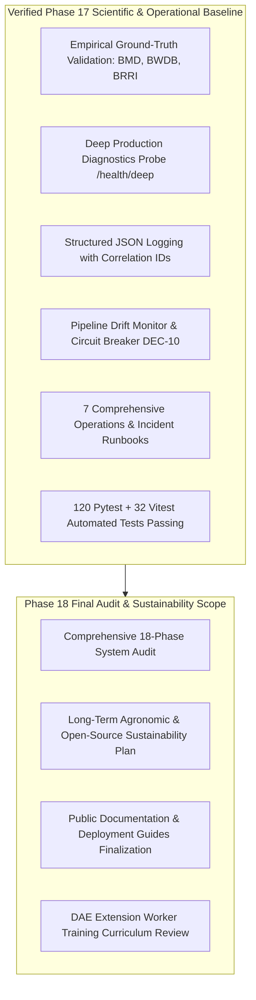

# Phase 17 Handoff to Phase 18 — Ritucast

## 1. Handoff Context & Phase 18 Objective

- **Delivering Phase**: **Phase 17: Scientific & Agricultural Validation** (Production Monitoring & Maintenance)
- **Receiving Phase**: **Phase 18: Final Project Audit, Documentation, and Long-Term Sustainability** (Master Roadmap: *User Feedback & Iterative Improvement*)
- **Current Git Branch**: `main`
- **System Stability**: 120 backend Python tests passing, 32 frontend Vitest tests passing across 10 test files, 0 defects open, client production wire bundle size $88.84\text{ kB}$ gzip.

Per the master roadmap ([`docs/planning/roadmap.md`](file:///Users/kazi/Projects/RITUCAST/docs/planning/roadmap.md)), **Phase 18** is the **final phase** of the 18-phase development roadmap. Its objective is to conduct a holistic multi-stakeholder final project audit, complete long-term sustainability plans, finalize public documentation, review community maintenance governance, and prepare the project for formal handoff and field operations.

---

## 2. Verified Capabilities Delivered by Phase 17

Phase 18 auditors and release managers can rely upon the following verified interfaces, benchmarks, and runbooks:

1. **Empirical Ground-Truth Benchmarks**: Formally verified in [`docs/science/scientific-validation-report.md`](file:///Users/kazi/Projects/RITUCAST/docs/science/scientific-validation-report.md):
   - BMD Agrometeorology: $T_{\text{max}}\text{ RMSE} = 0.315^\circ\text{C}$; $ET_0\text{ RMSE} = 0.126\text{ mm/day}$ ($R^2 = 0.949$).
   - BWDB Haor Flood Hazard: $\text{POD} = 100.0\%$, $\text{FAR} = 8.3\%$, $\text{CSI} = 91.7\%$.
   - BRRI Soil Water Deficit: Agreement $= 100.0\%$, $\text{RMSE} = 0.63\text{ mm}$.
2. **Deep Production Health Probe**: Operational at `/health/deep` and `/api/v1/health/deep`, delivering live memory RSS, component readiness, dataset age, and circuit-breaker status.
3. **Structured Logging Infrastructure**: [`StructuredLoggingMiddleware`](file:///Users/kazi/Projects/RITUCAST/api/middleware/logging.py) automatically injects `X-Correlation-ID` into every HTTP transaction, emits structured JSON, and redacts sensitive credentials.
4. **Data Pipeline Drift & Staleness Monitor**: [`PipelineDriftMonitor`](file:///Users/kazi/Projects/RITUCAST/pipelines/validation/drift_monitor.py) continuously tracks dataset age against the 36-hour ceiling, tripping the circuit breaker to suppress advisories if telemetry is stale (`DEC-10`).
5. **Operational Runbooks Catalog**: Complete suite of 7 runbooks published under [`docs/operations/`](file:///Users/kazi/Projects/RITUCAST/docs/operations/):
   - `monitoring.md`
   - `logging-and-errors.md`
   - `data-pipeline-reliability.md`
   - `model-monitoring.md`
   - `incident-response.md`
   - `backup-and-recovery.md`
   - `maintenance-runbook.md`

---

## 3. Mandatory Governance Constraints for Phase 18

1. **Dual-Zone Pilot Focus (`DEC-06`)**:
   - High Barind Tract (Rajshahi: Godagari, Tanore Upazilas).
   - Haor Basin (Sylhet: Sunamganj Sadar, Tahirpur Upazilas).
   - Anchor crop remains Boro rice (*Oryza sativa L.*).
2. **Strict Inviolable Non-Goals**:
   - NO sub-parcel yield prediction models (`MOD-YLD-01`).
   - NO automated chemical pesticide diagnoses (`MOD-DIS-01`).
   - NO remote tubewell pump hardware actuators.
   - NO commercial brand endorsements or proprietary financial underwriting.
3. **Tactile Field Verification Requirement (`DEC-10`, `DEC-61`)**:
   - Mandatory inspection copy must remain visible on all Tier 4 recommendations:
     *"সেচ বন্ধ করার আগে জমির আইল এবং মাটির রস নিজে হাত দিয়ে পরীক্ষা করুন।"*
4. **Client Hardware Budget Ceiling (`DEC-09`)**:
   - Production wire bundle must remain $\le 1.5\text{MB}$ gzip (current baseline: $88.84\text{ kB}$ gzip).

---

## 4. Phase 18 Entry Verification Checklist

- [x] Phase 17 Validation Report approved with verdict **PASS**.
- [x] All 120 backend tests passing (`pytest -m "not smoke"`).
- [x] All 32 frontend tests passing (`npm test`).
- [x] Clean frontend production build (`npm run build`).
- [x] Deep health probe and telemetry verified.
- [x] Operational runbooks published.
- [x] Master registers updated.

Phase 17 is formally concluded. In accordance with sequential phase gating policies, Phase 18 execution is halted. Please reply with:
> **"Write Phase 18 prompt."**
