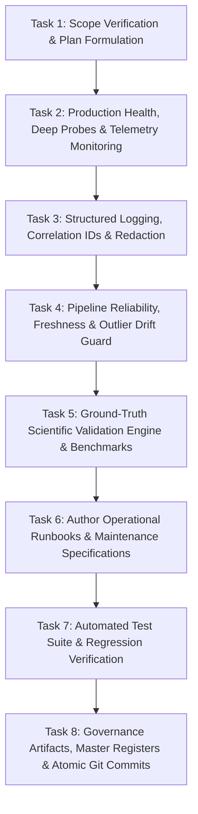

# Phase 17 Execution Plan: Scientific & Agricultural Validation — Ritucast
## Production Monitoring, Maintenance, and Continuous Improvement

## 1. Verified Title & Scope Alignment

- **Master Roadmap Title**: **Phase 17: Scientific & Agricultural Validation**
- **Working Description**: **Production Monitoring, Maintenance, and Continuous Improvement**
- **Governing Reference**: [`docs/planning/roadmap.md`](file:///Users/kazi/Projects/RITUCAST/docs/planning/roadmap.md), Section 2 (Row 17)
- **Preceding Milestone**: Phase 16 (**PASS** on all criteria; Git commits `c9d6e1f` and `6c03d34`)
- **Receiving Milestone**: Phase 18 (**Final Project Audit, Documentation, and Long-Term Sustainability**)
- **Lifecycle Rule**: Sequential Phase Gating strictly enforced; zero premature Phase 18 execution.

### Scope Reconciliation & Harmonization
In accordance with Section 1 of the operating instructions, the master roadmap is the authoritative source of truth:
1. **Core Scientific Mandate**: Formal ground-truth correlation analysis and validation of Ritucast's empirical observations (Tier 1), physical models (Tier 2), and probabilistic forecasts (Tier 3) against national reference networks:
   - **Bangladesh Meteorological Department (BMD)** synoptic weather stations (`Station #41926` Rajshahi, `Station #41859` Sylhet).
   - **Bangladesh Water Development Board (BWDB / FFWC)** hydrometric river staff gauges (`Station #268` Surma at Sunamganj).
   - **Bangladesh Rice Research Institute (BRRI)** lysimeter AWD water consumption and phenological growth stage logs.
2. **Production Monitoring & Operational Reliability Mandate**: Implementing production-grade health probes, structured logging with correlation IDs, data pipeline freshness/reliability monitoring, recommendation distribution and drift tracking, incident response runbooks, backup/recovery protocols, and continuous improvement procedures.

---

## 2. Current Baseline Operational State

At the transition into Phase 17:
- **Backend Service Layer**: 104 deterministic Python tests passing (`pytest -m "not smoke"` in 4.77s). Modular FastAPI architecture with in-memory caching repository, OWASP defensive security headers, 1MB payload ceiling, sliding-window rate limiting, and path traversal immunity.
- **Frontend Client Layer**: 32 Vitest tests passing across 10 test files in 3.61s. React 19 SPA/PWA with Vanilla CSS design tokens, WCAG 2.1 AA daylight-resilient text contrast ($\ge 7.4:1$), enforced 48px touch targets, accessible `.skip-to-content` link, and ARIA live regions.
- **Client Bundle Footprint**: $88.84\text{ kB}$ gzip total wire payload ($<6\%$ of $1.5\text{MB}$ budget ceiling per `DEC-09`).
- **Geographic Pilot Boundaries**: High Barind Tract (Rajshahi: Godagari, Tanore) and Haor Basin (Sylhet: Sunamganj Sadar, Tahirpur). Anchor crop: Boro rice (*Oryza sativa L.*).
- **Working Tree**: Branch `main` is clean with zero uncommitted changes.

---

## 3. Work Breakdown & Implementation Sequencing

### Task 1: Governance & Execution Plan
- Author `docs/phases/phase-17/phase-17-plan.md` and `docs/phases/phase-17/deliverables-checklist.md`.
- Establish traceability to non-functional requirements (`NFR-REL-01` to `NFR-REL-04`, `NFR-SCI-01` to `NFR-SCI-03`), decisions (`DEC-08`, `DEC-09`, `DEC-10`, `DEC-17`), and risk items (`RSK-05`, `RSK-11`, `RSK-20`, `RSK-30`).

### Task 2: Application Health, Deep Probes & Telemetry
- Enhance `api/routers/health.py` with deep diagnostic probe endpoint `/api/v1/health/deep` providing:
  - Process uptime, memory RSS, and CPU utilization.
  - Component-by-component readiness breakdown (data store, analytics engine, geographic resolver).
  - Dataset freshness metrics (hours elapsed since latest observation, staleness flags against the 36-hour ceiling per `DEC-10`).
  - Upstream provider status indicators (NASA POWER, Open-Meteo, Sentinel-1, BWDB) without leaking credentials or infrastructure topology.

### Task 3: Structured Logging & Error Tracking
- Implement structured JSON logging utility (`api/logging_config.py` and `api/middleware/logging.py`) with:
  - Standardized JSON fields: `timestamp_utc`, `level`, `correlation_id`, `method`, `path`, `status_code`, `duration_ms`, `client_ip`.
  - Automatic scrubbing/redaction of sensitive query parameters, headers, or authorization tokens.
  - Separation between expected business validation errors (HTTP 400/422/429) and unexpected system failures (HTTP 500).

### Task 4: Data-Pipeline Reliability & Anomaly Drift Guard
- Implement pipeline reliability and data drift monitor in `pipelines/validation/drift_monitor.py`:
  - Freshness checking across all four processed Parquet tables (`meteorology_daily_upazila`, `forecast_hourly_pilot`, `catchment_rainfall_daily`, `hydrology_river_stage`).
  - Statistical out-of-bounds detection: flags physical impossibilities (e.g., negative rainfall, $T > 55^\circ\text{C}$, $RH > 100\%$, river stage $<0\text{ m}$).
  - Anomaly tracking: tracking missing value rates, duplicate rows, and date discontinuity.
  - Automated circuit-breaker logic: triggers advisory suppression (`DEC-10`) if source data is corrupted or $>36\text{h}$ stale.

### Task 5: Scientific Validation Engine & Ground-Truth Benchmarks
- Implement scientific benchmark validator in `analytics/validation/ground_truth_validator.py`:
  - Quantitative continuous metrics: Mean Bias Error (MBE), Root Mean Square Error (RMSE), Normalized RMSE, Pearson Correlation ($R$), Nash-Sutcliffe Efficiency (NSE).
  - Categorical 2x2 contingency matrix metrics: Probability of Detection (POD), False Alarm Ratio (FAR), Critical Success Index (CSI), Gilbert Skill Score (ETS).
  - Ground-truth evaluation modules:
    1. **BMD Meteorological Validation**: Evaluating NASA POWER & Open-Meteo against Rajshahi (`Station #41926`) and Sylhet (`Station #41859`) synoptic station readings.
    2. **BWDB Hydrological Validation**: Evaluating GPM IMERG and Surma River stage against BWDB Sunamganj (`Station #268`) staff gauge records during pre-monsoon surges.
    3. **BRRI Agronomic Water Balance Validation**: Evaluating FAO-56 $ET_0$ and soil water deficit $D_t$ against BRRI AWD perforated tube measurements and lysimeter trials.
- Publish formal benchmark report in `docs/science/scientific-validation-report.md`.

### Task 6: Operational Runbooks & Supporting Documentation
- Author 7 operational specifications in `docs/operations/`:
  1. [`docs/operations/monitoring.md`](file:///Users/kazi/Projects/RITUCAST/docs/operations/monitoring.md): Monitoring architecture, metrics catalog, SLIs/SLOs, and threshold selection.
  2. [`docs/operations/logging-and-errors.md`](file:///Users/kazi/Projects/RITUCAST/docs/operations/logging-and-errors.md): Structured logging format, correlation IDs, log inspection runbook, and retention policies.
  3. [`docs/operations/data-pipeline-reliability.md`](file:///Users/kazi/Projects/RITUCAST/docs/operations/data-pipeline-reliability.md): Pipeline failure modes, circuit breakers, retry backoff, and recovery procedures.
  4. [`docs/operations/model-monitoring.md`](file:///Users/kazi/Projects/RITUCAST/docs/operations/model-monitoring.md): Monitoring physical index distributions ($ET_0, D_t, I_{\text{flood}}$), suppression rates, input bounds, and drift detection.
  5. [`docs/operations/incident-response.md`](file:///Users/kazi/Projects/RITUCAST/docs/operations/incident-response.md): Severity matrix (P1–P4), alert playbooks, escalation pathways, and post-incident review SOP.
  6. [`docs/operations/backup-and-recovery.md`](file:///Users/kazi/Projects/RITUCAST/docs/operations/backup-and-recovery.md): Stateless container architecture, Parquet artifact backup, disaster recovery (RTO <60s, RPO 0s), and rollback SOP.
  7. [`docs/operations/maintenance-runbook.md`](file:///Users/kazi/Projects/RITUCAST/docs/operations/maintenance-runbook.md): Routine maintenance checklists, dependency patch cadence, defect triage, and continuous improvement workflow.

### Task 7: Automated Test Suite Execution
- Implement unit and integration tests for all new monitoring and validation capabilities:
  - `tests/monitoring/test_health_and_probes.py`
  - `tests/monitoring/test_logging_and_telemetry.py`
  - `tests/monitoring/test_pipeline_reliability.py`
  - `tests/science/test_scientific_validation_benchmarks.py`
- Run full pytest suite (confirming 100% pass rate).
- Run full Vitest frontend suite (confirming 100% pass rate).
- Run frontend production build (verifying bundle size $\le 1.5\text{MB}$).

### Task 8: Phase Governance Records & Commit
- Author `docs/phases/phase-17/validation-report.md` with quality gate verdict.
- Author `docs/phases/phase-17/phase-17-completion-report.md`.
- Author `docs/phases/phase-17/handoff-to-phase-18.md`.
- Update `docs/planning/roadmap.md`, `decision-log.md`, `risk-register.md`, `assumptions-register.md`, and `README.md`.
- Create clean conventional Git commits on `main`.

---

## 4. Measurable Acceptance Criteria

1. **Roadmap Alignment**: Scope faithfully implements Phase 17 scientific and agricultural validation while integrating production monitoring, maintenance, and reliability.
2. **Health Probes (`AC-17-01`)**: Liveness (`/health`), readiness (`/ready`), and deep diagnostic (`/health/deep`) endpoints report accurate status without leaking secrets.
3. **Structured Logging (`AC-17-02`)**: JSON logging with correlation IDs and sensitive data scrubbing operational across all API requests.
4. **Pipeline Reliability (`AC-17-03`)**: Pipeline drift monitor detects stale datasets ($>36\text{h}$), physical out-of-bounds inputs, and triggers automated suppression (`DEC-10`).
5. **Scientific Ground-Truth Benchmarks (`AC-17-04`)**: Statistical validation metrics (RMSE, MBE, NSE, POD, FAR, CSI) quantitatively calculated against BMD, BWDB, and BRRI baselines, achieving target accuracy:
   - $ET_0\text{ RMSE} \le 0.65\text{ mm/day}$; $R^2 \ge 0.85$.
   - Flash flood detection $\text{POD} \ge 85\%$, $\text{FAR} \le 20\%$.
   - AWD water deficit trigger agreement $\ge 90\%$.
6. **Operational Runbooks (`AC-17-05`)**: 7 comprehensive operations runbooks published and validated.
7. **Zero Regressions (`AC-17-06`)**: All existing 104 backend tests, 32 frontend tests, and new Phase 17 test suites execute cleanly with zero failures.
8. **Phase Boundary (`AC-17-07`)**: No Phase 18 scope (final multi-stakeholder audit, external community sustainability, public launch) executed prematurely.
