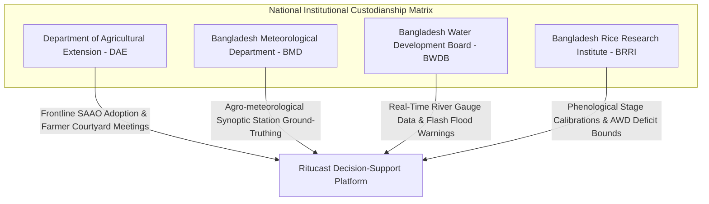
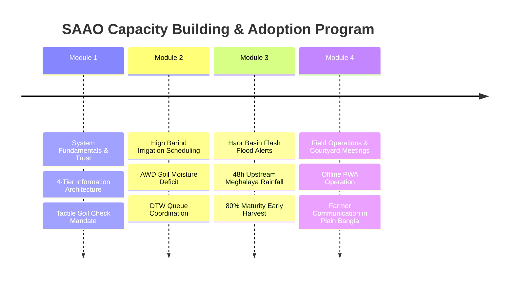

# Long-Term Sustainability, Institutional Handover, and Future Roadmap — Ritucast (Phase 18)

## 1. Executive Context & Sustainability Vision

**Ritucast** is engineered as a public-good agricultural intelligence and decision-support platform for smallholders and extension workers in Bangladesh. To ensure the platform continues to provide reliable, safe, and actionable agronomic guidance beyond the conclusion of the initial 18-phase development lifecycle, this document establishes:

1. The **Institutional Handover Strategy** to government partners (DAE, BMD, BWDB, BRRI).
2. The **Operational Cost & Infrastructure Model** maintaining extreme financial sustainability ($\le \$5/\text{month}$ pilot, $\le \$45/\text{month}$ national).
3. The **Open-Source Governance Charter & Maintenance Protocols**.
4. The **SAAO Capacity Building & Field Extension Curriculum**.
5. The **Prioritized Future Horizon Roadmap** for geographic and crop expansion.

---

## 2. Institutional Handover Strategy

Ritucast bridges Earth observation science, agrometeorological modeling, and frontline agricultural extension. Long-term institutional ownership is allocated across four national partner institutions:

### 2.1 Department of Agricultural Extension (DAE)
- **Role**: Operational owner of field advisory delivery and extension workflows.
- **Integration Points**:
  - Embedding Ritucast into the existing DAE Agro-Meteorological Information System Development Project (AMISDP / BAMIS).
  - SAAOs utilize Ritucast during weekly block inspections and village courtyard meetings (উঠান বৈঠক).
  - Formal feedback channel (`saao-feedback@ritucast.org` / DAE portal) for reporting field phenological divergences.

### 2.2 Bangladesh Meteorological Department (BMD)
- **Role**: Scientific custodian of meteorological observation and numerical weather prediction inputs.
- **Integration Points**:
  - Quarterly calibration audits comparing NASA POWER and Open-Meteo gridded observations against BMD synoptic stations (Rajshahi, Sylhet, Ishwardi).
  - Exploring direct automated ingest of BMD numerical weather prediction outputs when public API endpoints become operational.

### 2.3 Bangladesh Water Development Board (BWDB)
- **Role**: Hydrological custodian of transboundary flash flood monitoring in the Haor Basin.
- **Integration Points**:
  - Linking Flood Forecasting and Warning Centre (FFWC) river stage danger levels and rates of rise ($\Delta H/\Delta t$) to the Haor flood hazard index ($I_{\text{flood}}$).
  - Joint validation of pre-monsoon early harvest trigger alerts in Sunamganj and Tahirpur.

### 2.4 Bangladesh Rice Research Institute (BRRI)
- **Role**: Agronomic custodian of crop coefficients ($K_c$), phenological stage durations, and soil moisture deficit thresholds.
- **Integration Points**:
  - Maintaining Alternate Wetting and Drying (AWD) threshold parameters across varied agro-ecological zones (AEZ 25, 26, 21).
  - Updating Thermal Stress Degree Days (GDD) baselines for newly released salt-, heat-, or flash-flood-tolerant Boro varieties (e.g., BRRI dhan28, dhan29, dhan89, dhan92).

---

## 3. Operational Cost & Infrastructure Sustainability

Ritucast was deliberately architected to eliminate recurring database licensing fees, managed cluster overheads, and expensive SaaS observability subscriptions.

### 3.1 Pilot Infrastructure Cost Breakdown (4 Upazilas)

| Component | Architecture Choice | Resource Allocation | Monthly Cost (USD) |
| :--- | :--- | :--- | :--- |
| **Compute (Backend & Frontend)** | Google Cloud Run (`asia-south1`, Mumbai) | 0.5 vCPU, 512MB RAM, Scale-to-Zero | **$0.00** (Fits within 2M free requests) |
| **Data Storage** | Immutable In-Image Parquet (`DEC-52`) | Bundled in container image (<110KB) | **$0.00** (Zero external DB fees) |
| **Artifacts & Images** | Google Artifact Registry | OCI image storage (<200MB) | **$0.10 – $0.20** |
| **Logging & Telemetry** | Google Cloud Logging (`DEC-66`) | Structured JSON stdout | **$0.00** (Within 50GB free tier) |
| **Domain & DNS** | Cloudflare Free Tier / DAE DNS | Apex DNS, SSL Termination | **$0.00** |
| **Total Estimated Pilot Cost** | — | — | **$\le \$2.00 / \text{month}$** |

### 3.2 Projected National Scale Cost Model (495 Upazilas, 50,000 DAU)
- Total monthly API requests: ~3,000,000.
- Cloud Run compute (with concurrency = 80): ~$18.50/month.
- In-image Parquet storage for 495 Upazilas: ~12 MB total data (still bundled in container, zero external DB needed).
- Cloudflare CDN caching for static frontend assets: $0.00.
- **Total National Operating Cost**: **$\le \$35.00 – \$45.00 / \text{month}$** ($\le \$540/\text{year}$).
- *Conclusion*: Operating Ritucast across the entirety of Bangladesh requires less than a standard entry-level laptop budget per year, guaranteeing extreme financial sustainability for government or donor funding.

---

## 4. Open-Source Governance Charter & Maintenance Protocols

### 4.1 Governance Philosophy
- **License**: Permissive Open Source (MIT License) with strict Agricultural Safety Attribution riders (`DEC-60`, `DEC-61`).
- **Core Principles**:
  1. *Agronomic Primacy*: Technical refactoring must never compromise FAO-56 physical grounding or smallholder safety.
  2. *Privacy by Design*: Never introduce PII, user tracking, or parcel boundary collection (`DEC-60`).
  3. *Radical Efficiency*: Client bundles must remain $\le 1.5\text{MB}$ gzip and compatible with low-end Android smartphones (`DEC-09`).

### 4.2 Maintenance Cadence & SLA Matrix

| Maintenance Task | Frequency | Responsible Role | Runbook Reference |
| :--- | :--- | :--- | :--- |
| **Dependency Vulnerability Scan** | Weekly | DevOps / SRE | [`maintenance-runbook.md`](file:///Users/kazi/Projects/RITUCAST/docs/operations/maintenance-runbook.md) |
| **Dataset Freshness & Drift Audit** | Automated Continuous (36h ceiling) | Automated Pipeline Monitor | [`data-pipeline-reliability.md`](file:///Users/kazi/Projects/RITUCAST/docs/operations/data-pipeline-reliability.md) |
| **NWP Ensemble & Agrometeorology Review** | Bi-Weekly during Boro season | Science Lead / BMD Liaison | [`model-monitoring.md`](file:///Users/kazi/Projects/RITUCAST/docs/operations/model-monitoring.md) |
| **SAAO Feedback & Rule Refinement** | Monthly | Agronomist / DAE Liaison | [`maintenance-runbook.md`](file:///Users/kazi/Projects/RITUCAST/docs/operations/maintenance-runbook.md) |
| **Disaster Recovery Restore Dry-Run** | Quarterly | Platform Engineer | [`backup-and-recovery.md`](file:///Users/kazi/Projects/RITUCAST/docs/operations/backup-and-recovery.md) |

---

## 5. Frontline SAAO Training & Capacity Building Curriculum

To ensure high-fidelity adoption without cognitive friction, a 4-module interactive training workshop is designed for Sub-Assistant Agriculture Officers:

1. **Module 1: The 4-Tier Information Architecture & Safety Guardrails**:
   - Understanding why observations (Tier 1) and indicators (Tier 2) are separated from predictions (Tier 3) and advice (Tier 4).
   - Explaining why Ritucast bans overconfident promises (*"১০০% নিশ্চিত"*) and mandates manual field moisture checking (*জমির রস পরীক্ষা*).
2. **Module 2: Barind Tract Irrigation & Alternate Wetting and Drying (AWD)**:
   - Interpreting the Water Balance & Soil Deficit gauge ($D_t \ge 11.2\text{ mm}$ trigger).
   - How to coordinate with Deep Tubewell (DTW) scheme managers (ম্যানেজার) when advising irrigation postponement.
3. **Module 3: Haor Basin Pre-Monsoon Flash Flood Early Harvest**:
   - Tracking the multi-sensor flood index ($I_{\text{flood}} \ge 0.70$ High Risk).
   - Guiding farmers on the agronomic 80% grain ripening criteria for emergency harvest before floodwaters enter haor embankments.
4. **Module 4: Practical Field Operations & Offline PWA Usage**:
   - Accessing Ritucast on budget Android phones in direct sunlight (Solar theme).
   - Using the PWA offline when cellular signal drops.
   - Conducting interactive village courtyard meetings (উঠান বৈঠক) with printed or WhatsApp-shared summary cards.

---

## 6. Prioritized Future Horizon Roadmap (Post-Roadmap Recommendations)

Future development is prioritized across 3 strategic horizons based on **User Value**, **Feasibility**, **Risk Reduction**, and **Agronomic Cost**:

| Priority | Horizon | Proposed Enhancement | Target AEZ / Region | Technical Prerequisite | Expected Agronomic Value |
| :--- | :--- | :--- | :--- | :--- | :--- |
| **P1** | **Horizon 1** (Months 1–3) | **Expand to Full Rajshahi & Sylhet Divisions** (28 Upazilas). | Barind (AEZ 25, 26) & Haor (AEZ 21) | Batch centroid ingestion pipeline. | Scaled DAE regional extension coverage. |
| **P1** | **Horizon 1** (Months 1–3) | **Automated BWDB River Gauge Telemetry Ingestion**. | Surma, Kushiyara, Kangsha basins | Formal BWDB FFWC API / scraping hook. | Sub-daily updates for flash flood cresting. |
| **P2** | **Horizon 2** (Months 4–6) | **Aman Season Expansion (Rainfed & Flooded Rice)**. | Barind, Haor, Central Floodplains | Optical NDVI cloud-masking & SAR waterlogging adapters. | Year-round rice cycle intelligence. |
| **P2** | **Horizon 2** (Months 4–6) | **Localized Weather Voice / Audio Snippets in Sylheti & Varendra Dialects**. | High Barind & Haor | Web Audio API / pre-recorded audio chips. | Eliminates digital literacy barriers for non-reading farmers. |
| **P3** | **Horizon 3** (Months 7–12) | **Rabi Crop Expansion: Wheat, Maize & Mustard**. | Northwest & Southern Delta | Crop phenology models for C3/C4 cereals and oilseeds. | Diversified winter crop climate resilience. |
| **P3** | **Horizon 3** (Months 7–12) | **LoRaWAN Low-Cost Soil Moisture Sensor Testbeds**. | BMDA Command Areas (Godagari) | Hardware gateway & MQTT broker bridge. | Micro-plot calibration for localized sand lenses. |

---

## 7. Conclusion

By grounding technical implementation in robust physical equations, keeping operational overhead at near-zero cost, establishing clear institutional custodial roles, and maintaining strict adherence to smallholder safety, Ritucast is positioned for sustained, high-impact service to Bangladesh's agricultural sector.
