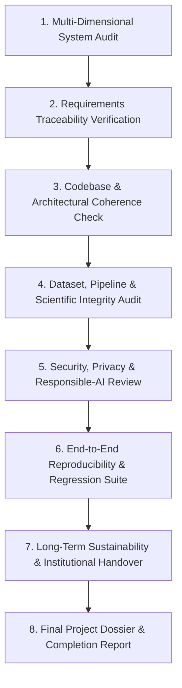

# Phase 18 Execution Plan: Final Project Audit, Documentation, and Long-Term Sustainability — Ritucast

## 1. Verified Title & Scope Baseline

- **Phase ID**: **Phase 18**
- **Verified Roadmap Title**: **Final Project Audit, Documentation, and Long-Term Sustainability**
- **Lifecycle Milestone**: Final Phase of the 18-Phase Governed Engineering Lifecycle.
- **Governing Standard**: [`AGENTS.md`](file:///Users/kazi/Projects/RITUCAST/AGENTS.md), [`roadmap.md`](file:///Users/kazi/Projects/RITUCAST/docs/planning/roadmap.md).
- **Dual-Zone Pilot Boundaries (`DEC-06`)**:
  - High Barind Tract (Godagari, Tanore Upazilas) for drought monitoring, groundwater deficit, and irrigation scheduling.
  - Haor Basin (Sunamganj Sadar, Tahirpur Upazilas) for pre-monsoon transboundary flash floods and early harvest alerts.
  - Anchor Crop: Boro rice (*Oryza sativa L.*).
- **Strict Non-Goals (`DEC-06`)**:
  - NO sub-parcel yield prediction models (`MOD-YLD-01`).
  - NO automated chemical pesticide diagnoses (`MOD-DIS-01`).
  - NO remote tubewell pump actuators.
  - NO commercial brand endorsements or proprietary financial underwriting.

---

## 2. Current Operational State of Ritucast

Ritucast has completed 17 successive engineering phases with formal quality gate passes across all phases. The verified current state comprises:

1. **Backend Service Layer (`api/`)**:
   - Production FastAPI application serving 13 REST endpoints.
   - Four-tier information taxonomy (`DEC-08`): Tier 1 (Observations), Tier 2 (Derived Indicators), Tier 3 (Probabilistic Forecasts), Tier 4 (Actionable Recommendations).
   - Mandatory Contextual Gating (`DEC-17`): Requires validated Upazila, Crop, and Growth Stage before issuing advice.
   - Centralized Automated Suppression (`DEC-10`): Trips safe fallback notice if telemetry >36h old, ensemble spread >50%, or physical checks fail.
   - Deep diagnostic probe (`/health/deep`, `DEC-65`): Reports memory RSS, dataset freshness, and circuit-breaker status without leaking credentials.
   - Structured JSON logging (`DEC-66`): Correlation ID injection (`X-Correlation-ID`) and automated credential scrubbing.
   - Defense-in-depth security (`DEC-58`): OWASP security headers, 1MB payload ceiling, sliding-window rate limiting.
2. **Analytics & Scientific Core (`analytics/`, `pipelines/`)**:
   - FAO-56 Penman-Monteith reference evapotranspiration ($ET_0$, `EQN-ET0-01`).
   - Dynamic crop coefficient $K_c(t)$ and root-zone soil water deficit ($D_t$, `EQN-SWD-01`).
   - Multi-sensor Haor flash-flood hazard index ($I_{\text{flood}}$, `IDX-FLD-01`).
   - Automated pipeline drift monitor (`PipelineDriftMonitor`, `DEC-67`).
   - Ground-truth validation engine (`ground_truth_validator.py`, `DEC-68`) benchmarked against BMD, BWDB, and BRRI baselines.
3. **Frontend Application Layer (`frontend/`)**:
   - React 19 + TypeScript single-page application built with Vite 8.
   - Pure Vanilla CSS design system (`DEC-45`) with daylight outdoor contrast tokens ($\ge 7.4:1$, `DEC-62`).
   - WCAG 2.1 AA compliant touch targets ($\ge 48\text{px}$), bypass skip-link, and ARIA live regions (`DEC-63`).
   - Production bundle size: $88.83\text{ kB}$ gzip (under 6% of the $1.5\text{MB}$ mobile ceiling `DEC-09`).
4. **Testing & Quality Assurance (`tests/`, `frontend/src/test/`)**:
   - 120 backend Python tests passing (100% pass rate in <5.0s).
   - 32 frontend Vitest tests passing across 10 test files.
   - 0 open defects.
5. **Deployment & Operations (`deploy/`, `docs/operations/`)**:
   - Google Cloud Run containerization (`asia-south1`, Mumbai).
   - Multi-stage Dockerfiles (`UID 10001` non-root backend, NGINX Alpine frontend).
   - Bundled immutable Parquet feature tables (<110KB, `DEC-52`).
   - 7 operational runbooks for monitoring, incident response, disaster recovery, and maintenance.

---

## 3. Phase 18 Work Breakdown & Implementation Order

Phase 18 will execute eight systematic activities:

1. **Holistic Multi-Dimensional Audit**:
   - Requirements & Scope Audit: Compare original Phase 1/2 vision with actual implementation.
   - Codebase & Architecture Audit: Review dependencies, interface consistency, error translation, dead code.
   - Dataset & Pipeline Audit: Trace data provenance, licensing, physical boundaries, and caching.
   - Analytics & Recommendation Audit: Audit physical equations, rule firing conditions, and explainability copy.
   - Frontend & UX Audit: Audit user workflows, Bengali typography, outdoor contrast, accessibility landmarks.
   - Security, Privacy & Responsible-AI Audit: Review zero-PII posture, non-in-source secrets, anti-overconfidence standards.
   - Deployment & Operations Audit: Verify container build, Cloud Run manifests, and disaster recovery procedures.
2. **Requirements Traceability Matrix (RTM)**:
   - Assemble full RTM tracing all Functional Requirements (`FR-*`), Non-Functional Requirements (`NFR-*`), Dataset Requirements (`DR-*`), and Architectural Decisions (`DEC-*`) across all 18 phases to implementation modules and test evidence.
3. **Defect Triage & Resolution**:
   - Identify and resolve any final discrepancies, broken documentation links, or minor inconsistencies.
4. **Reproducibility Verification**:
   - Execute clean automated tests across backend and frontend.
   - Document exact step-by-step setup and validation procedures.
5. **Long-Term Sustainability & Institutional Roadmap**:
   - Formulate sustainability plan for DAE (Department of Agricultural Extension), BMD (Bangladesh Meteorological Department), and BRRI (Bangladesh Rice Research Institute).
   - Define open-source maintenance protocols, cost projections ($\le \$5/\text{month}$ on Cloud Run), and community governance.
6. **Final Documentation & Phase Gating**:
   - Update `README.md` with final project overview, capabilities, quickstart, and test commands.
   - Update `docs/planning/roadmap.md` marking Phase 18 as **Completed - PASS**.
   - Publish Phase 18 execution package (`phase-18-plan.md`, `final-project-audit.md`, `requirements-traceability-matrix.md`, `long-term-sustainability-and-future-roadmap.md`, `deliverables-checklist.md`, `validation-report.md`, `phase-18-completion-report.md`).

---

## 4. Measurable Acceptance Criteria

1. **Audit Completeness**: All 8 audit dimensions thoroughly reviewed with findings documented in `final-project-audit.md`.
2. **Requirements Traceability**: Master RTM published tracing all 18 phases with explicit status values (**Verified**, **Partially verified**, **Not applicable**).
3. **Zero Critical/High Defects**: Zero open critical or high defects; any residual limitations clearly documented with workarounds.
4. **Automated Verification**: 100% test pass rate across backend pytest suite and frontend Vitest suite.
5. **Reproducibility**: Complete reproducible developer quick start documented and validated.
6. **Honest Readiness Classification**: Distinct, evidence-based readiness ratings assigned for Demonstration, Pilot, and Production.
7. **Disciplined Phase Closeout**: Final completion report and deliverables checklist signed off; no Phase 19 started.

---

## 5. Potential Risks & Mitigation

| Risk | Likelihood | Impact | Mitigation Strategy |
| :--- | :--- | :--- | :--- |
| **Overstating Production Readiness**: Claiming broad Bangladesh-wide readiness despite dual-zone pilot bounds. | Low | Critical | Enforce strict separation between Demonstration, Pilot, and Full Production readiness in completion report. |
| **Documentation Link Drift**: Historical links pointing to modified or moved documentation. | Medium | Medium | Audit all file references and verify valid absolute `file:///` URLs. |
| **Premature Phase 19 Expansion**: Attempting post-roadmap feature development during audit. | Low | High | Strict phase boundary: freeze new feature engineering; focus exclusively on audit, coherence, and documentation. |

---

## 6. Required Deliverables Summary

- [`docs/phases/phase-18/phase-18-plan.md`](file:///Users/kazi/Projects/RITUCAST/docs/phases/phase-18/phase-18-plan.md) (This document)
- [`docs/phases/phase-18/final-project-audit.md`](file:///Users/kazi/Projects/RITUCAST/docs/phases/phase-18/final-project-audit.md)
- [`docs/phases/phase-18/requirements-traceability-matrix.md`](file:///Users/kazi/Projects/RITUCAST/docs/phases/phase-18/requirements-traceability-matrix.md)
- [`docs/phases/phase-18/long-term-sustainability-and-future-roadmap.md`](file:///Users/kazi/Projects/RITUCAST/docs/phases/phase-18/long-term-sustainability-and-future-roadmap.md)
- [`docs/phases/phase-18/deliverables-checklist.md`](file:///Users/kazi/Projects/RITUCAST/docs/phases/phase-18/deliverables-checklist.md)
- [`docs/phases/phase-18/validation-report.md`](file:///Users/kazi/Projects/RITUCAST/docs/phases/phase-18/validation-report.md)
- [`docs/phases/phase-18/phase-18-completion-report.md`](file:///Users/kazi/Projects/RITUCAST/docs/phases/phase-18/phase-18-completion-report.md)
- Updated [`README.md`](file:///Users/kazi/Projects/RITUCAST/README.md) and [`docs/planning/roadmap.md`](file:///Users/kazi/Projects/RITUCAST/docs/planning/roadmap.md)
