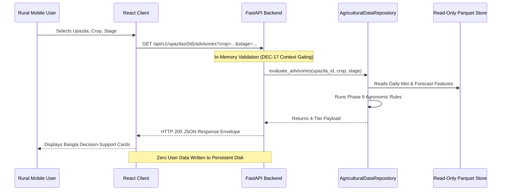

# Data Handling and Retention Policy — Ritucast

## 1. Core Principles

Ritucast operates under three foundational data governance principles:
1. **Data Minimization**: Only the minimum data required to compute regional agro-meteorological indicators is collected.
2. **Ephemeral Request Processing**: User query parameters (Upazila, crop, stage) are processed in-memory and discarded upon response transmission.
3. **Public Provenance**: All scientific indicators maintain transparent references to upstream source datasets and calculation formulas.

---

## 2. Data Flow & Lifecycle Handling

---

## 3. Storage and Retention Guidelines

| Storage Tier | Target Data | Media | Retention Policy | Disposal Mechanism |
| :--- | :--- | :--- | :--- | :--- |
| **In-Memory Volatile RAM** | Active HTTP Request contexts, Rate limiter IP timestamps | Container RAM | Ephemeral ($\le 60\text{ seconds}$) | Automatically overwritten or garbage-collected |
| **Local Container Storage** | Processed Parquet feature tables | Read-only container image layer | Tied to container lifecycle | Replaced atomically with new container version deployments |
| **Persistent Logs** | Uvicorn / NGINX access logs | Standard container stdout/stderr | 14 days maximum in Cloud Logging | Rotated and deleted automatically by Cloud Run log retention policy |

---

## 4. Logging & Privacy Guarantees

To ensure that server logs do not accidentally capture private or sensitive data:
1. **Zero Query Body Logging in Production**: Request bodies containing custom scenario inputs are not logged to stdout.
2. **IP Anonymization**: NGINX and Cloud Run logs capture IP addresses for operational security diagnostics only; logs are never merged with external demographic or farmer databases.
3. **Stack Trace Masking**: As implemented in [`api/middleware/error_handlers.py`](file:///Users/kazi/Projects/RITUCAST/api/middleware/error_handlers.py), internal server error traces are logged with generic placeholders.

---

## 5. Security of Data at Rest and in Transit

- **In Transit**: All client-to-server traffic is encrypted using TLS 1.3 / HTTPS. Unencrypted HTTP traffic is prohibited.
- **At Rest**: Container images and data files in Google Artifact Registry and Cloud Run execution environments are encrypted at rest using Google-managed encryption keys (AES-256).

Related documentation:
- [`docs/privacy/data-inventory.md`](file:///Users/kazi/Projects/RITUCAST/docs/privacy/data-inventory.md)
- [`docs/privacy/external-services-and-data-sharing.md`](file:///Users/kazi/Projects/RITUCAST/docs/privacy/external-services-and-data-sharing.md)
- [`docs/security/api-security.md`](file:///Users/kazi/Projects/RITUCAST/docs/security/api-security.md)
