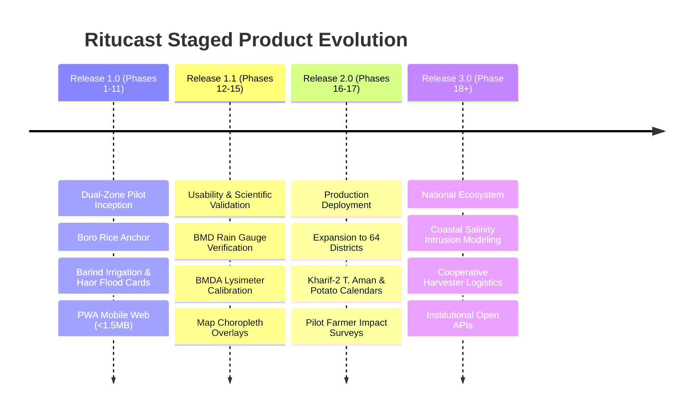

# Ritucast: Initial Release Strategy & Release Gates

## 1. The Minimum Complete Product (MCP)

Rather than releasing a bare technical prototype (which lacks agronomic credibility) or delaying for years to build a massive national platform, Ritucast defines a **Minimum Complete Product (MCP)** for its initial release.

### MCP Core Mandate
> **"Deliver an end-to-end agro-climatic decision-support tool in Bangla that enables frontline extension workers (SAAOs) and progressive lead farmers in the Barind and Haor pilot zones to make confident, weather-synchronized irrigation postponement decisions and emergency flash-flood harvest mobilizations on Boro rice."**

```mermaid
flowchart TD
    subgraph MCP Scope [Minimum Complete Product - Dual Zone Pilot]
        L[Upazila & Boro Stage Selection]
        W[7-Day Agro-Weather Forecast + Anomaly]
        I[Irrigation Postponement Advisory Card]
        F[Haor Flash Flood Alert Card]
        E[Explainability Drawer - Plain Bangla]
        O[Offline PWA Support & One-Tap Share]
    end

    subgraph User Outcomes [Target Outcomes]
        O1[Avoided tubewell fuel/electricity pumping waste]
        O2[Mitigated mature Boro rice flood submersion]
        O3[High farmer comprehension without training]
    end

    MCP Scope --> User Outcomes
```

### Composition of the MCP (P0 + P1 Features)
1. **Administrative Selector (`FEAT-01`)**: Instant switching between pilot upazilas (Godagari, Tanore, Sunamganj Sadar, Tahirpur) and national districts.
2. **Boro Phenology Configuration (`FEAT-02`)**: Stage-specific water demand calculations ($K_c$ coefficients).
3. **Agro-Weather Engine (`FEAT-03`)**: Ingested NASA POWER / BMD forecasts with temperature extremes and rain totals.
4. **Irrigation Advisory Engine (`FEAT-04`)**: Automated calculation comparing 72h forecast rain against crop evapotranspiration ($ET_c$) and soil moisture status.
5. **Haor Flood Inundation Alert (`FEAT-08`)**: Upstream Meghalaya rainfall accumulation combined with Sentinel-1 SAR water masks.
6. **Explainability Drawer (`FEAT-05`)**: Transparent "কেন এই পরামর্শ?" breakdown in Bangla.
7. **Offline-Enabled Mobile PWA (`FEAT-06`, `FEAT-07`)**: Sub-1.5MB bundle with 72-hour advisory local caching.
8. **One-Tap WhatsApp Share (`FEAT-10`)**: Instant export of formatted advisory cards for village dissemination.

---

## 2. Staged Product Evolution Roadmap

The evolution of Ritucast from MCP to national platform aligns directly with the established 18-phase lifecycle:



---

## 3. Rigorous Release Gates

No software version of Ritucast may be promoted to public pilot deployment without satisfying five mandatory release gates:

### Gate 1: Ingestion & Data Quality Gate (Verified in Phase 8)
- **Criteria**:
  - Scheduled daily ingestion pipelines complete with $\ge 99.0\%$ reliability over a continuous 14-day observation window.
  - Ingested weather observations are $<4\text{ hours}$ old from upstream provider publication.
  - Zero unhandled null or corrupt raster values passed to the analytics core.
- **Verification Lead**: Data Pipeline Engineer (Phase 8).

### Gate 2: Scientific Accuracy & Calibration Gate (Verified in Phase 15)
- **Criteria**:
  - 48-hour precipitation forecast probability achieves a Brier Score $<0.18$ evaluated against BMD ground weather stations.
  - Penman-Monteith Reference Evapotranspiration ($ET_0$) exhibits an $\text{RMSE} \le 0.8\text{ mm/day}$ against regional agricultural research benchmarks (BRRI/BMDA).
  - Sentinel-1 SAR surface water masks achieve an Intersection over Union (IoU) $\ge 0.75$ against confirmed historical flood inundation boundaries in Sunamganj.
- **Verification Lead**: Agricultural Science Lead (Phase 15).

### Gate 3: Usability & Comprehension Gate (Verified in Phase 14)
- **Criteria**:
  - $\ge 90\%$ of surveyed SAAOs and lead farmers correctly interpret the primary action card and can explain the underlying reasoning using the explainability drawer without external prompting.
  - 100% of UI terminology complies with official DAE/BRRI extension standards.
  - User journey completion rate exceeds $\ge 85\%$ without unassisted abandonment.
- **Verification Lead**: UX Strategist (Phase 14).

### Gate 4: Hardware & Bandwidth Gate (Verified in Phase 14)
- **Criteria**:
  - Compressed client-side production bundle size remains $\le 1.5\text{MB}$.
  - Time-to-Interactive (TTI) measures $\le 3.5\text{s}$ under simulated slow 3G cellular throttling ($400\text{Kbps}$, $400\text{ms}$ RTT).
  - Application shell and latest 72-hour advisory data successfully render in 100% disconnected offline mode.
  - Peak browser heap memory remains $\le 45\text{MB}$ on simulated 2GB RAM budget Android hardware.
- **Verification Lead**: Frontend Technical Lead (Phase 14).

### Gate 5: Production Operational Readiness Gate (Verified in Phase 16)
- **Criteria**:
  - Automated SSL/TLS 1.3 encryption with A+ rating on Qualys SSL Labs.
  - Automated uptime monitoring and health checks configured with alerting thresholds.
  - Circuit breakers active: automatic graceful fallback to cached data with warnings when upstream APIs fail.
  - Zero PII captured or stored in production logs.
- **Verification Lead**: DevOps / Systems Architect (Phase 16).
